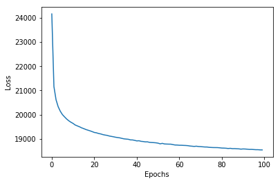
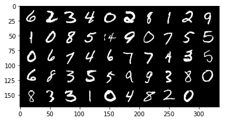
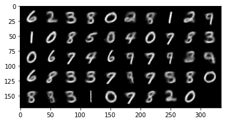
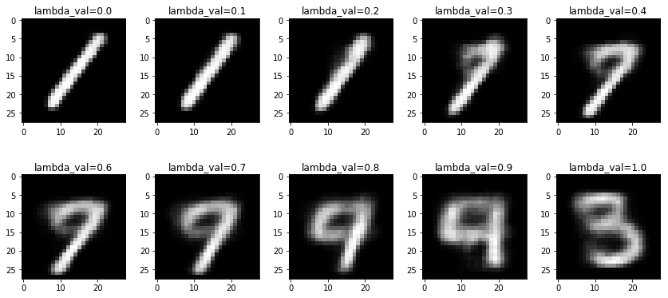
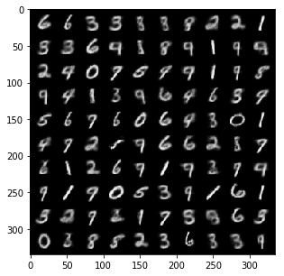

```{=html}
<style>#title-block-header { display: none; }</style>
<div class="lecture-header">
  <h1>Week 7: Variational Inference II and VAEs</h1>
</div>
```

**Overview.** Week 6 set up **variational inference** (VI): when the posterior $p(z\mid x)$ of a latent variable model is intractable, pick a tractable family of distributions $q$ and find the member closest to the posterior in **KL divergence**. It also showed that minimizing $\mathrm{KL}(q\,\|\,p(z\mid x))$ is the same as maximizing the **evidence lower bound** (ELBO), which needs only the joint $p(x,z)$. This week answers the question Week 6 left open: how do we actually maximize the ELBO? The first hour rewrites the ELBO in two useful forms, shows why its gradient is awkward (the distribution we average over depends on the parameters we are optimizing), and fixes this with the **reparameterization trick**, giving **stochastic variational inference** (SVI). The second hour builds the **autoencoder**, a neural network that compresses its input through a narrow bottleneck and reconstructs it, and then combines it with VI to get the **variational autoencoder** (VAE): an encoder network that outputs an approximate posterior $q_\phi(z\mid x)$, a decoder network that outputs a likelihood $p_\theta(x\mid z)$, and the negative ELBO as the training loss.

The tutorial derives the same VAE from the latent-variable-model side, and walks through a PyTorch notebook that trains a VAE on handwritten digits. Both get their own parts at the end of this chapter (@sec-w7-tut and @sec-w7-code).

Skipped: the title slide, the two agenda slides (slides 2 and 15, folded into this paragraph), and the closing summary slide (folded into @sec-summary7).

::: {.callout-note}
**Notation used in this chapter.** We follow the lecture: $z$ is the latent variable, $\phi$ are the parameters of the approximate posterior $q_\phi$ (the **encoder** in a VAE), and $\theta$ are the parameters of the likelihood $p_\theta(x\mid z)$ (the **decoder**). Week 6 called the variational parameters $\lambda$; they are the same thing, now called $\phi$. The tutorial uses different letters, and @sec-w7-tut starts with a translation table.
:::

## Recap: posterior inference in latent variable models {#sec-w7-recap}

The lecture opens by restating the setting of Week 6 (@sec-latent-post in Week 6). A **[latent variable model](https://en.wikipedia.org/wiki/Latent_variable_model)** factors the joint distribution of observed data $x$ and unobserved (latent) variables $z$ as

$$p(x,z) = p(z)\,p(x\mid z),$$

where $p(z)$ is the **prior** and $p(x\mid z)$ is the **likelihood**. The TrueSkill model of Week 4 is one example: the skills are $z$ and the game outcomes are $x$.

What we want is the **posterior**, the distribution of the unobserved variables given the observed ones:

$$p(z\mid x) = \frac{p(x,z)}{p(x)} = \frac{p(x,z)}{\int p(x,z)\,dz}.$$

The numerator is easy to evaluate. The denominator, the **evidence** $p(x)=\int p(x,z)\,dz$, is an integral over every latent variable at once, and we assume throughout that it is hard to compute (@sec-hard-post in Week 6).

::: {.callout-tip collapse="true" .clarification title="Recap: Posterior inference in latent variable models"}
What the symbols stand for:

- $x$: the observed data. $z$: the latent (unobserved) variables.
- $p(z)$: the prior, what we believe about $z$ before seeing $x$.
- $p(x\mid z)$: the likelihood, how probable the data are for a given $z$.
- $p(x,z)$: the joint, prior times likelihood.
- $p(z\mid x)$: the posterior, what we believe about $z$ after seeing $x$.
- $p(x)$: the evidence, the total probability of the data averaged over every $z$.

Taking the equations apart:

- $p(x,z) = p(z)\,p(x\mid z)$: to score a pair $(x,z)$, first ask how plausible $z$ is, then how well $z$ explains $x$.
- $p(z\mid x) = p(x,z)/p(x)$: the posterior is the joint rescaled so that it sums (or integrates) to 1 over $z$.
- $p(x) = \int p(x,z)\,dz$: the rescaling constant adds up the joint over every possible $z$. This sum is the hard part.

A teaching example. Let $z\in\{0,1\}$ with $p(z=1) = 0.3$, and let $p(x=1\mid z=1) = 0.8$, $p(x=1\mid z=0) = 0.1$. We observe $x = 1$.

- Joint: $p(x=1,z=1) = 0.3\times0.8 = 0.24$ and $p(x=1,z=0) = 0.7\times0.1 = 0.07$.
- Evidence: $p(x=1) = 0.24 + 0.07 = 0.31$.
- Posterior: $p(z=1\mid x=1) = 0.24/0.31\approx0.774$.

With one binary latent variable the evidence is a sum of 2 terms. With 30 binary latent variables it is a sum of $2^{30}\approx1.07$ billion terms, which is why we treat it as intractable.
:::

## Variational methods {#sec-w7-vi}

Variational inference turns this integration problem into an optimization problem (@sec-vi in Week 6). It has two steps:

1. Choose a tractable parametric distribution $q_\phi(z)$ with parameters $\phi$. This distribution will approximate $p(z\mid x)$. For example, $q_\phi(z) = \mathcal N(z\mid\mu,\Sigma)$ with $\phi=(\mu,\Sigma)$.
2. Choose some notion of "distance" between $q_\phi(z)$ and $p(z\mid x)$ that can be estimated efficiently, and minimize it over $\phi$. Usually this is the reverse KL divergence $\mathrm{KL}(q_\phi(z)\,\|\,p(z\mid x))$ (@sec-why-iproj in Week 6).

The word "distance" is in quotes on the slide because the [KL divergence](https://en.wikipedia.org/wiki/Kullback%E2%80%93Leibler_divergence) is not a true distance: it is not symmetric (@sec-kl in Week 6).

::: {.callout-tip collapse="true" .clarification title="Recap: Variational methods"}
What the symbols stand for:

- $q_\phi(z)$: the approximating distribution, chosen from a family we can work with.
- $\phi$: its adjustable parameters, for a Gaussian the mean $\mu$ and covariance $\Sigma$.
- $\mathrm{KL}(q_\phi(z)\,\|\,p(z\mid x))$: the reverse KL divergence, how far $q_\phi$ is from the posterior, measured by averaging under $q_\phi$.

Taking the recipe apart:

- Step 1 replaces "find the posterior" by "pick the best member of a family". The family fixes the shape (here, a bell curve); $\phi$ fixes the position and spread.
- Step 2 turns "best" into a number we can minimize. KL is zero only when the two distributions are equal, and positive otherwise.
- KL is not a true distance: swapping its two arguments generally changes its value.

A teaching example of the asymmetry, on two outcomes. Let $q = (0.5, 0.5)$ and $p = (0.9, 0.1)$.

- $\mathrm{KL}(q\,\|\,p) = 0.5\log\frac{0.5}{0.9} + 0.5\log\frac{0.5}{0.1}\approx -0.294 + 0.805 = 0.511$.
- $\mathrm{KL}(p\,\|\,q) = 0.9\log\frac{0.9}{0.5} + 0.1\log\frac{0.1}{0.5}\approx 0.529 - 0.161 = 0.368$.

Same pair of distributions, two different numbers, so the order of the arguments matters.
:::

## The ELBO: evidence lower bound {#sec-w7-elbo}

Evaluating $\mathrm{KL}(q_\phi(z)\,\|\,p(z\mid x))$ directly is intractable, because it contains the posterior $p(z\mid x)$ and therefore the evidence $p(x)$. Instead, we solve a different optimization problem with the same answer: maximize the ELBO.

Expand the KL divergence using $p(z\mid x) = p(z,x)/p(x)$:

$$
\begin{aligned}
\mathrm{KL}\big(q_\phi(z)\,\|\,p(z\mid x)\big) &= \mathbb{E}_{z\sim q_\phi}\left[\log\frac{q_\phi(z)}{p(z\mid x)}\right] \\
&= \mathbb{E}_{z\sim q_\phi}\left[\log\left(q_\phi(z)\cdot\frac{p(x)}{p(z,x)}\right)\right] \\
&= \mathbb{E}_{z\sim q_\phi}\left[\log\frac{q_\phi(z)}{p(z,x)}\right] + \mathbb{E}_{z\sim q_\phi}\big[\log p(x)\big] \\
&= -\mathcal{L}(\phi) + \log p(x).
\end{aligned}
$$

The last step uses that $\log p(x)$ does not depend on $z$, so its expectation is itself.

::: {.definition-block}
**Definition.** The **[evidence lower bound](https://en.wikipedia.org/wiki/Evidence_lower_bound) (ELBO)** of the variational distribution $q_\phi$ is
$$\mathcal{L}(\phi) = \mathbb{E}_{z\sim q_\phi}\big[\log p(z,x) - \log q_\phi(z)\big].$$
:::

This is the same quantity Week 6 wrote as $\mathcal L(\lambda)$ (@sec-elbo in Week 6). Since $\log p(x)$ does not depend on $\phi$, the expansion says that **maximizing the ELBO is the same as minimizing $\mathrm{KL}(q_\phi(z)\,\|\,p(z\mid x))$**. The ELBO needs only the joint $p(z,x)$, which we can evaluate, and an average under $q_\phi$, which we chose to be easy to work with.

### Why "evidence lower bound"? {#sec-w7-why-lb}

Rearranging the expansion gives

::: {.boxed-eq}
$$\mathcal{L}(\phi) + \mathrm{KL}\big(q_\phi(z)\,\|\,p(z\mid x)\big) = \log p(x).$$
:::

The log evidence on the right is a fixed number for our data; the two terms on the left share it between them. Because the KL divergence is never negative,

$$\mathcal{L}(\phi) \le \log \underbrace{p(x)}_{\text{evidence}}.$$

So the ELBO is a lower bound on the log of the evidence, which is where the name comes from.

```{=html}
<div style="overflow-x:auto; margin:1.5rem 0;">
<svg viewBox="0 0 560 210" width="100%" style="max-width:560px;display:block;margin:auto;font-family:Helvetica,'Helvetica Neue',Arial,sans-serif;" role="img" aria-label="A horizontal bar whose total length is the log evidence log p(x). The left part, shaded green, is the ELBO. The right part, shaded pink, is the KL gap between q and the posterior.">
  <text x="280" y="32" text-anchor="middle" font-size="24" font-weight="600" fill="#333">Log evidence = ELBO + gap</text>
  <line x1="60" y1="72" x2="500" y2="72" stroke="#555" stroke-width="1.6"/>
  <line x1="60" y1="66" x2="60" y2="80" stroke="#555" stroke-width="1.6"/>
  <line x1="500" y1="66" x2="500" y2="80" stroke="#555" stroke-width="1.6"/>
  <text x="280" y="62" text-anchor="middle" font-size="16" fill="#333">log p(x): fixed by the data</text>
  <rect x="60" y="86" width="300" height="44" fill="#C9E4DE" stroke="#57C7AE" stroke-width="2"/>
  <rect x="360" y="86" width="140" height="44" fill="#F2C6DE" stroke="#C75794" stroke-width="2"/>
  <text x="210" y="114" text-anchor="middle" font-size="17" fill="#207965">ELBO L(φ)</text>
  <text x="430" y="114" text-anchor="middle" font-size="17" fill="#792051">KL gap ≥ 0</text>
  <text x="280" y="164" text-anchor="middle" font-size="15" fill="#555">Raising the ELBO moves the boundary right and shrinks the gap.</text>
  <text x="280" y="188" text-anchor="middle" font-size="15" fill="#555">The gap is zero only when q equals the posterior p(z | x).</text>
</svg>
</div>
```

**Figure 1.** The identity $\mathcal L(\phi) + \mathrm{KL} = \log p(x)$ as a bar of fixed length. Changing $\phi$ only moves the boundary between the two parts.

::: {.callout-tip collapse="true" .clarification title="Recap: The ELBO"}
What the symbols stand for:

- $\mathcal L(\phi)$: the ELBO, a number that depends on the parameters $\phi$ of $q_\phi$.
- $\mathbb{E}_{z\sim q_\phi}[\cdot]$: an average over values of $z$ drawn from $q_\phi$.
- $\log p(z,x)$: the log-joint, which we can evaluate for any $z$.
- $\log q_\phi(z)$: the log-density of our approximation at $z$.
- $\log p(x)$: the log evidence, a fixed number once the data are fixed.

Taking the equations apart:

- $\mathcal L(\phi) = \mathbb{E}_{q_\phi}[\log p(z,x) - \log q_\phi(z)]$: for each $z$, compare how much the model likes it with how much $q_\phi$ likes it, then average under $q_\phi$.
- $\mathrm{KL}(q_\phi\,\|\,p(z\mid x)) = -\mathcal L(\phi) + \log p(x)$: the KL we want to shrink is the log evidence minus the ELBO.
- $\mathcal L(\phi) + \mathrm{KL} = \log p(x)$: a fixed total split into two parts. Raising one part lowers the other.
- $\mathcal L(\phi)\le\log p(x)$: because KL is never negative, the ELBO can never exceed the log evidence.

A teaching example, continuing the two-state model from the first recap ($p(x=1,z=1) = 0.24$, $p(x=1,z=0) = 0.07$, so $\log p(x)=\log0.31\approx-1.171$). Take $q(z=1) = 0.5$, $q(z=0) = 0.5$.

- ELBO: $0.5\big(\log0.24 - \log0.5\big) + 0.5\big(\log0.07-\log0.5\big)\approx -0.367 - 0.983 = -1.350$.
- Gap: $-1.171 - (-1.350) = 0.179$.
- Direct check: the posterior is $(0.774, 0.226)$, and $\mathrm{KL}(q\,\|\,p(z\mid x)) = 0.5\log\frac{0.5}{0.774} + 0.5\log\frac{0.5}{0.226}\approx0.179$. The gap is exactly this KL.

If we instead set $q(z=1)=0.774$, the posterior itself, the gap becomes 0 and the ELBO equals $-1.171$.
:::

## Two formulations of the ELBO {#sec-w7-two-forms}

The ELBO can be split in two different ways, and each split says something different about what maximizing it does.

**First split: log-joint plus entropy.** Separate the two terms inside the expectation:

$$
\begin{aligned}
\mathcal{L}(\phi) &= \underbrace{\mathbb{E}_{z\sim q_\phi}\big[\log p(z,x)\big]}_{\text{expected log-joint}} \\
&\quad + \underbrace{\mathbb{E}_{z\sim q_\phi}\big[-\log q_\phi(z)\big]}_{\text{entropy } H(q_\phi)}.
\end{aligned}
$$

The second term is the **[entropy](https://en.wikipedia.org/wiki/Entropy_%28information_theory%29)** of $q_\phi$ (@sec-kl in Week 6). Maximizing the ELBO therefore pulls in two directions: put $q_\phi$'s mass where the joint $p(z,x)$ is large, but keep $q_\phi$ spread out. Without the entropy term, the best $q_\phi$ would concentrate all its mass on the single most probable $z$. This is the same "expected potential plus entropy" shape that Week 6's mean-field objective had (@sec-mf-mrf in Week 6).

**Second split: expected log-likelihood minus KL to the prior.** Write the joint as $p(x,z) = p(x\mid z)\,p(z)$ and regroup:

$$
\begin{aligned}
\mathcal{L}(\phi) &= \mathbb{E}_{q_\phi(z)}\big[\log p(x,z) - \log q_\phi(z)\big] \\
&= \mathbb{E}_{q_\phi(z)}\big[\log p(x\mid z) + \log p(z) - \log q_\phi(z)\big] \\
&= \underbrace{\mathbb{E}_{q_\phi(z)}\big[\log p(x\mid z)\big]}_{\text{expected log-likelihood}} \\
&\quad - \underbrace{\mathrm{KL}\big(q_\phi(z)\,\|\,p(z)\big)}_{\text{KL to prior}}.
\end{aligned}
$$

The last line uses $\mathbb{E}_{q_\phi}[\log p(z) - \log q_\phi(z)] = -\mathbb{E}_{q_\phi}[\log q_\phi(z)/p(z)] = -\mathrm{KL}(q_\phi\,\|\,p(z))$. Maximizing the ELBO now reads as: choose $q_\phi$ so that latent values drawn from it explain the data well (high log-likelihood), while staying close to the prior.

Note which KL appears here. The KL in @sec-w7-elbo compared $q_\phi$ to the **posterior** $p(z\mid x)$ and was intractable. The KL in this second split compares $q_\phi$ to the **prior** $p(z)$, which we chose ourselves, and for Gaussian choices it has a closed form (@sec-w7-tut-terms). The lecture says this second formulation is the one the VAE uses.

::: {.callout-tip collapse="true" .clarification title="Recap: Two formulations of the ELBO"}
What the symbols stand for:

- $\mathbb{E}_{q_\phi}[\log p(z,x)]$: the expected log-joint, how well $q_\phi$'s typical $z$ values score under the model.
- $H(q_\phi) = \mathbb{E}_{q_\phi}[-\log q_\phi(z)]$: the entropy of $q_\phi$, how spread out it is.
- $\mathbb{E}_{q_\phi}[\log p(x\mid z)]$: the expected log-likelihood, how well $q_\phi$'s typical $z$ values explain the data.
- $\mathrm{KL}(q_\phi(z)\,\|\,p(z))$: the KL to the prior, how far $q_\phi$ strays from the prior.

Taking the two splits apart:

- First split, $\mathcal L = \text{expected log-joint} + H(q_\phi)$: the first term pulls $q_\phi$ toward high-probability $z$; the entropy stops it from collapsing onto a single point.
- Second split, $\mathcal L = \text{expected log-likelihood} - \mathrm{KL}(q_\phi\,\|\,p(z))$: obtained by writing $\log p(x,z) = \log p(x\mid z) + \log p(z)$ and grouping $\log p(z) - \log q_\phi(z)$ into a KL.
- The KL here is to the **prior**, which we chose, not to the posterior, which we cannot compute.

A teaching example with the same two-state model and $q = (0.5, 0.5)$; recall $p(z=1)=0.3$, $p(x=1\mid z=1)=0.8$, $p(x=1\mid z=0)=0.1$.

- First split: expected log-joint $= 0.5\log0.24 + 0.5\log0.07\approx-2.043$; entropy $=\log2\approx0.693$; sum $\approx-1.350$.
- Second split: expected log-likelihood $= 0.5\log0.8 + 0.5\log0.1\approx-1.263$; KL to prior $= 0.5\log\frac{0.5}{0.3} + 0.5\log\frac{0.5}{0.7}\approx0.087$; difference $\approx-1.350$.

Both splits give the ELBO from the previous recap. They are two readings of one number.
:::

## Maximizing the ELBO: gradients of an expectation {#sec-w7-grad}

To maximize $\mathcal L(\phi)$ we follow its gradient. Recall that $\nabla\mathcal L(\phi)$ points in the direction of steepest ascent, so the update is

$$\phi_{t+1} = \phi_t + s_t\,\nabla_\phi\mathcal L(\phi_t),$$

with step size $s_t > 0$. The slide calls this "gradient descent"; because we are maximizing, the plus sign makes it [gradient](https://en.wikipedia.org/wiki/Gradient_descent) *ascent* (descent on $-\mathcal L$). For [stochastic gradient](https://en.wikipedia.org/wiki/Stochastic_gradient_descent) methods, an unbiased estimate of $\nabla_\phi\mathcal L$ is enough.

The difficulty is that $\mathcal L(\phi) = \mathbb{E}_{z\sim q_\phi}[\log p(x,z) - \log q_\phi(z)]$ is an expectation, and we need the gradient of an expectation. Consider the general form $\nabla_\phi\,\mathbb{E}_Z[f(Z,\phi)]$.

**Easy case: the distribution of $Z$ does not depend on $\phi$.** Then the gradient can move inside the expectation,

$$\nabla_\phi\,\mathbb{E}_Z\big[f(Z,\phi)\big] = \mathbb{E}_Z\big[\nabla_\phi f(Z,\phi)\big],$$

and the right side is estimated by [simple Monte Carlo](https://en.wikipedia.org/wiki/Monte_Carlo_method) (@sec-simplemc in Week 4): draw $z_1,\dots,z_n$ from the distribution of $Z$ and average,

$$\nabla_\phi\,\mathbb{E}_Z\big[f(Z,\phi)\big] \approx \frac1n\sum_{i=1}^n\nabla_\phi f(z_i,\phi).$$

**Our case: the distribution of $z$ is $q_\phi$, which depends on $\phi$.** Now $\phi$ affects the expectation in two ways: through the function inside, and through *which* $z$ values are likely. Moving the gradient inside captures only the first, so

$$
\begin{aligned}
&\nabla_\phi\,\mathbb{E}_{z\sim q_\phi}\big[\log p(x,z) - \log q_\phi(z)\big] \\
&\qquad\ne\ \mathbb{E}_{z\sim q_\phi}\Big[\nabla_\phi\big(\log p(x,z) - \log q_\phi(z)\big)\Big].
\end{aligned}
$$

::: {.callout-note}
**Worked example: why the gradient cannot move inside.** Take the lecture's Gaussian with unit variance, $z\sim\mathcal N(\mu,1)$, so $\phi=\mu$, and the function $f(z)=z^2$.

- **True gradient.** $\mathbb{E}[z^2] = \mathrm{Var}(z) + (\mathbb{E}z)^2 = 1 + \mu^2$, so $\nabla_\mu\,\mathbb{E}[z^2] = 2\mu$. At $\mu=1$ this is $2$.
- **Gradient moved inside.** $f(z)=z^2$ does not contain $\mu$ at all, so $\nabla_\mu f(z) = 0$ for every $z$, and $\mathbb{E}[\nabla_\mu f(z)] = 0$.

The answers disagree. All of the dependence on $\mu$ lives in the sampling distribution, which the naive swap ignores. Moving the mean right makes large values of $z^2$ more likely, and only the true gradient sees that.
:::

::: {.callout-tip collapse="true" .clarification title="Recap: Gradients of an expectation"}
What the symbols stand for:

- $\phi_t$: the parameters after $t$ steps. $s_t > 0$: the step size at step $t$.
- $\nabla_\phi\mathcal L(\phi_t)$: the gradient, the direction in which the ELBO rises fastest.
- $f(Z,\phi)$: a generic function being averaged, playing the role of $\log p(x,z) - \log q_\phi(z)$.
- $z_1,\dots,z_n$: random draws used for a Monte Carlo average.

Taking the equations apart:

- $\phi_{t+1} = \phi_t + s_t\nabla_\phi\mathcal L(\phi_t)$: take a step of size $s_t$ uphill. The plus sign makes it ascent.
- Easy case, $\nabla_\phi\mathbb{E}_Z[f] = \mathbb{E}_Z[\nabla_\phi f]$: if the distribution of $Z$ ignores $\phi$, differentiate each sample and then average.
- Our case: $q_\phi$ depends on $\phi$, so $\phi$ also changes *which* $z$ are likely. Differentiating inside the expectation misses that effect.

A teaching example of the easy case. Let $Z\sim\mathcal N(0,1)$, fixed, and $f(Z,\phi) = (\phi Z)^2$. Then $\mathbb{E}[f] = \phi^2$ and the true gradient is $2\phi$.

- Inside the expectation: $\nabla_\phi f = 2\phi Z^2$. With draws $z = 0.8, -1.1, 1.0$, the squares average to $(0.64+1.21+1.00)/3 = 0.95$.
- At $\phi = 3$: estimate $2\cdot3\cdot0.95 = 5.7$, close to the true $6$.
- One ascent step with $s_t = 0.1$: $\phi_{t+1} = 3 + 0.1\times5.7 = 3.57$.

A teaching example of our case. Let $z\sim\mathcal N(\mu,1)$ and $f(z) = 3z$. Then $\mathbb{E}[3z] = 3\mu$, whose gradient in $\mu$ is $3$. But $f$ contains no $\mu$, so the gradient moved inside is $0$. All of the dependence on $\mu$ is in the sampling distribution.
:::

## The reparameterization trick {#sec-w7-reparam}

In some situations there is a way out. Break the sampling of $z$ into two parts:

1. Sample a random variable $\epsilon$ from a distribution $p_0(\epsilon)$ with **fixed** (or no) parameters, such as a uniform distribution or a standard normal.
2. Compute $z$ **deterministically** from $\phi$ and $\epsilon$, using a function $T$ chosen so that the result has the right distribution:
$$\epsilon\sim p_0(\epsilon),\quad z = T(\epsilon,\phi) \quad\Longrightarrow\quad z\sim q_\phi(z).$$

::: {.definition-block}
**Definition.** The **[reparameterization trick](https://en.wikipedia.org/wiki/Reparameterization_trick)** writes a sample $z\sim q_\phi$ as a deterministic, differentiable function $z=T(\epsilon,\phi)$ of the parameters $\phi$ and a noise variable $\epsilon\sim p_0$ whose distribution does not depend on $\phi$.
:::

The lecture's example is the Gaussian. With $\phi=(\mu,\sigma)$, where $\sigma$ is the standard deviation,

$$\epsilon\sim\mathcal N(0,1),\qquad z = T(\epsilon,\phi) = \mu + \sigma\epsilon \quad\Longrightarrow\quad z\sim\mathcal N(\mu,\sigma^2).$$

Shifting a standard normal by $\mu$ and scaling it by $\sigma$ gives a normal with mean $\mu$ and variance $\sigma^2$. (The slide writes $\mathcal N(\mu,\sigma)$ with $\sigma$ as the standard deviation; we write the variance $\sigma^2$ explicitly.)

The randomness now comes from $\epsilon$, whose density $p_0$ does not depend on $\phi$. Substituting $z = T(\phi,\epsilon)$ puts us back in the easy case of @sec-w7-grad:

$$
\begin{aligned}
\nabla_\phi\mathcal{L}(\phi) &= \nabla_\phi\,\mathbb{E}_{z\sim q_\phi(z)}\big[\log p(x,z) - \log q_\phi(z)\big] \\
&= \nabla_\phi\,\mathbb{E}_{\epsilon\sim p_0(\epsilon)}\big[\log p(x,T(\phi,\epsilon)) - \log q_\phi(T(\phi,\epsilon))\big] \\
&= \mathbb{E}_{\epsilon\sim p_0(\epsilon)}\Big[\nabla_\phi\big(\log p(x,T(\phi,\epsilon)) - \log q_\phi(T(\phi,\epsilon))\big)\Big].
\end{aligned}
$$

The second line is the same expectation written in terms of $\epsilon$; the third line is allowed because the distribution we average over, $p_0$, no longer depends on $\phi$. All the dependence on $\phi$ is now inside the function, where the chain rule ([backpropagation](https://en.wikipedia.org/wiki/Backpropagation), in a neural network) can reach it.

::: {.callout-note}
**Worked example, continued.** Return to $z\sim\mathcal N(\mu,1)$ and $f(z)=z^2$. Reparameterize as $z = \mu + \epsilon$ with $\epsilon\sim\mathcal N(0,1)$. Then
$$\nabla_\mu f(\mu+\epsilon) = 2(\mu+\epsilon), \qquad \mathbb{E}_\epsilon\big[2(\mu+\epsilon)\big] = 2\mu,$$
since $\mathbb{E}[\epsilon]=0$. This matches the true gradient $2\mu$ from @sec-w7-grad. The dependence on $\mu$ that the naive swap missed is now visible to the derivative, because $\mu$ appears inside $f(\mu+\epsilon)$.
:::

```{=html}
<div style="overflow-x:auto; margin:1.5rem 0;">
<svg viewBox="0 0 640 335" width="100%" style="max-width:640px;display:block;margin:auto;font-family:Helvetica,'Helvetica Neue',Arial,sans-serif;" role="img" aria-label="Two computation graphs. Before: parameters mu and sigma feed a random sampling node z drawn from a normal distribution, which feeds the loss; there is no gradient path through the sampling node. After: parameters mu and sigma and an outside noise variable epsilon feed a deterministic node z equals mu plus sigma epsilon, which feeds the loss; gradients flow from the loss back to the parameters.">
  <defs>
    <marker id="arrW7r" markerWidth="8" markerHeight="8" refX="7" refY="4" orient="auto">
      <path d="M0,0 L0,8 L8,4 z" fill="#555"/>
    </marker>
  </defs>
  <text x="320" y="32" text-anchor="middle" font-size="24" font-weight="600" fill="#333">Sampling before and after reparameterization</text>
  <text x="160" y="74" text-anchor="middle" font-size="17" font-weight="600" fill="#333">Before</text>
  <text x="480" y="74" text-anchor="middle" font-size="17" font-weight="600" fill="#333">After</text>
  <line x1="320" y1="60" x2="320" y2="290" stroke="#ccc" stroke-width="1.2"/>
  <rect x="100" y="92" width="120" height="36" rx="6" fill="#DBCDF0" stroke="#8457C7" stroke-width="2"/>
  <text x="160" y="116" text-anchor="middle" font-size="16" fill="#442079">φ = (μ, σ)</text>
  <line x1="160" y1="128" x2="160" y2="160" stroke="#555" stroke-width="1.6" marker-end="url(#arrW7r)"/>
  <rect x="85" y="164" width="150" height="36" rx="6" fill="#FAEDCB" stroke="#C7A857" stroke-width="2" stroke-dasharray="5,3"/>
  <text x="160" y="188" text-anchor="middle" font-size="16" fill="#796020">z ~ N(μ, σ²)</text>
  <line x1="160" y1="200" x2="160" y2="232" stroke="#555" stroke-width="1.6" marker-end="url(#arrW7r)"/>
  <rect x="110" y="236" width="100" height="36" rx="6" fill="#F2C6DE" stroke="#C75794" stroke-width="2"/>
  <text x="160" y="260" text-anchor="middle" font-size="16" fill="#792051">loss</text>
  <text x="172" y="150" text-anchor="start" font-size="15" fill="#e53935">✕ blocked</text>
  <rect x="345" y="92" width="120" height="36" rx="6" fill="#DBCDF0" stroke="#8457C7" stroke-width="2"/>
  <text x="405" y="116" text-anchor="middle" font-size="16" fill="#442079">φ = (μ, σ)</text>
  <rect x="490" y="92" width="125" height="36" rx="6" fill="#C6DEF1" stroke="#5795C7" stroke-width="2" stroke-dasharray="5,3"/>
  <text x="552" y="116" text-anchor="middle" font-size="16" fill="#205279">ε ~ N(0, 1)</text>
  <line x1="405" y1="128" x2="458" y2="160" stroke="#555" stroke-width="1.6" marker-end="url(#arrW7r)"/>
  <line x1="552" y1="128" x2="502" y2="160" stroke="#555" stroke-width="1.6" marker-end="url(#arrW7r)"/>
  <rect x="410" y="164" width="140" height="36" rx="6" fill="#C9E4DE" stroke="#57C7AE" stroke-width="2"/>
  <text x="480" y="188" text-anchor="middle" font-size="16" fill="#207965">z = μ + σε</text>
  <line x1="480" y1="200" x2="480" y2="232" stroke="#555" stroke-width="1.6" marker-end="url(#arrW7r)"/>
  <rect x="430" y="236" width="100" height="36" rx="6" fill="#F2C6DE" stroke="#C75794" stroke-width="2"/>
  <text x="480" y="260" text-anchor="middle" font-size="16" fill="#792051">loss</text>
  <text x="328" y="160" text-anchor="start" font-size="15" fill="#2e7d32">gradient flows</text>
  <text x="320" y="302" text-anchor="middle" font-size="15" fill="#555">Dashed boxes are random.</text>
  <text x="320" y="322" text-anchor="middle" font-size="15" fill="#555">After the trick, the random box is off the path from φ to the loss.</text>
</svg>
</div>
```

**Figure 2.** Before reparameterization, $z$ is drawn at random from a distribution that depends on $\phi$, and there is no derivative of "draw a sample" with respect to $\phi$. After it, the randomness enters from outside through $\epsilon$, and $z$ is an ordinary differentiable function of $\phi$.

The trick needs $T$ to exist and be differentiable in $\phi$. It works for Gaussians (and any location-scale family). The lecture says "in some situations"; for a discrete $q_\phi$, for instance, there is no differentiable $T$ of this kind.

::: {.callout-tip collapse="true" .clarification title="Recap: The reparameterization trick"}
What the symbols stand for:

- $\epsilon$: noise drawn from a fixed distribution $p_0$ (for example $\mathcal N(0,1)$) that does not depend on $\phi$.
- $T(\epsilon,\phi)$: a deterministic, differentiable function that turns the noise into a sample of $q_\phi$.
- $\mu$, $\sigma$: the mean and standard deviation of a Gaussian $q_\phi$, so $\phi = (\mu,\sigma)$.

Taking the equations apart:

- $z = \mu + \sigma\epsilon$: shift the noise by $\mu$ and stretch it by $\sigma$. The result has distribution $\mathcal N(\mu,\sigma^2)$.
- Line 2 of the derivation rewrites the same expectation as an average over $\epsilon$ instead of over $z$.
- Line 3 moves the gradient inside, which is allowed now because $p_0$ does not depend on $\phi$.
- $\partial z/\partial\mu = 1$ and $\partial z/\partial\sigma = \epsilon$: the chain rule can now reach both parameters through $z$.

A teaching example, this time for the gradient in $\sigma$. Let $q = \mathcal N(\mu,\sigma^2)$ with $\mu = 2$, $\sigma = 0.5$, and $f(z) = z^2$.

- True value: $\mathbb{E}[z^2] = \mu^2 + \sigma^2$, so $\nabla_\sigma\mathbb{E}[z^2] = 2\sigma = 1$.
- Reparameterized: $\nabla_\sigma(\mu + \sigma\epsilon)^2 = 2(\mu+\sigma\epsilon)\,\epsilon$. Its average is $2\mu\,\mathbb{E}[\epsilon] + 2\sigma\,\mathbb{E}[\epsilon^2] = 0 + 2\sigma = 1$. It matches.
- One draw, $\epsilon = 0.4$: $z = 2.2$, and the single-sample gradient is $2(2.2)(0.4) = 1.76$. One draw is unbiased but noisy, which is the next section's topic.
:::

## Stochastic variational inference {#sec-w7-svi}

The reparameterized gradient is still an expectation, $\mathbb{E}_{\epsilon\sim p_0}[\nabla_\phi(\cdots)]$, which in general we cannot compute exactly. Instead we compute a simple Monte Carlo estimate of it.

::: {.definition-block}
**Definition.** **Stochastic variational inference (SVI)** maximizes the ELBO by stochastic gradient ascent, using at each step a Monte Carlo estimate of the reparameterized gradient from $m$ noise samples $\epsilon_1,\dots,\epsilon_m\sim p_0$:
$$\nabla_\phi\mathcal L(\phi) \approx \frac1m\sum_{i=1}^m\nabla_\phi\Big[\log p\big(x,T(\phi,\epsilon_i)\big) - \log q_\phi\big(T(\phi,\epsilon_i)\big)\Big].$$
:::

Each term in the sum is the exact gradient for one fixed draw $\epsilon_i$; averaging $m$ of them gives an unbiased estimate of the true gradient, as in Week 4's simple Monte Carlo. The lecture calls the $m$ draws a "mini-batch of size $m$". Here that means $m$ **noise samples** for the same data $x$, not $m$ data points. (When the data set is large, we will also average over a mini-batch of data points; the VAE pipeline in @sec-w7-vae does both.)

::: {.callout-note}
**Worked example: one SVI gradient estimate.** Continue with $f(z)=z^2$, $z=\mu+\epsilon$, and $\mu=1$, so the true gradient is $2\mu=2$. Draw $m=3$ noise values, say $\epsilon_1=0.5$, $\epsilon_2=-1.2$, $\epsilon_3=0.3$. The per-sample gradients $2(\mu+\epsilon_i)$ are

$$2(1.5)=3.0,\qquad 2(-0.2)=-0.4,\qquad 2(1.3)=2.6,$$

and their average is $5.2/3\approx1.73$. This is close to, but not equal to, the true value 2. Another three draws would give a different estimate; on average over draws the estimate equals 2, and its spread shrinks as $m$ grows.
:::

### MCMC vs SVI {#sec-w7-mcmc-svi}

We now have two answers to an intractable posterior: Week 5's [Markov chain Monte Carlo](https://en.wikipedia.org/wiki/Markov_chain_Monte_Carlo) samples from it, and SVI fits an approximation to it. The lecture compares them:

| | MCMC (Week 5) | SVI (this week) |
|---|---|---|
| **Pros** | Accurate results, at least asymptotically; no approximating family, so no built-in approximation; flexible; handles multimodal posteriors | Faster convergence; scales to large data and models; easy to use |
| **Cons** | High computational cost; hyperparameters to tune; convergence issues; inefficient when the posterior has complex dependencies | Approximate results, and it can collapse to something degenerate; limited flexibility (only as good as the family $q_\phi$); sensitive to hyperparameters |

"No approximation" for MCMC means that, run long enough, its samples come from the exact posterior. SVI can never do better than the best member of its family. Recall from Week 6 that the reverse KL is mode-seeking (@sec-projections in Week 6), which is one reason SVI can lock onto one mode of a multimodal posterior.

::: {.callout-important}
**Homework note.** The lecture says SVI will probably come up again in Assignment 3. The reparameterized gradient and its Monte Carlo estimate above are the pieces to understand; any specific estimator the assignment asks for is left to the assignment.
:::

::: {.callout-tip collapse="true" .clarification title="Recap: Stochastic variational inference"}
What the symbols stand for:

- $m$: the number of noise samples per gradient estimate.
- $\epsilon_1,\dots,\epsilon_m$: independent draws from $p_0$.
- $T(\phi,\epsilon_i)$: the sample $z_i$ produced by the $i$-th noise draw.

Taking the estimator apart:

- Inside the sum: the exact gradient of the ELBO integrand for one fixed noise value $\epsilon_i$.
- $\frac1m\sum_{i=1}^m$: average these $m$ gradients. On average over draws, the result equals the true gradient (unbiased).
- Larger $m$ gives a less noisy estimate at the cost of more computation per step.
- The MCMC vs SVI table: MCMC targets the exact posterior but is slow; SVI is fast but can be no better than the best member of the family $q_\phi$.

A teaching example, continuing the previous recap ($\mu = 2$, $\sigma = 0.5$, $f(z)=z^2$, true $\sigma$-gradient $= 1$). Draw $m = 3$ noise values $\epsilon = 0.4, -1, 0.6$.

- $\epsilon_1=0.4$: $z = 2.2$, gradient $2(2.2)(0.4) = 1.76$.
- $\epsilon_2=-1$: $z = 1.5$, gradient $2(1.5)(-1) = -3.00$.
- $\epsilon_3=0.6$: $z = 2.3$, gradient $2(2.3)(0.6) = 2.76$.

The average is $1.52/3\approx0.51$, about half the true value. A single estimate can be far off; SVI still works because many such noisy steps point uphill on average.
:::

## Autoencoders {#sec-w7-ae}

The second half of the lecture changes topic, then joins back up with VI. The new question is: how can a neural network find a compact representation of high-dimensional data without labels?

### A prerequisite: principal component analysis {#sec-w7-pca}

The lecture compares autoencoders to principal component analysis, which these notes have not introduced, so here is a short version.

::: {.definition-block}
**Definition.** **[Principal component analysis](https://en.wikipedia.org/wiki/Principal_component_analysis) (PCA)** finds the $M$ orthogonal directions along which $D$-dimensional data vary the most (the first $M$ **principal components**). It represents each data point $x\in\mathbb R^D$ by its $M$ coordinates along those directions, and reconstructs an approximation of $x$ by mapping those coordinates back linearly. Among all ways of projecting onto an $M$-dimensional linear subspace, this one has the smallest average squared reconstruction error.
:::

PCA is a form of **[dimensionality reduction](https://en.wikipedia.org/wiki/Dimensionality_reduction)**: $M$ numbers per data point instead of $D$. Its limitation is that both the compression and the reconstruction are **linear** maps, so the data can only be summarized by a flat subspace.

### Nonlinear dimension reduction with a bottleneck {#sec-w7-bottleneck}

Neural networks can do [nonlinear dimensionality reduction](https://en.wikipedia.org/wiki/Nonlinear_dimensionality_reduction). Take a [multilayer perceptron](https://en.wikipedia.org/wiki/Multilayer_perceptron) with $D$ inputs, $D$ outputs, and a hidden layer of $M$ units with $M < D$, and train it to output its own input. The hidden layer is a **bottleneck**: everything the network needs to reproduce $x$ has to be squeezed through $M$ numbers.

::: {.definition-block}
**Definition.** An **[autoencoder](https://en.wikipedia.org/wiki/Autoencoder)** is a neural network trained to reconstruct its input. It has an **encoder** $g$ that maps the input to a **code** $z = g(x)$ in a lower-dimensional feature (latent) space, and a **decoder** $f$ that maps the code back to a reconstruction $\tilde x = f(z)$ in the data space. Training makes $\tilde x = f(g(x)) \approx x$.
:::

```{=html}
<div style="overflow-x:auto; margin:1.5rem 0;">
<svg viewBox="0 0 600 320" width="100%" style="max-width:600px;display:block;margin:auto;font-family:Helvetica,'Helvetica Neue',Arial,sans-serif;" role="img" aria-label="An autoencoder. Six input units on the left connect to two bottleneck units in the middle, which connect to six output units on the right. The left half is labelled encoder g and the right half decoder f.">
  <text x="300" y="32" text-anchor="middle" font-size="24" font-weight="600" fill="#333">An autoencoder bottleneck</text>
  <g stroke="#bbb" stroke-width="1">
    <line x1="90" y1="80" x2="300" y2="145"/><line x1="90" y1="80" x2="300" y2="185"/>
    <line x1="90" y1="114" x2="300" y2="145"/><line x1="90" y1="114" x2="300" y2="185"/>
    <line x1="90" y1="148" x2="300" y2="145"/><line x1="90" y1="148" x2="300" y2="185"/>
    <line x1="90" y1="182" x2="300" y2="145"/><line x1="90" y1="182" x2="300" y2="185"/>
    <line x1="90" y1="216" x2="300" y2="145"/><line x1="90" y1="216" x2="300" y2="185"/>
    <line x1="90" y1="250" x2="300" y2="145"/><line x1="90" y1="250" x2="300" y2="185"/>
    <line x1="510" y1="80" x2="300" y2="145"/><line x1="510" y1="80" x2="300" y2="185"/>
    <line x1="510" y1="114" x2="300" y2="145"/><line x1="510" y1="114" x2="300" y2="185"/>
    <line x1="510" y1="148" x2="300" y2="145"/><line x1="510" y1="148" x2="300" y2="185"/>
    <line x1="510" y1="182" x2="300" y2="145"/><line x1="510" y1="182" x2="300" y2="185"/>
    <line x1="510" y1="216" x2="300" y2="145"/><line x1="510" y1="216" x2="300" y2="185"/>
    <line x1="510" y1="250" x2="300" y2="145"/><line x1="510" y1="250" x2="300" y2="185"/>
  </g>
  <g fill="#C6DEF1" stroke="#5795C7" stroke-width="2">
    <circle cx="90" cy="80" r="12"/><circle cx="90" cy="114" r="12"/><circle cx="90" cy="148" r="12"/>
    <circle cx="90" cy="182" r="12"/><circle cx="90" cy="216" r="12"/><circle cx="90" cy="250" r="12"/>
  </g>
  <g fill="#C9E4DE" stroke="#57C7AE" stroke-width="2">
    <circle cx="300" cy="145" r="14"/><circle cx="300" cy="185" r="14"/>
  </g>
  <g fill="#F7D9C4" stroke="#C78557" stroke-width="2">
    <circle cx="510" cy="80" r="12"/><circle cx="510" cy="114" r="12"/><circle cx="510" cy="148" r="12"/>
    <circle cx="510" cy="182" r="12"/><circle cx="510" cy="216" r="12"/><circle cx="510" cy="250" r="12"/>
  </g>
  <text x="195" y="70" text-anchor="middle" font-size="16" fill="#207965">encoder g</text>
  <text x="405" y="70" text-anchor="middle" font-size="16" fill="#207965">decoder f</text>
  <text x="90" y="290" text-anchor="middle" font-size="16" fill="#205279">input x</text>
  <text x="90" y="310" text-anchor="middle" font-size="14" fill="#205279">(D units)</text>
  <text x="300" y="290" text-anchor="middle" font-size="16" fill="#207965">code z</text>
  <text x="300" y="310" text-anchor="middle" font-size="14" fill="#207965">(M &lt; D units)</text>
  <text x="510" y="290" text-anchor="middle" font-size="16" fill="#794520">reconstruction x̃</text>
  <text x="510" y="310" text-anchor="middle" font-size="14" fill="#794520">(D units)</text>
</svg>
</div>
```

**Figure 3.** An autoencoder with $D=6$ inputs and outputs and an $M=2$ bottleneck. The network is trained so that the output reproduces the input.

### A 2-layer autoencoder {#sec-w7-ae2}

With one hidden layer, the reconstruction of input $x$ is

$$y_k(x,w) = \sum_{j=1}^M w^{(2)}_{kj}\,\sigma\Big(\sum_{i=1}^D w^{(1)}_{ji}\,x_i\Big), \qquad k=1,\dots,D.$$

The inner sum computes hidden unit $j$ from the input with first-layer weights $w^{(1)}$; the outer sum computes output $k$ from the $M$ hidden units with second-layer weights $w^{(2)}$. Here $\sigma$ is the hidden layer's **[activation function](https://en.wikipedia.org/wiki/Activation_function)**, a fixed nonlinearity applied to each hidden unit. It is not a standard deviation; the letter $\sigma$ means a standard deviation everywhere else in this chapter.

The weights $w$ are chosen by minimizing the **reconstruction error** over the $N$ training points,

$$E(w) = \frac12\sum_{n=1}^N\big\|y(x_n,w) - x_n\big\|^2,$$

the sum of squared differences between each input and its reconstruction.

If the hidden and output layers are **linear** (the activation is the identity), this is essentially PCA: the lecture states that the $M$ hidden units then span the same space as the first $M$ principal components. The weights need not equal the principal directions themselves, only span the same subspace. So a linear autoencoder can do no better than PCA, and the reason to use a neural network is the nonlinearity.

### Deep autoencoders {#sec-w7-deep-ae}

We can put extra nonlinear hidden layers between the input and the bottleneck, and between the bottleneck and the output. This gives a nonlinear generalization of PCA. The network is still trained by minimizing the reconstruction error. The trade-off the lecture notes is that deeper autoencoders can be harder to train.

**Geometric picture.** The lecture illustrates a network with two nonlinear hidden layers for $D=3$ inputs and $M=2$ bottleneck units. The encoder is a mapping $F_1$ from the 3-dimensional data space onto a 2-dimensional region $S$: a nonlinear projection of each point to $M$ coordinates. The decoder is a mapping $F_2$ from that 2-dimensional region back into 3-dimensional space, where its image is a curved 2-dimensional surface. PCA can only reconstruct onto a flat plane; a deep autoencoder can reconstruct onto a curved surface that follows the data.

**Examples from the lecture.** The lecture shows image reconstructions in three rows: the real images, a deep autoencoder with a bottleneck of 30 linear units, and 30-dimensional PCA. With the same 30 numbers per image, the deep autoencoder's reconstructions are visibly closer to the originals. A similar comparison on **[MNIST](https://en.wikipedia.org/wiki/MNIST_database)** handwritten digits (28 by 28 grayscale images of the digits 0 to 9) shows the same thing: deep autoencoders produce much better reconstructions.

### Autoencoders: summary {#sec-w7-ae-summary}

An autoencoder reconstructs its input via an encoder and a decoder:

- **Encoder:** $g(x) = z\in\mathcal F$ for $x\in\mathcal X$,
- **Decoder:** $f(z) = \tilde x\in\mathcal X$,

where $\mathcal X$ is the data space and $\mathcal F$ is the feature (latent) space. The code $z$ is a compressed representation of $x$, and it matters that the code is a bottleneck, $\dim\mathcal F\ll\dim\mathcal X$. Otherwise the network could learn to copy the input unchanged and would learn nothing about its structure. The goal is $\tilde x = f(g(x))\approx x$.

::: {.callout-tip collapse="true" .clarification title="Recap: Autoencoders"}
What the symbols stand for:

- $D$: the dimension of the data. $M$: the dimension of the code, with $M < D$.
- $g$: the encoder, data to code. $f$: the decoder, code to reconstruction.
- $z = g(x)$: the code. $\tilde x = f(z)$: the reconstruction.
- $w^{(1)}_{ji}$: first-layer weight from input $i$ to hidden unit $j$. $w^{(2)}_{kj}$: second-layer weight from hidden unit $j$ to output $k$.
- $\sigma(\cdot)$: the activation function here, not a standard deviation.
- $E(w)$: the reconstruction error over $N$ training points. $\mathcal X$, $\mathcal F$: the data space and the feature (code) space.

Taking the equations apart:

- Inner sum $\sum_i w^{(1)}_{ji}x_i$: hidden unit $j$ takes a weighted sum of the $D$ inputs; $\sigma$ then bends it.
- Outer sum $\sum_j w^{(2)}_{kj}(\cdot)$: output $k$ takes a weighted sum of the $M$ hidden values.
- $E(w) = \frac12\sum_n\|y(x_n,w) - x_n\|^2$: for each training point, square the difference between reconstruction and input in every coordinate, add up, and halve.
- With identity activations the whole map is linear, so the code can only describe a flat subspace, as PCA does.

A teaching example with $D = 3$, $M = 1$, identity activation. Take $x = (2, 1, 0)$, encoder weights $w^{(1)} = (0.5, 0.5, 0)$ and decoder weights $w^{(2)} = (1, 1, 0)^\top$.

- Code: $z = 0.5\cdot2 + 0.5\cdot1 + 0\cdot0 = 1.5$.
- Reconstruction: $\tilde x = (1.5, 1.5, 0)$.
- Error: $\tfrac12\big[(1.5-2)^2 + (1.5-1)^2 + 0^2\big] = \tfrac12(0.25+0.25) = 0.25$.

Three numbers went in, one came out of the bottleneck, and the decoder rebuilt three numbers from it. Training adjusts the 6 weights to make errors like this one small across the whole data set.
:::

## Issues with deterministic autoencoders {#sec-w7-ae-issues}

The autoencoder above is **deterministic**: each input gets exactly one code, $g(x_1)=z_1$ and $f(z_1)=\tilde x_1$. The lecture raises two problems.

**Issue 1: closeness in data space does not imply closeness in feature space.** Nothing in the training objective forces two similar inputs to get similar codes:

$$x_1\approx x_2 \;\not\Rightarrow\; z_1\approx z_2.$$

The reconstruction error only asks that each code decode back to its own input. As a result, the [latent space](https://en.wikipedia.org/wiki/Latent_space) may not be continuous or allow easy interpolation. The lecture's picture contrasts what we would like (clusters of codes that touch and blend into each other) with what we may end up with (tight clusters separated by gaps). If we then pick a code in one of the gaps, for example to generate a new image, the decoder has never been trained on anything near it and produces an unrealistic output. Figure 5 in @sec-w7-ae-vs-vae shows this contrast.

**Issue 2: how do we measure how good a reconstruction is?** The lecture's example is a handwritten 7 whose reconstruction is also a clear 7, but shifted slightly sideways. To a person it is a good reconstruction. A simple pixel-by-pixel distance, such as the squared error $E(w)$ above, compares each pixel with the pixel in the same position; after a shift, the ink no longer lines up, so the two images count as far apart. Choosing a metric that matches what we mean by "a good reconstruction" can be difficult.

The VAE below is designed around Issue 1. It still scores reconstructions pixel by pixel (with a different per-pixel loss, @sec-w7-tut-terms), so Issue 2 is raised here but not solved this week.

::: {.callout-tip collapse="true" .clarification title="Recap: Issues with deterministic autoencoders"}
What the symbols stand for:

- $x_1, x_2$: two inputs. $z_1 = g(x_1)$, $z_2 = g(x_2)$: their codes.
- $x_1\approx x_2\not\Rightarrow z_1\approx z_2$: similar inputs need not get similar codes.

Taking the two issues apart:

- Issue 1: the loss $E(w)$ checks each input against its own reconstruction only. Nothing in it compares the codes of different inputs, so the code space can have gaps the decoder never learned.
- Issue 2: $E(w)$ compares pixel $d$ with pixel $d$. A shifted copy of an image misaligns every inked pixel, so it can score worse than a much poorer reconstruction.

A teaching example of Issue 2 with a 4-pixel strip. The input is $x = (0,1,0,0)$.

- A perfect copy shifted one pixel right, $(0,0,1,0)$, has error $\tfrac12(1^2 + 1^2) = 1$.
- A blank strip, $(0,0,0,0)$, has error $\tfrac12(1^2) = 0.5$.

By squared error, the blank strip is the "better" reconstruction, even though a person would pick the shifted copy.
:::

## Variational autoencoders {#sec-w7-vae}

How can we make the latent space continuous, so that nearby codes decode to similar images and there are no gaps? The lecture's answer is to encode each input **with uncertainty**.

::: {.definition-block}
**Definition.** A **[variational autoencoder](https://en.wikipedia.org/wiki/Variational_autoencoder) (VAE)** is an autoencoder whose encoder outputs a probability distribution over codes, $q_\phi(z\mid x)$, used as a variational approximation to the posterior $p(z\mid x)$, and whose decoder outputs the parameters of a likelihood $p_\theta(x\mid z)$. Encoder and decoder are trained together by maximizing the ELBO.
:::

Instead of learning one code vector per input, the encoder learns two vectors: a vector of means $\mu$ and a vector of standard deviations $\sigma$. The code for $x$ is then a random draw from $\mathcal N(\mu,\sigma^2)$, not a fixed point. Because each input now covers a small cloud of codes rather than a single point, and (as we will see) the clouds are pulled toward a common prior, the gaps between clusters get filled in.

### VAE specifics {#sec-w7-vae-specifics}

The VAE is VI with **both** distributions parameterized: the likelihood by $\theta$ and the approximate posterior by $\phi$. Using the second ELBO formulation from @sec-w7-two-forms, the ELBO for one data point $x$ is

::: {.boxed-eq}
$$\mathcal{L}(\theta,\phi;x) = \mathbb{E}_{z\sim q_\phi}\big[\log p_\theta(x\mid z)\big] - \mathrm{KL}\big(q_\phi(z)\,\|\,p(z)\big).$$
:::

The first term rewards codes that explain $x$ well under the decoder; the second keeps the encoder's distribution close to the prior $p(z)$.

The two networks are:

- **Encoder (data point $\to$ distribution $q_{\phi_i}$).** For data point $x_i$,
$$q_{\phi_i}(z) = q_{\phi_i}(z\mid x_i) = \mathcal N(\mu_i,\sigma_i^2), \qquad \phi_i = (\mu_i,\log\sigma_i).$$
The encoder outputs $\log\sigma_i$ rather than $\sigma_i$ so that $\sigma_i = \exp(\log\sigma_i) > 0$ automatically, whatever real number the network produces.
- **Decoder (code $\to$ distribution parameter).** A function $f(z_i) = \theta_i$, typically a neural network, maps a code to the parameters of the likelihood $p_\theta(x\mid z_i)$.

Two clarifications.

1. **$\log\sigma$ vs $\log\sigma^2$.** The slide encodes $\log\sigma$; the tutorial and the code encode $\log\sigma^2$ (the log-variance, `logvar`). These carry the same information, since $\log\sigma^2 = 2\log\sigma$, and both guarantee a positive standard deviation. We switch to $\log\sigma^2$ from @sec-w7-tut onward.
2. **Two uses of $\theta$.** The slide writes the decoder's output as $\theta_i$, while $\theta$ also names the decoder network's weights. Below, $\theta$ always means the weights, and we call the decoder's output for a code by its role (for MNIST, the vector of pixel probabilities $\mathbf p$).

### The VAE pipeline {#sec-w7-vae-pipeline}

For a given input (or mini-batch) $x_i$:

1. Sample $z_i\sim q_{\phi_i}(z\mid x_i)$. This is the code in the feature space $\mathcal F$.
2. Run the code through the decoder and write down the likelihood $p_\theta(x\mid z)$.
3. The loss function is the **negative** ELBO:
$$\ell(x;\theta,\phi) = -\mathbb{E}_{z\sim q_\phi}\big[\log p_\theta(x\mid z)\big] + \mathrm{KL}\big(q_\phi(z\mid x)\,\|\,p(z)\big).$$
4. Use gradient-based optimization over both $\phi$ and $\theta$.

The lecture uses the same letter $L$ for this loss as for the ELBO; we write $\ell$ for the loss to keep the sign straight. **Minimizing the loss $\ell$ is maximizing the ELBO $\mathcal L$.**

```{=html}
<div style="overflow-x:auto; margin:1.5rem 0;">
<svg viewBox="0 0 690 360" width="100%" style="max-width:690px;display:block;margin:auto;font-family:Helvetica,'Helvetica Neue',Arial,sans-serif;" role="img" aria-label="The VAE pipeline. An image x goes into the encoder, which outputs mu and log sigma squared. These and a noise sample epsilon form z equals mu plus sigma times epsilon. The decoder maps z to pixel probabilities p. The loss has two parts: a KL term computed from mu and log sigma squared, and a binary cross-entropy term computed from p and x.">
  <defs>
    <marker id="arrW7p" markerWidth="8" markerHeight="8" refX="7" refY="4" orient="auto">
      <path d="M0,0 L0,8 L8,4 z" fill="#555"/>
    </marker>
  </defs>
  <text x="345" y="32" text-anchor="middle" font-size="24" font-weight="600" fill="#333">The VAE pipeline</text>
  <rect x="15" y="80" width="80" height="40" rx="6" fill="#C6DEF1" stroke="#5795C7" stroke-width="2"/>
  <text x="55" y="105" text-anchor="middle" font-size="16" fill="#205279">x</text>
  <line x1="95" y1="100" x2="121" y2="100" stroke="#555" stroke-width="1.6" marker-end="url(#arrW7p)"/>
  <rect x="125" y="80" width="115" height="40" rx="6" fill="#C9E4DE" stroke="#57C7AE" stroke-width="2"/>
  <text x="182" y="105" text-anchor="middle" font-size="16" fill="#207965">encoder g_φ</text>
  <line x1="240" y1="92" x2="266" y2="78" stroke="#555" stroke-width="1.6" marker-end="url(#arrW7p)"/>
  <line x1="240" y1="108" x2="266" y2="122" stroke="#555" stroke-width="1.6" marker-end="url(#arrW7p)"/>
  <rect x="270" y="58" width="80" height="32" rx="6" fill="#DBCDF0" stroke="#8457C7" stroke-width="2"/>
  <text x="310" y="79" text-anchor="middle" font-size="16" fill="#442079">μ</text>
  <rect x="270" y="110" width="80" height="32" rx="6" fill="#DBCDF0" stroke="#8457C7" stroke-width="2"/>
  <text x="310" y="131" text-anchor="middle" font-size="16" fill="#442079">log σ²</text>
  <line x1="350" y1="74" x2="391" y2="92" stroke="#555" stroke-width="1.6" marker-end="url(#arrW7p)"/>
  <line x1="350" y1="126" x2="391" y2="108" stroke="#555" stroke-width="1.6" marker-end="url(#arrW7p)"/>
  <rect x="395" y="80" width="135" height="40" rx="6" fill="#C9E4DE" stroke="#57C7AE" stroke-width="2"/>
  <text x="462" y="105" text-anchor="middle" font-size="16" fill="#207965">z = μ + σ ⊙ ε</text>
  <rect x="400" y="160" width="125" height="34" rx="6" fill="#C6DEF1" stroke="#5795C7" stroke-width="2" stroke-dasharray="5,3"/>
  <text x="462" y="182" text-anchor="middle" font-size="16" fill="#205279">ε ~ N(0, I)</text>
  <line x1="462" y1="160" x2="462" y2="124" stroke="#555" stroke-width="1.6" marker-end="url(#arrW7p)"/>
  <line x1="530" y1="100" x2="556" y2="100" stroke="#555" stroke-width="1.6" marker-end="url(#arrW7p)"/>
  <rect x="560" y="80" width="115" height="40" rx="6" fill="#C9E4DE" stroke="#57C7AE" stroke-width="2"/>
  <text x="617" y="105" text-anchor="middle" font-size="16" fill="#207965">decoder f_θ</text>
  <line x1="617" y1="120" x2="617" y2="156" stroke="#555" stroke-width="1.6" marker-end="url(#arrW7p)"/>
  <rect x="560" y="160" width="115" height="40" rx="6" fill="#F7D9C4" stroke="#C78557" stroke-width="2"/>
  <text x="617" y="185" text-anchor="middle" font-size="16" fill="#794520">p ∈ (0, 1)^D</text>
  <line x1="617" y1="200" x2="560" y2="246" stroke="#555" stroke-width="1.6" marker-end="url(#arrW7p)"/>
  <line x1="310" y1="142" x2="200" y2="246" stroke="#555" stroke-width="1.6" marker-end="url(#arrW7p)"/>
  <rect x="25" y="250" width="290" height="40" rx="6" fill="#F2C6DE" stroke="#C75794" stroke-width="2"/>
  <text x="170" y="275" text-anchor="middle" font-size="16" fill="#792051">KL( q_φ(z | x) || N(0, I) )</text>
  <rect x="395" y="250" width="280" height="40" rx="6" fill="#F2C6DE" stroke="#C75794" stroke-width="2"/>
  <text x="535" y="275" text-anchor="middle" font-size="16" fill="#792051">reconstruction: −log p_θ(x | z)</text>
  <text x="345" y="335" text-anchor="middle" font-size="16" fill="#333">loss = reconstruction + KL = −ELBO</text>
</svg>
</div>
```

**Figure 4.** One training step of a VAE, using the reparameterization of @sec-w7-reparam (introduced for the VAE in @sec-w7-vae-mnist). The KL term needs only $\mu$ and $\log\sigma^2$; the reconstruction term needs the decoder's output and the original $x$. Here $\odot$ is elementwise multiplication.

### After the VAE is trained {#sec-w7-vae-after}

Once a VAE is trained, it is a **generative model**: we can produce new data that was never in the training set by sampling

$$z\sim p(z), \qquad \tilde x\sim p_\theta(x\mid z).$$

Draw a code from the prior, then draw data from the decoder's likelihood for that code. The encoder is not used. This works because the KL-to-prior term trained the encoder's codes to lie where the prior puts its mass, so codes drawn from the prior land in regions the decoder knows how to decode.

We can also **interpolate** between inputs using simple vector arithmetic: encode two inputs, take points on the line between their codes, and decode each point. @sec-w7-code-interp does this in the tutorial's code.

### Example: MNIST {#sec-w7-vae-mnist}

For MNIST, the lecture makes three choices:

- **Prior:** the standard Gaussian, $p(z) = \mathcal N(0, I)$.
- **Likelihood:** $p_\theta(x\mid z) = \mathrm{Bernoulli}(\theta)$, one [Bernoulli](https://en.wikipedia.org/wiki/Bernoulli_distribution) probability per pixel, output by the decoder.
- **Approximate posterior:** $q_{\phi_i}(z\mid x_i) = \mathcal N(\mu_i,\sigma_i^2 I)$.

To get a reconstruction, we evaluate $\tilde x\sim p_\theta(x\mid z)$, and we use neural networks as the encoder and decoder.

Two remarks. The slide's $\sigma_i^2 I$ is a single variance shared by every latent dimension; the tutorial and code use a separate variance for each dimension, $\mathrm{diag}(\sigma_1^2,\dots,\sigma_M^2)$. And in practice (including the code below), the image displayed as the "reconstruction" is usually the vector of Bernoulli probabilities itself, the mean of $p_\theta(x\mid z)$, rather than a random draw of 0/1 pixels from it.

**Reparameterization inside the VAE.** The encoder produces a code by sampling from $q_\phi(z\mid x)$. That sampling step blocks gradients from flowing back into the encoder, so the encoder would not train (Figure 2, left). The fix is the trick of @sec-w7-reparam, now in vector form: instead of sampling $z_i\sim\mathcal N(\mu_i,\sigma_i^2)$ directly, write

$$z_i = \mu_i + \sigma_i\odot\epsilon_i, \qquad \epsilon_i\sim\mathcal N(0,I).$$

With this, gradients flow through the entire network, from the loss through the decoder, through $z_i$, and into the encoder outputs $\mu_i$ and $\sigma_i$ (Figure 4).

::: {.callout-tip collapse="true" .clarification title="Recap: Variational autoencoders"}
What the symbols stand for:

- $q_\phi(z\mid x)$: the encoder's distribution over codes for input $x$, here $\mathcal N(\mu,\sigma^2)$.
- $\phi_i = (\mu_i,\log\sigma_i)$: the mean and log standard deviation for data point $x_i$.
- $p_\theta(x\mid z)$: the decoder's likelihood, with decoder weights $\theta$.
- $p(z) = \mathcal N(0,I)$: the prior over codes.
- $\mathcal L(\theta,\phi;x)$: the ELBO for one data point. $\ell(x;\theta,\phi) = -\mathcal L$: the training loss.
- $\odot$: elementwise multiplication.

Taking the equations apart:

- $\mathbb{E}_{z\sim q_\phi}[\log p_\theta(x\mid z)]$: draw codes from the encoder, decode them, and score how probable the original $x$ is. High means good reconstruction.
- $\mathrm{KL}(q_\phi(z)\,\|\,p(z))$: how far the encoder's cloud of codes is from the prior. Small means codes stay near the origin with spread about 1.
- $\ell$ = reconstruction penalty + KL penalty. Minimizing $\ell$ maximizes the ELBO.
- $\sigma_i = \exp(\log\sigma_i)$: predicting the log keeps $\sigma$ positive for any network output.
- $z_i = \mu_i + \sigma_i\odot\epsilon_i$: the reparameterization trick, so gradients reach $\mu_i$ and $\sigma_i$.
- After training: draw $z\sim p(z)$, decode, and get new data.

A teaching example with a 1-dimensional code and a 2-pixel image $x = (1, 0)$. The encoder outputs $\mu = 0.6$ and $\log\sigma = -0.5$.

- Standard deviation: $\sigma = e^{-0.5}\approx0.607$, so $\sigma^2\approx0.368$ and $\log\sigma^2 = -1$.
- Sample: with $\epsilon = 0.5$, $z = 0.6 + 0.607\times0.5\approx0.903$.
- Decode: suppose the decoder outputs pixel probabilities $(0.8, 0.3)$.
- Reconstruction term: $-\big[\log0.8 + \log(1-0.3)\big]\approx0.223 + 0.357 = 0.580$.
- KL term, using the closed form of @sec-w7-tut-kl: $\tfrac12(0.368 + 0.36 - 1 + 1)\approx0.364$.
- Loss: $\ell\approx0.580 + 0.364 = 0.944$.

Training lowers this number by making the decoder more confident on the right pixels and by keeping $\mu$ near 0 and $\sigma$ near 1.
:::

## Application: image denoising {#sec-w7-denoise}

Autoencoders are also useful as ordinary (non-generative) networks. A **denoising autoencoder** takes a noisy image as input and is trained to minimize the reconstruction error between its output and the corresponding **clean** image. The bottleneck forces it to keep the structure of the image and discard the noise. This requires training on noisy-clean image pairs.

The lecture contrasts this with an approach from earlier in the course: loopy belief propagation on an MRF (@sec-denoise in Week 4, and Question 1 of Assignment 2). Loopy BP works directly on a single noisy image, with no training data set. It still needs a probabilistic model of the image and of the noise process, written down by hand. The two methods trade a hand-built model for a data set of examples.

## Amortized inference {#sec-w7-amortized}

So far each data point $x_i$ has had its own variational parameters $\phi_i = (\mu_i,\log\sigma_i)$. With $N$ data points, that is $N$ separate sets of parameters to optimize, and a new data point would need a fresh optimization of its own.

::: {.definition-block}
**Definition.** **Amortized inference** replaces the separate variational parameters $\phi_i$ of every data point by a single global $\phi$ that specifies one **recognition model** $q_\phi(z_i\mid x_i)$, typically a neural network that maps each $x_i$ to the parameters of its approximate posterior:
$$q_\phi(z_i\mid x_i) = \mathcal N\big(z_i\mid\mu_\phi(x_i),\,\Sigma_\phi(x_i)\big).$$
:::

"Amortized" means the cost of inference is spread over the whole data set: the network is trained once, and afterwards the approximate posterior for any $x$, including one never seen in training, is a single forward pass. The lecture's trade-off: the number of parameters goes down, at the cost of a less expressive encoder, because one set of weights is shared across all data points and cannot fit each one's posterior as freely as a private $\phi_i$ could.

To make the parameter savings concrete with the numbers from the tutorial's code (@sec-w7-code-arch): with $N = 60{,}000$ training images and a 2-dimensional latent space, separate parameters would mean $60{,}000\times(2+2) = 240{,}000$ numbers (a mean and a log-variance per dimension per image). The amortized encoder in the code has $157{,}380$ parameters (weights and biases), and that count does not grow with $N$.

This is a disambiguation worth holding onto. The "standard VAE" of @sec-w7-vae-specifics, with a private $(\mu_i,\sigma_i)$ per data point, is the non-amortized version. The VAE that people train in practice, including the one in the tutorial's code, is amortized: the encoder network is $q_\phi$.

### Standard vs amortized VAE {#sec-w7-amortized-pipeline}

For a given input (or mini-batch) $x_i$, the two pipelines differ only in step 1:

| Step | Standard VAE | Amortized VAE |
|---|---|---|
| 1. Sample a code | $z_i\sim q_{\phi_i}(z\mid x_i) = \mathcal N(\mu_i,\sigma_i^2I)$ | $z_i\sim q_\phi(z\mid x_i) = \mathcal N(\mu_\phi(x_i),\Sigma_\phi(x_i))$ |
| 2. Decode | run the code through the decoder; get the likelihood $p_\theta(x\mid z)$ | same |
| 3. Loss | $\ell(x;\theta,\phi) = -\mathbb{E}_{z\sim q_\phi}[\log p_\theta(x\mid z)] + \mathrm{KL}(q_\phi(z\mid x)\,\|\,p(z))$ | same |
| 4. Optimize | backpropagate $\nabla_\theta\ell$, $\nabla_\phi\ell$, using the reparameterization trick where needed | same |

### Example: MNIST, amortized {#sec-w7-amortized-mnist}

The MNIST example becomes: prior $p(z) = \mathcal N(0,I)$, likelihood $p_\theta(x\mid z) = \mathrm{Bernoulli}(\theta)$, and approximate posterior $q_\phi(z\mid x_i) = \mathcal N(\mu_\phi(x_i),\Sigma_\phi(x_i))$, with neural networks as encoder and decoder:

- **Encoder:** $g_\phi(x_i) = [\mu(x_i),\ \log\Sigma(x_i)]$, the mean and the log of the (diagonal) covariance.
- **Decoder:** $f_\theta(z_i) = \theta_i$, where $\theta_i$ are the parameters of a Bernoulli random variable for each input pixel.

To get a reconstruction we again evaluate $\tilde x\sim p_\theta(x\mid z)$. This is exactly the model the tutorial's code builds (@sec-w7-code).

::: {.callout-tip collapse="true" .clarification title="Recap: Amortized inference"}
What the symbols stand for:

- $\phi_i$: separate variational parameters for data point $i$ (the non-amortized VAE).
- $\phi$: one shared set of encoder weights (the amortized VAE).
- $\mu_\phi(x_i)$, $\Sigma_\phi(x_i)$: the mean and covariance the encoder network outputs for input $x_i$.
- $g_\phi(x_i) = [\mu(x_i),\log\Sigma(x_i)]$: the encoder's two outputs. $f_\theta(z_i)$: the decoder's Bernoulli probabilities.

Taking the equation apart:

- $q_\phi(z_i\mid x_i) = \mathcal N(z_i\mid\mu_\phi(x_i),\Sigma_\phi(x_i))$: the approximate posterior is still a Gaussian, but its mean and covariance are now *computed* from $x_i$ by a network instead of *stored* per data point.
- Only step 1 of the pipeline changes. Decoding, the loss, and the optimization are the same.
- Trade-off: far fewer parameters, and instant inference for new $x$, at the cost of one shared network that cannot fit each posterior as freely.

A teaching example of the parameter count. Take $N = 1{,}000$ images of 16 pixels and a 3-dimensional code.

- Non-amortized: each image stores 3 means and 3 log-variances, so $1{,}000\times6 = 6{,}000$ numbers. With $N = 1{,}000{,}000$, it is 6 million.
- Amortized, with a single linear layer from 16 pixels to the 6 outputs: $16\times6 = 96$ weights plus 6 biases, $102$ numbers, for any $N$.
:::

## MNIST: autoencoder vs VAE codes {#sec-w7-ae-vs-vae}

The lecture closes by plotting the 2-dimensional codes of MNIST test digits, coloured by digit class, for an ordinary autoencoder and for a VAE. The autoencoder's codes form separate clusters spread over a wide range with empty space between them, as in Issue 1 of @sec-w7-ae-issues. The VAE's codes are packed into a compact region around the origin, where the $\mathcal N(0,I)$ prior has its mass, with neighbouring classes touching.

```{=html}
<div style="overflow-x:auto; margin:1.5rem 0;">
<svg viewBox="0 0 640 320" width="100%" style="max-width:640px;display:block;margin:auto;font-family:Helvetica,'Helvetica Neue',Arial,sans-serif;" role="img" aria-label="Two sketched latent spaces. Left, autoencoder: three small tight clusters far apart with empty gaps between them, and a question mark in a gap. Right, VAE: three larger overlapping clusters packed inside a dashed circle around the origin that marks where the standard normal prior has most of its mass.">
  <text x="320" y="32" text-anchor="middle" font-size="24" font-weight="600" fill="#333">Codes from an autoencoder and a VAE</text>
  <rect x="30" y="56" width="280" height="214" fill="#fff" stroke="#888" stroke-width="1.2"/>
  <rect x="330" y="56" width="280" height="214" fill="#fff" stroke="#888" stroke-width="1.2"/>
  <ellipse cx="85" cy="105" rx="26" ry="18" fill="#C6DEF1" stroke="#5795C7" stroke-width="2" opacity="0.9"/>
  <ellipse cx="250" cy="120" rx="24" ry="20" fill="#C9E4DE" stroke="#57C7AE" stroke-width="2" opacity="0.9"/>
  <ellipse cx="140" cy="228" rx="28" ry="18" fill="#F7D9C4" stroke="#C78557" stroke-width="2" opacity="0.9"/>
  <text x="185" y="175" text-anchor="middle" font-size="22" fill="#e53935">?</text>
  <text x="185" y="197" text-anchor="middle" font-size="14" fill="#555">gap</text>
  <circle cx="470" cy="165" r="88" fill="none" stroke="#888" stroke-width="1.5" stroke-dasharray="6,4"/>
  <ellipse cx="440" cy="145" rx="55" ry="40" fill="#C6DEF1" stroke="#5795C7" stroke-width="2" opacity="0.6"/>
  <ellipse cx="505" cy="160" rx="50" ry="42" fill="#C9E4DE" stroke="#57C7AE" stroke-width="2" opacity="0.6"/>
  <ellipse cx="465" cy="205" rx="55" ry="36" fill="#F7D9C4" stroke="#C78557" stroke-width="2" opacity="0.6"/>
  <line x1="462" y1="165" x2="478" y2="165" stroke="#333" stroke-width="1.5"/>
  <line x1="470" y1="157" x2="470" y2="173" stroke="#333" stroke-width="1.5"/>
  <text x="170" y="296" text-anchor="middle" font-size="16" fill="#333">Autoencoder: separated, with gaps</text>
  <text x="470" y="296" text-anchor="middle" font-size="16" fill="#333">VAE: packed near the origin</text>
  <text x="470" y="314" text-anchor="middle" font-size="14" fill="#555">dashed circle: most of the N(0, I) prior's mass</text>
</svg>
</div>
```

**Figure 5.** A sketch of the contrast in the lecture's plot (three classes shown, not ten). A code chosen in a gap of the autoencoder's latent space decodes to something unrealistic; in the VAE, the KL-to-prior term keeps every class's codes inside the region the prior covers, so codes drawn from the prior decode to plausible digits.

The tutorial's code produces the VAE side of this picture directly, by decoding a grid of codes (@sec-w7-code-grid).

## Tutorial: the VAE as a latent variable model {#sec-w7-tut}

The tutorial rebuilds the VAE from the other direction. The lecture started from an autoencoder and added uncertainty; the tutorial starts from a probabilistic model of the data, finds that maximum likelihood is intractable, and arrives at the same encoder, decoder, and loss. Each subsection below answers one question the tutorial poses or works through.

The tutorial uses different letters from the lecture. Everything below is written in the lecture's notation:

| Quantity | Lecture (and these notes) | Tutorial slides |
|---|---|---|
| Latent variable | $z$ | $\mathbf h$ |
| Encoder / variational parameters | $\phi$ | $\theta$ |
| Decoder / model parameters | $\theta$ | $\phi$ |
| Probability | $p(\cdot)$ | $Pr(\cdot)$ |
| Normal density | $\mathcal N(x;\mu,\Sigma)$ | $\mathrm{Norm}_x[\mu,\Sigma]$ |
| Decoder network | $f(z,\theta)$ | $\mathbf f[\mathbf h,\phi]$ |
| Encoder network | $g(x,\phi)$ | $\mathbf g[\mathbf x,\theta]$ |

The tutorial's $\theta$ and $\phi$ are swapped relative to the lecture. When reading the tutorial slides, mentally exchange them.

We also fix two dimension letters for this part: $D$ is the dimension of the data (for MNIST, $D=784$ pixels, indexed by $d$), and $M$ is the dimension of the latent space (indexed by $m$), matching the bottleneck size $M$ of @sec-w7-ae. The tutorial writes $D$ for the latent dimension in its KL formula; that is our $M$.

### Tutorial question 1: Why decompose $p(x)$ at all? {#sec-w7-tq1}

*Why not learn the distribution of the data directly? Why introduce a hidden variable and write $p(x)$ as an integral?*

Introduce a latent variable $z$, write the joint as likelihood times prior, and marginalize $z$ out:

$$p(x) = \int p(x,z)\,dz = \int p(x\mid z)\,p(z)\,dz.$$

**The tutorial's answer:** relatively simple expressions for $p(x\mid z)$ and $p(z)$ can combine into a very complex distribution $p(x)$. We get to specify two easy pieces, and the integral builds the complicated shape for us.

**Example: a mixture of Gaussians.** Let the latent variable be discrete, $z\in\{1,\dots,K\}$, chosen with probability $\lambda_k$, and let each value of $z$ pick out one Gaussian:

$$p(z=k) = \lambda_k, \qquad p(x\mid z=k) = \mathcal N(x;\mu_k,\Sigma_k).$$

(Here $\lambda_k$ are mixing weights, not Week 6's variational parameters.) The joint $p(x,z)$ places one weighted Gaussian at each value of $z$. Summing over $z$, the discrete version of the integral, gives the density of the data:

$$
\begin{aligned}
p(x) &= \sum_{k=1}^K p(x, z=k) = \sum_{k=1}^K p(x\mid z=k)\,p(z=k) \\
&= \sum_{k=1}^K \lambda_k\,\mathcal N(x;\mu_k,\Sigma_k).
\end{aligned}
$$

This is a **[mixture model](https://en.wikipedia.org/wiki/Mixture_model)**. Each component is a single bell curve, but the sum can have several peaks.

```{=html}
<div style="overflow-x:auto; margin:1.5rem 0;">
<svg viewBox="0 0 640 300" width="100%" style="max-width:640px;display:block;margin:auto;font-family:Helvetica,'Helvetica Neue',Arial,sans-serif;" role="img" aria-label="Three weighted Gaussian components drawn as dashed curves, centred at three different places with different heights and widths, and their sum drawn as a thick solid curve with three peaks.">
  <text x="320" y="32" text-anchor="middle" font-size="24" font-weight="600" fill="#333">Three simple components, one multimodal density</text>
  <line x1="50" y1="250" x2="600" y2="250" stroke="#555" stroke-width="1.5"/>
  <line x1="50" y1="250" x2="50" y2="60" stroke="#555" stroke-width="1.5"/>
  <text x="590" y="274" text-anchor="end" font-size="16" fill="#555">x</text>
  <path d="M528,96 L548,96" stroke="#C78557" stroke-width="2.5" stroke-dasharray="6,4"/>
  <path d="M528,118 L548,118" stroke="#57C7AE" stroke-width="2.5" stroke-dasharray="6,4"/>
  <path d="M528,140 L548,140" stroke="#8457C7" stroke-width="2.5" stroke-dasharray="6,4"/>
  <path d="M528,74 L548,74" stroke="#002A5C" stroke-width="4"/>
  <text x="554" y="79" font-size="15" fill="#333">p(x)</text>
  <text x="554" y="101" font-size="15" fill="#794520">z = 1</text>
  <text x="554" y="123" font-size="15" fill="#207965">z = 2</text>
  <text x="554" y="145" font-size="15" fill="#442079">z = 3</text>
  <path fill="none" stroke="#002A5C" stroke-width="4" opacity="0.85" d="M50.0,250.0 L60.8,250.0 L71.6,250.0 L82.4,249.9 L93.2,249.6 L104.0,248.5 L114.8,245.5 L125.6,238.2 L136.4,223.7 L147.2,200.1 L158.0,169.4 L168.8,139.0 L179.6,119.8 L190.4,119.7 L201.2,138.8 L212.0,168.8 L222.8,198.3 L233.6,218.9 L244.4,227.2 L255.2,222.9 L266.0,206.9 L276.8,180.9 L287.6,148.4 L298.4,115.6 L309.2,90.5 L320.0,80.0 L330.8,86.8 L341.6,107.9 L352.4,136.2 L363.2,163.8 L374.0,184.8 L384.8,197.3 L395.6,202.2 L406.4,201.9 L417.2,199.3 L428.0,196.4 L438.8,194.7 L449.6,194.9 L460.4,197.1 L471.2,201.1 L482.0,206.7 L492.8,213.1 L503.6,219.8 L514.4,226.2 L525.2,232.0 L536.0,236.9 L546.8,240.9 L557.6,243.9 L568.4,246.1 L579.2,247.6 L590.0,248.6"/>
  <path fill="none" stroke="#C78557" stroke-width="2.5" stroke-dasharray="6,4" d="M98.6,249.2 L109.4,247.4 L120.2,242.5 L131.0,232.0 L141.8,213.1 L152.6,185.3 L163.4,153.5 L174.2,127.4 L185.0,117.1 L195.8,127.4 L206.6,153.5 L217.4,185.3 L228.2,213.1 L239.0,232.0 L249.8,242.5 L260.6,247.4 L271.4,249.2"/>
  <path fill="none" stroke="#57C7AE" stroke-width="2.5" stroke-dasharray="6,4" d="M212.0,249.4 L222.8,248.2 L233.6,245.3 L244.4,239.1 L255.2,227.5 L266.0,208.6 L276.8,181.7 L287.6,149.3 L298.4,117.0 L309.2,92.9 L320.0,83.9 L330.8,92.9 L341.6,117.0 L352.4,149.3 L363.2,181.7 L374.0,208.6 L384.8,227.5 L395.6,239.1 L406.4,245.3 L417.2,248.2 L428.0,249.4"/>
  <path fill="none" stroke="#8457C7" stroke-width="2.5" stroke-dasharray="6,4" d="M271.4,249.7 L292.0,248.9 L309.2,247.6 L325.4,245.1 L341.6,240.9 L357.8,234.6 L374.0,226.2 L390.2,216.4 L406.4,206.7 L422.6,198.9 L438.8,194.9 L444.2,194.6 L455.0,195.7 L471.2,201.1 L487.4,209.8 L503.6,219.8 L519.8,229.2 L536.0,236.9 L552.2,242.5 L568.4,246.1 L590.0,248.6"/>
</svg>
</div>
```

**Figure 6.** A one-dimensional mixture of three Gaussians, in the style of the tutorial's example. Each dashed curve is $\lambda_k\,\mathcal N(x;\mu_k,\sigma_k^2)$ for one value of $z$; the solid curve, their sum, is $p(x)$.

**A continuous, nonlinear version.** The tutorial then makes $z$ continuous with a standard normal prior, and lets each $z$ produce a spherical Gaussian in data space whose **mean is a neural network of $z$**:

$$p(z) = \mathcal N(z; 0, I), \qquad p(x\mid z,\theta) = \mathcal N\big(x;\ f(z,\theta),\ \sigma^2 I\big).$$

(This $\sigma^2$ is a fixed noise variance in data space, not the encoder's $\sigma$.) The tutorial's picture uses a 1-dimensional $z$ and 2-dimensional $x$. As $z$ varies, the mean $f(z,\theta)$ traces a curve through the plane, and each $z$ contributes a small round Gaussian blob centred on that curve. Integrating over $z$ smears the blobs along the whole curve, giving a curved, banana-shaped density for $x$ that no single Gaussian could represent. This is the mixture idea with infinitely many components, one per value of $z$.

### Tutorial question 2: Why is the evidence intractable? {#sec-w7-tq2}

*For the nonlinear model above, can we compute $p(x\mid\theta)$?*

The evidence integrates the decoder over every value of $z$:

$$
\begin{aligned}
p(x\mid\theta) &= \int p(x,z\mid\theta)\,dz = \int p(x\mid z,\theta)\,p(z)\,dz \\
&= \int \mathcal N\big(x;\ f(z,\theta),\ \sigma^2 I\big)\ \mathcal N(z; 0, I)\,dz.
\end{aligned}
$$

The Gaussian in $x$ has mean $f(z,\theta)$, a neural network of $z$, so this integral has **no closed form**. If $f$ were a linear function of $z$, the integrand would be a product of Gaussians in which $z$ appears linearly, and the integral could be done exactly. The nonlinearity that makes the model expressive is the same thing that makes its evidence impossible to compute in closed form. And as in Week 6, a numerical grid over $z$ becomes hopeless once $z$ has more than a few dimensions.

### Tutorial question 3: Why can't we just maximize the likelihood? {#sec-w7-tq3}

*Given training data $\{x_i\}_{i=1}^I$, why not fit $\theta$ by maximum likelihood (@sec-mle in Week 1)?*

Maximum likelihood asks for

$$
\begin{aligned}
\hat\theta &= \arg\max_\theta\left[\sum_{i=1}^I\log p(x_i\mid\theta)\right] \\
&= \arg\max_\theta\left[\sum_{i=1}^I\log\int p(x_i,z_i\mid\theta)\,dz_i\right].
\end{aligned}
$$

Every term contains the intractable integral of Tutorial question 2. We cannot write the objective in closed form, so we cannot simply build a network that computes it and let [PyTorch](https://en.wikipedia.org/wiki/PyTorch) differentiate and optimize it.

**The tutorial's answer:** instead, maximize a tractable **lower bound** on each $\log p(x_i\mid\theta)$, the ELBO. Pushing the lower bound up pushes the log-likelihood up with it (or at least never above it). The next two questions build that bound.

### Tutorial question 4: How does Jensen's inequality give the ELBO? {#sec-w7-tq4}

*The lecture derived the ELBO by expanding a KL divergence. How else can we see that it is a lower bound?*

**[Jensen's inequality](https://en.wikipedia.org/wiki/Jensen%27s_inequality)** for a **concave** function $g$ (one whose chords lie below its graph) says

$$g\big(\mathbb{E}[y]\big) \ \ge\ \mathbb{E}\big[g(y)\big].$$

This is Week 6's statement for convex functions (@sec-jensen in Week 6), turned upside down: if $g$ is concave then $-g$ is convex. The logarithm is concave, so

$$\log\big(\mathbb{E}[y]\big)\ \ge\ \mathbb{E}\big[\log y\big], \qquad\text{that is,}\qquad \log\left[\int p(y)\,y\,dy\right] \ \ge\ \int p(y)\log y\,dy.$$

The log of an average is at least the average of the logs. In the tutorial's picture with two equally likely values $y_1$ and $y_2$, the point $(\mathbb{E}[y], \log\mathbb{E}[y])$ is on the curve, while $(\mathbb{E}[y],\mathbb{E}[\log y])$ is the midpoint of the chord, which lies below it.

**Deriving the bound.** Start from the log evidence, and multiply and divide inside the integral by any distribution $q(z)$ over the latent variable:

$$
\begin{aligned}
\log p(x\mid\theta) &= \log\left[\int p(x,z\mid\theta)\,dz\right] \\
&= \log\left[\int q(z)\,\frac{p(x,z\mid\theta)}{q(z)}\,dz\right].
\end{aligned}
$$

The integral on the right is an expectation under $q$ of the quantity $y = p(x,z\mid\theta)/q(z)$. Apply Jensen's inequality:

$$\log\left[\int q(z)\,\frac{p(x,z\mid\theta)}{q(z)}\,dz\right] \ \ge\ \underbrace{\int q(z)\,\log\left[\frac{p(x,z\mid\theta)}{q(z)}\right]dz}_{\text{ELBO}}.$$

The right-hand side is the evidence lower bound, the same $\mathbb{E}_q[\log p(x,z) - \log q(z)]$ as in @sec-w7-elbo. It holds **for every choice of $q(z)$**. Different choices give different bounds, some tighter than others, which is what the next question measures.

### Tutorial question 5: When is the bound tight? {#sec-w7-tq5}

*How far below $\log p(x\mid\theta)$ is the ELBO, and when does it touch?*

Write the ELBO with $q(z\mid\phi)$ and factor the joint as posterior times evidence, $p(x,z\mid\theta) = p(z\mid x,\theta)\,p(x\mid\theta)$:

$$
\begin{aligned}
\mathrm{ELBO}(\theta,\phi) &= \int q(z\mid\phi)\log\left[\frac{p(x,z\mid\theta)}{q(z\mid\phi)}\right]dz \\
&= \int q(z\mid\phi)\log\left[\frac{p(z\mid x,\theta)\,p(x\mid\theta)}{q(z\mid\phi)}\right]dz \\
&= \int q(z\mid\phi)\log p(x\mid\theta)\,dz + \int q(z\mid\phi)\log\left[\frac{p(z\mid x,\theta)}{q(z\mid\phi)}\right]dz \\
&= \log p(x\mid\theta) - \mathrm{KL}\big(q(z\mid\phi)\,\|\,p(z\mid x,\theta)\big).
\end{aligned}
$$

In the third line, $\log p(x\mid\theta)$ does not depend on $z$ and $q$ integrates to 1, so the first integral is just $\log p(x\mid\theta)$. The second integral is minus the KL divergence.

So **ELBO = log-likelihood minus KL divergence**. Since KL $\ge 0$, the ELBO is a lower bound on $\log p(x\mid\theta)$, and it is **tight exactly when $q(z\mid\phi) = p(z\mid x,\theta)$**, the true posterior. This is the lecture's identity from @sec-w7-why-lb, reached by a different road: the lecture started from the KL and found the ELBO, the tutorial started from Jensen and found the KL as the size of the gap.

The two derivations also agree on the equality condition. Jensen's inequality is an equality when the quantity inside is constant, here when $p(x,z\mid\theta)/q(z)$ does not depend on $z$, that is, when $q(z)\propto p(x,z\mid\theta)$. Normalizing, that is exactly $q(z) = p(z\mid x,\theta)$.

### Tutorial question 6: Which variational distribution? {#sec-w7-tq6}

*The bound is tight when $q$ is the true posterior. Why not use the posterior?*

For the nonlinear model we cannot write the posterior down: it is $p(x,z\mid\theta)/p(x\mid\theta)$, and the denominator is the intractable evidence. So we choose a simple parametric family instead, here a normal distribution:

$$q(z\mid\phi) = \mathcal N(z;\mu,\Sigma), \qquad \phi=\{\mu,\Sigma\}.$$

A Gaussian cannot match every posterior. The tutorial's picture shows a skewed posterior with a long tail on one side, and a Gaussian approximation that captures its main peak but not its shape. Even so, some choices of $\mu$ and $\Sigma$ fit much better than others, and maximizing the ELBO picks the best one in KL.

**The encoder.** The posterior depends on $x$, so the best $\mu$ and $\Sigma$ change from one data point to the next. Rather than optimize them separately for each $x$, an encoder network $g$ predicts them, as in amortized inference (@sec-w7-amortized). The covariance is diagonal:

$$
\begin{aligned}
q(z\mid x,\phi) &= \mathcal N\big(z;\ \mu,\ \mathrm{diag}(\sigma^2)\big), \\
\mu = g_\mu(x,\phi), &\qquad \log\sigma^2 = g_{\log\sigma^2}(x,\phi).
\end{aligned}
$$

Here $\sigma^2 = (\sigma_1^2,\dots,\sigma_M^2)$ is a vector with one variance per latent dimension, and $\mathrm{diag}(\sigma^2)$ is the [diagonal matrix](https://en.wikipedia.org/wiki/Diagonal_matrix) with those variances on its diagonal. In the code, $g_\mu$ and $g_{\log\sigma^2}$ are the two output layers `fc_mu` and `fc_logvar` (@sec-w7-code-arch).

**The decoder.** For MNIST the tutorial replaces the Gaussian likelihood of Tutorial question 1 by a Bernoulli probability per pixel, predicted by a decoder network $f$:

$$p(x\mid z,\theta) = \prod_{d=1}^{784} p_d^{\,x_d}\,(1-p_d)^{1-x_d}, \qquad \mathbf p = f(z,\theta)\in(0,1)^{784}.$$

Pixel $d$ is "on" ($x_d = 1$) with probability $p_d$ and "off" with probability $1-p_d$, independently across pixels given $z$. The last layer of the decoder is a [sigmoid](https://en.wikipedia.org/wiki/Sigmoid_function), $1/(1+e^{-a})$, which squashes any real number into $(0,1)$ so that each $p_d$ is a valid probability. In the code this is the `Decoder` class ending in `torch.sigmoid`.

### Tutorial question 7: What are the two terms of the loss? {#sec-w7-tut-terms}

*Put the pieces into the ELBO. What does each term become, and how is it computed?*

With the encoder now conditioning on $x$, the ELBO splits into the lecture's second formulation (@sec-w7-two-forms):

$$
\begin{aligned}
\mathrm{ELBO}(\theta,\phi) &= \underbrace{\int q(z\mid x,\phi)\log p(x\mid z,\theta)\,dz}_{\text{first term: reconstruction}} \\
&\quad - \underbrace{\mathrm{KL}\big(q(z\mid x,\phi)\,\|\,p(z)\big)}_{\text{second term: regularizer}}.
\end{aligned}
$$

The first term asks that $x$ have high probability under the decoder, for codes drawn from the encoder. The second asks that the encoder's distribution stay close to the prior $p(z)$.

#### The first term: reconstruction as binary cross-entropy {#sec-w7-tut-bce}

The expectation under $q$ has no closed form, because the decoder is a neural network. The tutorial estimates it with **one sample** $z^*\sim q(z\mid x,\phi)$, a simple Monte Carlo estimate with a single draw. For that sample, the decoder outputs $\mathbf p = f(z^*,\theta)$, and the log-likelihood is

$$
\begin{aligned}
\log p(x\mid z^*,\theta) &= \sum_{d=1}^{784}\big[x_d\log p_d + (1-x_d)\log(1-p_d)\big] \\
&= -\mathrm{BCE}(\mathbf p, x).
\end{aligned}
$$

Taking the log turns the product over pixels into a sum. Each summand is the log-probability of one pixel's value, and minus their sum is the **binary [cross-entropy](https://en.wikipedia.org/wiki/Cross-entropy)** (BCE) between the predicted probabilities $\mathbf p$ and the image $x$.

::: {.definition-block}
**Definition.** The **binary cross-entropy** between a vector of predicted probabilities $\mathbf p\in(0,1)^D$ and a target vector $x\in[0,1]^D$ is
$$\mathrm{BCE}(\mathbf p,x) = -\sum_{d=1}^D\big[x_d\log p_d + (1-x_d)\log(1-p_d)\big].$$
It is Week 6's cross-entropy $H(p,q)$ applied pixel by pixel, between the target's two-outcome distribution $(x_d, 1-x_d)$ and the prediction $(p_d, 1-p_d)$, summed over pixels.
:::

So maximizing the reconstruction term is minimizing BCE. In code this is `F.binary_cross_entropy(recon_x, x, reduction='sum')`, summed over all 784 pixels (and over the images in a batch).

::: {.callout-note}
**Worked example: one pixel's contribution.** Suppose a pixel is fully on, $x_d = 1$. If the decoder predicts $p_d = 0.9$, the pixel contributes $-\log 0.9\approx0.105$ to the BCE. If it predicts $p_d = 0.5$, it contributes $-\log0.5\approx0.693$. If the pixel is off, $x_d=0$, and the decoder predicts $p_d=0.9$, it contributes $-\log(1-0.9) = -\log0.1\approx2.303$. Confident and right costs little; confident and wrong costs a lot.
:::

MNIST pixels are grey levels in $[0,1]$, not strictly 0 or 1. The tutorial treats each pixel value as the target probability and uses the same formula. Strictly, a Bernoulli distribution is over $\{0,1\}$, so for grey pixels the BCE is used as a convenient loss rather than an exact log-likelihood; for each pixel it is still smallest when $p_d = x_d$.

#### The second term: a closed-form KL {#sec-w7-tut-kl}

The KL divergence between $q(z\mid x,\phi) = \mathcal N(z;\mu,\Sigma)$ and the prior $p(z) = \mathcal N(z;0,I)$ in $M$ dimensions has a closed form:

$$\mathrm{KL}\big(q(z\mid x,\phi)\,\|\,p(z)\big) = \frac12\Big(\mathrm{tr}[\Sigma] + \mu^\top\mu - M - \log\det[\Sigma]\Big).$$

With the diagonal covariance $\Sigma = \mathrm{diag}(\sigma^2)$ used in the code, the trace is $\sum_m\sigma_m^2$ and the log-determinant is $\sum_m\log\sigma_m^2$, so the KL is a simple sum over latent dimensions:

::: {.boxed-eq}
$$\mathrm{KL} = \frac12\sum_{m=1}^M\Big(\sigma_m^2 + \mu_m^2 - 1 - \log\sigma_m^2\Big).$$
:::

Each latent dimension contributes separately. A dimension contributes zero exactly when $\mu_m = 0$ and $\sigma_m^2 = 1$, that is, when the encoder's distribution matches the prior in that dimension. The function $\sigma^2 - 1 - \log\sigma^2$ is never negative and is zero only at $\sigma^2 = 1$, and $\mu_m^2$ penalizes codes away from the origin.

::: {.callout-note}
**Derivation in one dimension.** Let $q = \mathcal N(\mu,\sigma^2)$ and $p = \mathcal N(0,1)$. The two log-densities are
$$\log q(z) = -\tfrac12\log(2\pi\sigma^2) - \frac{(z-\mu)^2}{2\sigma^2}, \qquad \log p(z) = -\tfrac12\log(2\pi) - \frac{z^2}{2}.$$
Take expectations under $q$, using $\mathbb{E}_q[(z-\mu)^2] = \sigma^2$ and $\mathbb{E}_q[z^2] = \sigma^2 + \mu^2$:
$$\mathbb{E}_q[\log q(z)] = -\tfrac12\log(2\pi\sigma^2) - \tfrac12, \qquad \mathbb{E}_q[\log p(z)] = -\tfrac12\log(2\pi) - \tfrac12(\sigma^2+\mu^2).$$
Subtract:
$$\mathrm{KL}(q\,\|\,p) = \mathbb{E}_q[\log q(z) - \log p(z)] = \tfrac12\big(\sigma^2 + \mu^2 - 1 - \log\sigma^2\big).$$
With a diagonal covariance, $q$ and $p$ both factor over dimensions, and the KL of a product of independent factors is the sum of the factors' KLs. That gives the boxed sum.
:::

::: {.callout-note}
**Worked example.** Suppose for some image the encoder outputs, in a 1-dimensional latent space, $\mu = 1$ and $\sigma = 0.5$, so $\sigma^2 = 0.25$ and $\log\sigma^2 = \log0.25\approx-1.386$. Then
$$\mathrm{KL} = \tfrac12\big(0.25 + 1 - 1 + 1.386\big) = \tfrac12(1.636)\approx0.818.$$
Of this, $\tfrac12\mu^2 = 0.5$ comes from the mean sitting one unit from the origin, and $\tfrac12(\sigma^2 - 1 - \log\sigma^2)\approx0.318$ from the variance being smaller than the prior's.
:::

The KL term is fully differentiable in $\mu$ and $\log\sigma^2$, so **this term needs no sampling**. Only the reconstruction term needs the sample $z^*$, and therefore the reparameterization trick.

### Tutorial question 8: How do gradients get through the sample? {#sec-w7-tq8}

*The reconstruction term uses a random sample $z^*\sim q(z\mid x,\phi)$. How does the gradient with respect to the encoder's parameters $\phi$ get past it?*

We cannot backpropagate through "sample $z^*\sim q$". So, as in @sec-w7-reparam, we sample standard normal noise and transform it deterministically:

$$z^* = \mu + \sigma\odot\epsilon^*, \qquad \sigma = \exp\!\big(\tfrac12\log\sigma^2\big), \qquad \epsilon^*\sim\mathcal N(0,I).$$

The encoder outputs $\log\sigma^2$; halving it and exponentiating gives the standard deviation $\sigma$. The noise $\epsilon^*$ enters from outside the gradient path, and the gradients now flow from the loss back through $z^*$ to $\mu$, $\log\sigma^2$, and the encoder's weights $\phi$. This is the pipeline of Figure 4.

Putting both terms together, the training loss is

::: {.boxed-eq}
$$\ell = \mathrm{BCE} + \beta\cdot\mathrm{KL} = -\mathrm{ELBO} \qquad (\beta = 1).$$
:::

With $\beta=1$ the loss is exactly the negative ELBO, estimated with one sample. The weight $\beta$ is a knob the code exposes as `variational_beta` (@sec-w7-code-sample); with $\beta\ne1$ the loss is no longer exactly the negative ELBO.

**Takeaways from the tutorial.**

- **Training: loss = −ELBO.** Binary cross-entropy (the first term) plus $\beta$ times the closed-form KL (the second term), trained end to end via reparameterization.
- **Inference: the decoder is a generator.** Sample $z$ from $\mathcal N(0,I)$ and decode it to create new digits; nearby codes give similar images.

::: {.callout-tip collapse="true" .clarification title="Recap: The VAE as a latent variable model"}
What the symbols stand for:

- $\lambda_k$, $\mu_k$, $\Sigma_k$: the weight, mean, and covariance of mixture component $k$.
- $f(z,\theta)$: the decoder network. $\sigma^2$ in $\mathcal N(x; f(z,\theta),\sigma^2 I)$: a fixed noise variance in data space.
- $\hat\theta$: the maximum-likelihood decoder weights. $I$: the number of training points.
- $g$: a concave function in Jensen's inequality, here $\log$.
- $q(z\mid x,\phi) = \mathcal N(z;\mu,\mathrm{diag}(\sigma^2))$: the encoder's Gaussian, one variance per latent dimension.
- $p_d$: the decoder's probability that pixel $d$ is on. $x_d$: the pixel's actual value.
- $M$: the latent dimension, indexed by $m$. $z^*$, $\epsilon^*$: the single sample and its noise. $\beta$: the KL weight.

Taking the equations apart:

- $p(x) = \int p(x\mid z)p(z)\,dz$: two simple pieces combine into a complex density. A mixture is the discrete case.
- Evidence and MLE: with a neural-network $f$, the integral has no closed form, so neither does the log-likelihood.
- Jensen: $\log\mathbb{E}[y]\ge\mathbb{E}[\log y]$. Applied with $y = p(x,z)/q(z)$, it gives $\log p(x)\ge\text{ELBO}$ for any $q$.
- $\mathrm{ELBO} = \log p(x\mid\theta) - \mathrm{KL}(q\,\|\,p(z\mid x))$: the gap is the KL to the posterior, zero when $q$ is the posterior.
- Reconstruction $= -\mathrm{BCE}(\mathbf p, x)$: each pixel adds $x_d\log p_d + (1-x_d)\log(1-p_d)$.
- $\mathrm{KL} = \tfrac12\sum_m(\sigma_m^2 + \mu_m^2 - 1 - \log\sigma_m^2)$: one term per latent dimension, zero when $\mu_m = 0$ and $\sigma_m^2 = 1$.
- $z^* = \mu + \sigma\odot\epsilon^*$ with $\sigma = \exp(\tfrac12\log\sigma^2)$: the reparameterization in log-variance form.
- $\ell = \mathrm{BCE} + \beta\cdot\mathrm{KL}$: equals $-\mathrm{ELBO}$ when $\beta = 1$.

A teaching example of Jensen with two equally likely values $y_1 = 1$ and $y_2 = 4$:

- $\log\mathbb{E}[y] = \log2.5\approx0.916$.
- $\mathbb{E}[\log y] = \tfrac12(\log1 + \log4)\approx0.693$.

The log of the average is larger, as Jensen says.

A teaching example of one full loss, with $M = 2$ and a 3-pixel image $x = (1, 0, 1)$. The encoder outputs $\mu = (0.5, -1)$ and $\log\sigma^2 = (0, -2)$.

- Variances: $\sigma^2 = (1,\ e^{-2})\approx(1,\ 0.135)$. Standard deviations: $\sigma\approx(1,\ 0.368)$.
- Sample: with $\epsilon^* = (0.2, -0.5)$, $z^* = (0.5 + 0.2,\ -1 - 0.184)\approx(0.7,\ -1.184)$.
- Decode: suppose $\mathbf p = (0.7, 0.2, 0.9)$.
- BCE: $-\big[\log0.7 + \log0.8 + \log0.9\big]\approx0.357 + 0.223 + 0.105 = 0.685$.
- KL, dimension 1: $\tfrac12(1 + 0.25 - 1 - 0) = 0.125$. Dimension 2: $\tfrac12(0.135 + 1 - 1 + 2)\approx1.068$. Total $\approx1.193$.
- Loss with $\beta = 1$: $\ell\approx0.685 + 1.193 = 1.878$.

Dimension 2 dominates the KL: its small variance and its mean one unit from the origin both pull it away from the prior.
:::

## Code walk-through: the VAE notebook {#sec-w7-code}

The tutorial demonstrates a VAE on MNIST with the notebook `variational_autoencoder.ipynb`. This part goes through it cell by cell, connecting each line to the equations above. The notebook's own prose uses the lecture's notation, $q_\phi(z\mid x_i)$ and $p_\theta(x\mid z)$, so no translation is needed here. The excerpts below trim comments, print statements, and plotting lines; otherwise they match the notebook.

### Parameter settings {#sec-w7-code-settings}

```python
latent_dims = 2
num_epochs = 100
batch_size = 128
capacity = 64
learning_rate = 1e-3
variational_beta = 1
use_gpu = True
```

- `latent_dims = 2` is the latent dimension $M$. Two dimensions are far too few to reconstruct digits well, but they let us plot the whole latent space directly (@sec-w7-code-grid). The notebook includes a commented-out 10-dimensional configuration for comparison.
- `num_epochs = 100`: the number of passes over the 60,000 training images.
- `batch_size = 128`: images per gradient step (a mini-batch of **data points**; each image also gets its own noise sample $\epsilon$).
- `capacity = 64`: the number of channels in the first convolution layer, written $c$ below; the second has $2c$.
- `learning_rate = 1e-3`: the optimizer's step size $s_t$ from @sec-w7-grad.
- `variational_beta = 1`: the weight $\beta$ on the KL term. With $\beta=1$ the loss is the negative ELBO.
- `use_gpu`: run on a graphics card if one is available.

### Loading MNIST {#sec-w7-code-data}

```python
img_transform = transforms.Compose([transforms.ToTensor()])
train_dataset = MNIST(root='./data/MNIST', download=True, train=True, transform=img_transform)
train_dataloader = DataLoader(train_dataset, batch_size=batch_size, shuffle=True)
test_dataset = MNIST(root='./data/MNIST', download=True, train=False, transform=img_transform)
test_dataloader = DataLoader(test_dataset, batch_size=batch_size, shuffle=True)
```

MNIST has 60,000 training and 10,000 test images, each 28 by 28 grayscale. `ToTensor()` converts each image to a tensor of shape $1\times28\times28$ (one channel) with pixel values scaled to $[0,1]$. The notebook deliberately does **not** centre the pixels at 0 (a common preprocessing step), because the BCE loss treats each pixel value as a probability in $[0,1]$ (@sec-w7-tut-bce). A `DataLoader` serves the images in shuffled mini-batches of 128.

### The encoder and decoder {#sec-w7-code-arch}

```python
class Encoder(nn.Module):
    def __init__(self):
        super(Encoder, self).__init__()
        c = capacity
        self.conv1 = nn.Conv2d(in_channels=1, out_channels=c, kernel_size=4, stride=2, padding=1) # out: c x 14 x 14
        self.conv2 = nn.Conv2d(in_channels=c, out_channels=c*2, kernel_size=4, stride=2, padding=1) # out: c x 7 x 7
        self.fc_mu = nn.Linear(in_features=c*2*7*7, out_features=latent_dims)
        self.fc_logvar = nn.Linear(in_features=c*2*7*7, out_features=latent_dims)

    def forward(self, x):
        x = F.relu(self.conv1(x))
        x = F.relu(self.conv2(x))
        x = x.view(x.size(0), -1) # flatten batch of multi-channel feature maps to a batch of feature vectors
        x_mu = self.fc_mu(x)
        x_logvar = self.fc_logvar(x)
        return x_mu, x_logvar
```

The encoder is the network $g$ of Tutorial question 6. It returns two vectors for each image: `x_mu`, which is $\mu = g_\mu(x,\phi)$, and `x_logvar`, which is $\log\sigma^2 = g_{\log\sigma^2}(x,\phi)$. Its weights are the encoder parameters $\phi$.

The building blocks, briefly:

- **`nn.Conv2d`** is a 2-dimensional convolution layer, the basic layer of a [convolutional neural network](https://en.wikipedia.org/wiki/Convolutional_neural_network). It slides a small $4\times4$ filter (`kernel_size=4`) over the image and computes a weighted sum at each position, once per output channel. With `stride=2` the filter moves two pixels at a time, so the output has half the height and width. With `padding=1` a one-pixel border of zeros is added first. The output side length is $\lfloor(28 + 2\cdot1 - 4)/2\rfloor + 1 = 14$, and then $\lfloor(14+2-4)/2\rfloor+1 = 7$.
- **`F.relu`** is the [rectifier](https://en.wikipedia.org/wiki/Rectifier_%28neural_networks%29) $\max(0,a)$, applied elementwise: the activation function $\sigma$ of @sec-w7-ae2.
- **`x.view(x.size(0), -1)`** flattens each image's $128\times7\times7$ block of features into one vector of length 6,272, keeping the batch dimension.
- **`nn.Linear`** is a fully connected layer $Wv + b$. There are two of them, side by side, both reading the same 6,272 features: `fc_mu` outputs $\mu$ and `fc_logvar` outputs $\log\sigma^2$, each of length `latent_dims`.

The comment on `conv2` says `c x 7 x 7`, but the layer has `out_channels=c*2`, so its output is $2c\times7\times7 = 128\times7\times7$. The `in_features=c*2*7*7` of the linear layers confirms this.

There is no activation on `fc_logvar`, which is the point of predicting the log-variance: any real number is a valid $\log\sigma^2$, and $\sigma^2 = e^{\log\sigma^2}$ is automatically positive (@sec-w7-vae-specifics).

```python
class Decoder(nn.Module):
    def __init__(self):
        super(Decoder, self).__init__()
        c = capacity
        self.fc = nn.Linear(in_features=latent_dims, out_features=c*2*7*7)
        self.conv2 = nn.ConvTranspose2d(in_channels=c*2, out_channels=c, kernel_size=4, stride=2, padding=1)
        self.conv1 = nn.ConvTranspose2d(in_channels=c, out_channels=1, kernel_size=4, stride=2, padding=1)

    def forward(self, x):
        x = self.fc(x)
        x = x.view(x.size(0), capacity*2, 7, 7) # unflatten batch of feature vectors to a batch of multi-channel feature maps
        x = F.relu(self.conv2(x))
        x = torch.sigmoid(self.conv1(x)) # last layer before output is sigmoid, since we are using BCE as reconstruction loss
        return x
```

The decoder is the network $f$ of Tutorial question 6, with weights $\theta$, and it mirrors the encoder. A linear layer expands the 2-dimensional code to 6,272 numbers, which are reshaped into a $128\times7\times7$ block. **`nn.ConvTranspose2d`** (a transposed convolution) runs a convolution "in reverse": with these settings each one doubles the height and width, $7\to14\to28$. The output side length is $(n-1)\cdot2 - 2\cdot1 + 4 = 2n$. The last layer has a single output channel and a sigmoid, so the decoder returns a $1\times28\times28$ image of pixel probabilities $\mathbf p\in(0,1)^{784}$.

**Shapes and parameter counts.** A layer's parameter count is its weights plus its biases. A convolution with $C_\text{in}$ input channels, $C_\text{out}$ output channels and a $4\times4$ kernel has $C_\text{in}C_\text{out}\cdot16$ weights and $C_\text{out}$ biases (a transposed convolution has the same count). A linear layer from $a$ to $b$ features has $ab$ weights and $b$ biases. With $c = 64$:

| Layer | Output shape (per image) | Parameters |
|---|---|---|
| input | $1\times28\times28$ (784 numbers) | |
| `conv1` + ReLU | $64\times14\times14$ (12,544) | $1\cdot64\cdot16 + 64 = 1{,}088$ |
| `conv2` + ReLU | $128\times7\times7$ (6,272) | $64\cdot128\cdot16 + 128 = 131{,}200$ |
| flatten | 6,272 | 0 |
| `fc_mu` | 2 | $6272\cdot2 + 2 = 12{,}546$ |
| `fc_logvar` | 2 | $6272\cdot2 + 2 = 12{,}546$ |
| **encoder total** | | $\mathbf{157{,}380}$ |
| decoder `fc` | 6,272, reshaped to $128\times7\times7$ | $2\cdot6272 + 6272 = 18{,}816$ |
| decoder `conv2` + ReLU | $64\times14\times14$ | $128\cdot64\cdot16 + 64 = 131{,}136$ |
| decoder `conv1` + sigmoid | $1\times28\times28$ | $64\cdot1\cdot16 + 1 = 1{,}025$ |
| **decoder total** | | $\mathbf{150{,}977}$ |

The two totals add up to $157{,}380 + 150{,}977 = 308{,}357$, which is exactly the `Number of parameters: 308357` that the notebook prints.

The notebook says that the number of features still decreases toward the bottleneck, because each convolution doubles the channels but divides the spatial size by 4. That holds for `conv2` ($12{,}544\to6{,}272$). The first convolution goes from 1 channel to 64, not a doubling, so it **increases** the count from 784 to 12,544; the real compression happens in `conv2` and then in the linear layers, down to 2.

The notebook also notes that kernel size 4 (divisible by the stride 2) is chosen to avoid "checkerboard" artifacts that transposed convolutions can produce when the kernel size is not divisible by the stride.

### The full model and the reparameterization {#sec-w7-code-vae}

```python
class VariationalAutoencoder(nn.Module):
    def __init__(self):
        super(VariationalAutoencoder, self).__init__()
        self.encoder = Encoder()
        self.decoder = Decoder()

    def forward(self, x):
        latent_mu, latent_logvar = self.encoder(x)
        latent = self.latent_sample(latent_mu, latent_logvar)
        x_recon = self.decoder(latent)
        return x_recon, latent_mu, latent_logvar

    def latent_sample(self, mu, logvar):
        if self.training:
            # the reparameterization trick
            std = logvar.mul(0.5).exp_()
            eps = torch.empty_like(std).normal_()
            return eps.mul(std).add_(mu)
        else:
            return mu
```

`forward` is the pipeline of Figure 4: encode to $(\mu,\log\sigma^2)$, draw a code, decode to $\mathbf p$. It returns $\mathbf p$ together with $\mu$ and $\log\sigma^2$, because the KL term needs those.

`latent_sample` is Tutorial question 8 line by line:

| Code | Math |
|---|---|
| `std = logvar.mul(0.5).exp_()` | $\sigma = \exp\big(\tfrac12\log\sigma^2\big)$ |
| `eps = torch.empty_like(std).normal_()` | $\epsilon^*\sim\mathcal N(0,I)$, same shape as $\sigma$ |
| `return eps.mul(std).add_(mu)` | $z^* = \mu + \sigma\odot\epsilon^*$ |

`eps` is created as fresh random numbers with no connection to the network's weights, so it is the "noise from outside the gradient path". Gradients flow into `mu` and `std`, and through `std` into `logvar`.

`self.training` is a flag PyTorch sets with `vae.train()` and clears with `vae.eval()`. In evaluation mode, `latent_sample` skips the noise and returns $\mu$, the mean of $q(z\mid x)$, so evaluation is deterministic: the same image always gets the same code and the same reconstruction.

### The loss {#sec-w7-code-loss}

```python
def vae_loss(recon_x, x, mu, logvar):
    recon_loss = F.binary_cross_entropy(recon_x.view(-1, 784), x.view(-1, 784), reduction='sum')
    kldivergence = -0.5 * torch.sum(1 + logvar - mu.pow(2) - logvar.exp())
    return recon_loss + variational_beta * kldivergence
```

Each line is one piece of $\ell = \mathrm{BCE} + \beta\cdot\mathrm{KL}$:

- **`recon_loss`** is the first term, $\mathrm{BCE}(\mathbf p,x)$ from @sec-w7-tut-bce. The `.view(-1, 784)` flattens each $1\times28\times28$ image into 784 pixels. `reduction='sum'` adds the BCE over all pixels **and over all images in the batch**.
- **`kldivergence`** is the second term. Pull the minus sign inside:
$$-\tfrac12\sum\big(1 + \log\sigma^2 - \mu^2 - \sigma^2\big) = \tfrac12\sum\big(\sigma^2 + \mu^2 - 1 - \log\sigma^2\big),$$
which is the boxed formula of @sec-w7-tut-kl, with `logvar.exp()` as $\sigma^2$. `torch.sum` adds over the latent dimensions and over the images in the batch.
- **The return value** is $\mathrm{BCE} + \beta\cdot\mathrm{KL}$, the negative ELBO summed over the batch (when $\beta = 1$).

The notebook's comments point out a subtle choice. Summing the BCE over pixels is the direct implementation of the negative log-likelihood. Averaging it over pixels instead would divide the reconstruction term by 784, which changes how much the KL term weighs relative to it by several orders of magnitude, so the right $\beta$ would change too. Averaging has the advantage that the balance no longer depends on the image resolution.

### Training {#sec-w7-code-train}

```python
optimizer = torch.optim.Adam(params=vae.parameters(), lr=learning_rate, weight_decay=1e-5)
vae.train()
train_loss_avg = []
for epoch in range(num_epochs):
    train_loss_avg.append(0)
    num_batches = 0
    for image_batch, _ in train_dataloader:
        image_batch = image_batch.to(device)
        image_batch_recon, latent_mu, latent_logvar = vae(image_batch)
        loss = vae_loss(image_batch_recon, image_batch, latent_mu, latent_logvar)
        optimizer.zero_grad()
        loss.backward()
        optimizer.step()
        train_loss_avg[-1] += loss.item()
        num_batches += 1
    train_loss_avg[-1] /= num_batches
```

This is SVI (@sec-w7-svi) for $\theta$ and $\phi$ together:

- **Adam** is a variant of [stochastic gradient descent](https://en.wikipedia.org/wiki/Stochastic_gradient_descent) that adapts the step size for each parameter; `lr` is its base step size. `weight_decay=1e-5` adds a small penalty that pulls all weights toward zero (a form of [regularization](https://en.wikipedia.org/wiki/Regularization_%28mathematics%29)), unrelated to the KL term.
- `vae.train()` switches on the noise in `latent_sample`.
- The image labels are discarded (`for image_batch, _ in ...`): a VAE is trained without labels.
- For each batch: forward pass with one fresh noise sample per image, compute the loss, clear old gradients (`zero_grad`), backpropagate (`backward`, which is where the reparameterization matters), and take one optimizer step. Minimizing $\ell = -\mathrm{ELBO}$ is gradient ascent on the ELBO.
- `train_loss_avg` records each epoch's average loss **per batch**.

{fig-alt="Line plot of loss against epochs from 0 to 100. The loss starts near 24,000, drops quickly below 20,000 within about 10 epochs, and decreases slowly to about 18,500 by epoch 100."}

**Reading the numbers.** The printout ends with

```
Epoch [100 / 100] average reconstruction error: 18541.095797
```

This is a loss summed over a batch of 128 images, so dividing by 128 gives about $18{,}541/128\approx145$ per image: the negative ELBO of a typical training digit is about 145 **[nats](https://en.wikipedia.org/wiki/Nat_%28unit%29)** (the unit of information when logs are natural logs). Three things to keep in mind when reading it:

1. The printout calls it "reconstruction error", but `vae_loss` includes the KL term as well. It is the whole negative ELBO, not just the BCE.
2. Since the ELBO is a lower bound on $\log p(x)$, its negative is an **upper bound** on $-\log p(x)$: the model's true negative log-likelihood per training image is at most about 145 nats (up to the noise of the one-sample estimate).
3. Dividing by 128 is an approximation. $60{,}000 = 468\times128 + 96$, so each epoch has 469 batches and the last holds only 96 images; the average per batch is therefore a little smaller than 128 times the average per image. Here the difference is under 0.1 nats.

The notebook offers an alternative cell that downloads a pretrained model (`vae_2d.pth`, or `vae_10d.pth` for the 10-dimensional configuration) instead of training for 100 epochs.

### Evaluating on the test set {#sec-w7-code-test}

```python
vae.eval()
test_loss_avg, num_batches = 0, 0
for image_batch, _ in test_dataloader:
    with torch.no_grad():
        image_batch = image_batch.to(device)
        image_batch_recon, latent_mu, latent_logvar = vae(image_batch)
        loss = vae_loss(image_batch_recon, image_batch, latent_mu, latent_logvar)
        test_loss_avg += loss.item()
        num_batches += 1
test_loss_avg /= num_batches
```

`vae.eval()` turns off the noise, and `torch.no_grad()` tells PyTorch not to track gradients, since nothing is being trained. The printout is

```
average reconstruction error: 19294.807126
```

Dividing by 128 gives about 151 nats per test image, a little worse than the 145 on the training set, which is the usual gap between data a model was fitted to and data it was not. Two details make this comparison approximate rather than exact:

- **The test number uses $z=\mu$, not a sample.** In evaluation mode the reconstruction term is evaluated at the mean code instead of a random draw from $q$, so it is a deterministic approximation to the negative ELBO rather than the one-sample estimate used during training. The KL term is computed the same way in both.
- **The last test batch is short.** $10{,}000 = 78\times128 + 16$, so there are 79 batches and the last holds 16 images. Accounting for that, the loss per test image is $19{,}294.8\times79/10{,}000\approx152$ nats rather than 151.

### Reconstructions {#sec-w7-code-recon}

```python
def visualise_output(images, model):
    with torch.no_grad():
        images = images.to(device)
        images, _, _ = model(images)
        images = images.cpu()
        images = to_img(images)
        np_imagegrid = torchvision.utils.make_grid(images[1:50], 10, 5).numpy()
        plt.imshow(np.transpose(np_imagegrid, (1, 2, 0)))
        plt.show()
```

The cell takes one shuffled test batch, shows images 1 to 49 (`images[1:50]`, which is 49 images), and then shows the model's output for the same images. `make_grid(images, 10, 5)` lays them out 10 per row with 5 pixels of padding, which is why the grids have four full rows and a last row of nine. `np.transpose(..., (1, 2, 0))` reorders the tensor from PyTorch's (channels, height, width) to the (height, width, channels) that `imshow` expects. `to_img` clamps values to $[0,1]$. Since the model is in evaluation mode, each reconstruction decodes the mean code $\mu$, and what is displayed is the probability vector $\mathbf p$, not a 0/1 sample (@sec-w7-vae-mnist).

{fig-alt="A grid of 49 handwritten digits in white on black, in five rows."}

{fig-alt="The same grid of 49 digits as reconstructed by the VAE. The digits are blurrier than the originals, and several have turned into a different digit."}

Compare Figures 8 and 9 position by position. The reconstructions are blurry, and some ambiguous digits come back as a similar-looking class: in the first row the 4 comes back looking like an 8, and in the second row the last 5 comes back looking like a 3. With only 2 numbers per image, the code cannot keep every detail, and similar-looking digits end up with nearby codes. The tutorial suggests the 10-dimensional configuration (and its pretrained model) for comparison.

### Interpolating in latent space {#sec-w7-code-interp}

```python
def interpolation(lambda1, model, img1, img2):
    with torch.no_grad():
        img1 = img1.to(device)
        latent_1, _ = model.encoder(img1)
        img2 = img2.to(device)
        latent_2, _ = model.encoder(img2)
        inter_latent = lambda1* latent_1 + (1- lambda1) * latent_2
        inter_image = model.decoder(inter_latent)
        inter_image = inter_image.cpu()
        return inter_image

lambda_range=np.linspace(0,1,10)
for ind,l in enumerate(lambda_range):
    inter_image=interpolation(float(l), vae, digits[7][0], digits[1][0])
    ...
```

This is the lecture's "interpolate using simple vector arithmetic" (@sec-w7-vae-after), done with the encoder means. For a 7 (`img1`) and a 1 (`img2`) from the test set, the encoder's mean codes $\mu(x_1)$ and $\mu(x_2)$ are mixed as

$$z_\lambda = \lambda\,\mu(x_1) + (1-\lambda)\,\mu(x_2),$$

a point on the straight line between them ([linear interpolation](https://en.wikipedia.org/wiki/Linear_interpolation)), and each $z_\lambda$ is decoded. At $\lambda = 0$ we decode the 1's code; at $\lambda = 1$, the 7's. The `_` in `latent_1, _ = model.encoder(img1)` discards the log-variance: only the mean is used. (Before this cell, the notebook sorts the first 1,000 or so test images into lists `digits[0]` to `digits[9]` by their labels, which is the only place labels are used.)

{fig-alt="Ten small images titled lambda_val equals 0.0, 0.1, 0.2, 0.3, 0.4, 0.6, 0.7, 0.8, 0.9 and 1.0. They change smoothly from a slanted 1, through shapes like a 7 and a 9, to a shape like a 3."}

Two things to notice:

- **The panel titles are rounded.** `np.linspace(0,1,10)` gives ten points spaced $1/9\approx0.111$ apart: $0, 0.111, 0.222, \dots, 1$. The titles round them to one decimal, so the panels labelled "0.4" and "0.6" are really $4/9\approx0.444$ and $5/9\approx0.556$, and there is no $\lambda = 0.5$ panel.
- **The path passes through other digits.** The images change smoothly, with no sudden jump to noise, as the lecture promised for a VAE. But the straight line between the two codes passes through the regions of other classes (shapes like a 7 and a 9 appear in the middle). In this run the $\lambda=1$ end, which decodes the code of a test 7, comes out looking more like a 3, the same loss of identity through a 2-dimensional code seen in Figure 9.

### Sampling from the prior: the VAE as a generator {#sec-w7-code-sample}

```python
vae.eval()
with torch.no_grad():
    latent = torch.randn(128, latent_dims, device=device)
    img_recon = vae.decoder(latent)
    img_recon = img_recon.cpu()
    show_image(torchvision.utils.make_grid(img_recon.data[:100],10,5))
```

This is generation from @sec-w7-vae-after: `torch.randn(128, latent_dims)` draws 128 codes $z\sim\mathcal N(0,I)$ from the prior, and the decoder turns each into an image (the first 100 are shown). The encoder is not used at all.

{fig-alt="A 10 by 10 grid of generated handwritten digits. Most are recognizable digits; some are blurry or ambiguous blends of two digits."}

Most samples are recognizable digits, some are blurry blends. The notebook remarks that these are usually better than samples from a non-variational autoencoder, and that the set of codes that decode to valid digits becomes sparser in higher-dimensional latent spaces. Increasing `variational_beta` above 1 weights the KL-to-prior term more heavily, which packs the codes more closely onto the prior (so prior samples decode to valid digits more often) at the cost of lower-quality reconstructions. A pretrained 10-dimensional model with $\beta = 10$ is provided for comparison.

### The 2-dimensional latent space {#sec-w7-code-grid}

```python
with torch.no_grad():
    latent_x = np.linspace(-1.5,1.5,20)
    latent_y = np.linspace(-1.5,1.5,20)
    latents = torch.FloatTensor(len(latent_y), len(latent_x), 2)
    for i, lx in enumerate(latent_x):
        for j, ly in enumerate(latent_y):
            latents[j, i, 0] = lx
            latents[j, i, 1] = ly
    latents = latents.view(-1, 2) # flatten grid into a batch
    latents = latents.to(device)
    image_recon = vae.decoder(latents)
    image_recon = image_recon.cpu()
    show_image(torchvision.utils.make_grid(image_recon.data[:400],20,5))
```

Because $M = 2$, we can look at the whole latent space at once. The cell builds a $20\times20$ grid of codes over the square $[-1.5,1.5]^2$, flattens it into a batch of 400 codes, decodes them all, and lays the results out 20 per row. Entry `[j, i]` holds the code $(z_1,z_2) = $ (`latent_x[i]`, `latent_y[j]`) and lands in row $j$, column $i$. So in Figure 12, $z_1$ increases from left to right and $z_2$ increases from top to bottom.

Why $[-1.5,1.5]$? Under the prior, each coordinate is a standard normal, which lies in $[-1.5,1.5]$ with probability about 0.866. The two coordinates are independent, so the square holds about $0.866^2\approx0.75$ of the prior's mass: the region the decoder sees most often during generation.

![**Figure 12.** The decoder's output over a $20\times20$ grid of codes in $[-1.5,1.5]^2$. Each digit class occupies its own region, and neighbouring regions blend into each other.](figures/week07/latent-grid.png){fig-alt="A 20 by 20 grid of decoded digits. Regions of the grid show 7s, 9s and 1s on the left, 4s, 8s, 5s and 3s in the middle, 0s at the top right, 2s on the right and 6s at the bottom right, with smooth transitions between neighbouring regions."}

This is the right-hand side of Figure 5, decoded. Each class has its own region (1s at the bottom left, 0s at the top right, 6s at the bottom right, 2s on the right), and neighbouring regions blend smoothly, with no gaps of noise between them. The KL term is what packs the codes near the prior, so the whole grid decodes to plausible digits. Raising `variational_beta` would fill the space more evenly, at the cost of blurrier reconstructions.

### Running the notebook today {#sec-w7-code-run}

The notebook was written for an older PyTorch. Two cells fail on current versions:

- The first cell's install block (inside `if 'google.colab' in sys.modules ...`) imports `wheel.pep425tags` and installs torch 1.1.0; current Colab already has PyTorch, so this block can be deleted.
- `iter(test_dataloader).next()` in the reconstruction cell needs to be written `next(iter(test_dataloader))`.

::: {.callout-tip collapse="true" .clarification title="Recap: The VAE notebook"}
What the symbols and variables stand for:

- `latent_dims`: the latent dimension $M$. `batch_size`: images per gradient step.
- `x_mu`, `x_logvar`: the encoder outputs $\mu$ and $\log\sigma^2$.
- `std`, `eps`: $\sigma$ and the noise $\epsilon^*$ in the reparameterization.
- `recon_loss`: the BCE summed over pixels and images. `kldivergence`: the KL summed over latent dimensions and images.
- `variational_beta`: the KL weight $\beta$.
- $z_\lambda$: a code on the straight line between two encoder means, with mixing weight $\lambda\in[0,1]$.

Taking the code's formulas apart:

- `std = logvar.mul(0.5).exp_()`: $\sigma = \exp(\tfrac12\log\sigma^2)$.
- `eps.mul(std).add_(mu)`: $z^* = \mu + \sigma\odot\epsilon^*$.
- `-0.5 * torch.sum(1 + logvar - mu.pow(2) - logvar.exp())`: pull the minus sign inside and this is the boxed KL formula, term by term.
- Loss per image: the printed loss is summed over a batch, so divide by the batch size to read it per image.
- $z_\lambda = \lambda\,\mu(x_1) + (1-\lambda)\,\mu(x_2)$: at $\lambda = 1$ we get the first code, at $\lambda = 0$ the second.

A teaching example of the KL line. Suppose for one image `mu = (0.0, 0.8)` and `logvar = (0.5, -0.5)`.

- `std` $= (e^{0.25}, e^{-0.25})\approx(1.284,\ 0.779)$.
- Inside the sum, dimension 1: $1 + 0.5 - 0 - e^{0.5}\approx-0.149$. Dimension 2: $1 - 0.5 - 0.64 - e^{-0.5}\approx-0.747$.
- `kldivergence` $= -0.5\times(-0.149 - 0.747)\approx0.448$.
- Boxed form check: $\tfrac12(1.649 + 0 - 1 - 0.5) + \tfrac12(0.607 + 0.64 - 1 + 0.5)\approx0.074 + 0.373 = 0.448$.

A teaching example of interpolation. Take $\mu(x_1) = (1, -1)$ and $\mu(x_2) = (-0.5, 2)$. At $\lambda = 0.25$:
$$z_{0.25} = 0.25(1,-1) + 0.75(-0.5, 2) = (-0.125,\ 1.25).$$
This point is three quarters of the way from the first code to the second, and the decoder turns it into an image between the two.
:::

## Summary {#sec-summary7}

::: {.callout-note}
**Key takeaways from Week 7:**

- **ELBO.** $\mathcal L(\phi) = \mathbb{E}_{q_\phi}[\log p(z,x) - \log q_\phi(z)]$ satisfies $\mathcal L(\phi) + \mathrm{KL}(q_\phi(z)\,\|\,p(z\mid x)) = \log p(x)$, so it is a lower bound on the log evidence, and maximizing it minimizes the reverse KL without ever computing $p(x)$. It can also be derived from Jensen's inequality, with the KL as the gap; the bound is tight exactly when $q$ is the posterior.
- **Two forms.** $\mathcal L$ = expected log-joint + entropy of $q_\phi$ = expected log-likelihood − $\mathrm{KL}(q_\phi(z)\,\|\,p(z))$. The second form, with a KL to the prior, is the one the VAE uses.
- **Reparameterization and SVI.** The gradient of $\mathbb{E}_{z\sim q_\phi}[\cdot]$ cannot be moved inside the expectation, because $q_\phi$ depends on $\phi$. Writing $z = T(\epsilon,\phi)$, e.g. $z = \mu+\sigma\epsilon$ with $\epsilon\sim\mathcal N(0,1)$, moves the randomness into $\epsilon$ and makes $\nabla_\phi\mathcal L = \mathbb{E}_\epsilon[\nabla_\phi(\cdot)]$, which SVI estimates by averaging over $m$ noise samples. SVI is faster and more scalable than MCMC but only as good as its family.
- **Autoencoders.** An encoder $g$ and decoder $f$ trained so that $f(g(x))\approx x$ through a bottleneck $\dim\mathcal F\ll\dim\mathcal X$. Linear ones match PCA; deep ones give nonlinear dimensionality reduction. Deterministic codes can leave gaps in the latent space, and pixel-wise errors can misjudge good reconstructions.
- **VAEs.** The encoder outputs $q_\phi(z\mid x) = \mathcal N(\mu,\mathrm{diag}(\sigma^2))$ (as $\mu$ and $\log\sigma^2$), the decoder outputs the likelihood's parameters, and the loss is $-\mathrm{ELBO}$ = reconstruction + KL to the prior $\mathcal N(0,I)$. Gradients reach the encoder through $z = \mu + \sigma\odot\epsilon$. **Amortized inference** shares one encoder network across all data points instead of separate $\phi_i$.
- **In code (MNIST).** Bernoulli decoder, so reconstruction = pixel-wise BCE (`reduction='sum'`); diagonal Gaussian, so $\mathrm{KL} = \tfrac12\sum_m(\sigma_m^2+\mu_m^2-1-\log\sigma_m^2)$; total loss BCE + $\beta\cdot$KL. After training, decoding $z\sim\mathcal N(0,I)$ generates new digits, and a 2-dimensional latent space decodes to a continuous map of digit classes.
:::

**Next week:** reading week, with no lecture. The midterm follows.

## Quick self-check

If you can explain, using only "lower bound," "KL gap," and "posterior," why maximizing the ELBO is a sensible substitute for maximizing $\log p(x)$; using only "noise," "deterministic function," and "gradient," why the reparameterization trick lets backpropagation reach the encoder; and using only "reconstruction," "prior," and "latent space," what each of the two terms of the VAE loss does, you have understood the core of Week 7.

## High-level overview {#sec-overview7}

This section retells each part of the week in plain language and without formulas, using the lecture's and tutorial's own examples. Read it before the chapter for orientation, or after it as a review.

**Recap and variational methods (@sec-w7-recap, @sec-w7-vi).** We want the posterior over hidden variables, but it needs the total probability of the data, which we cannot compute. Variational inference picks a simple family of distributions and finds the member closest to the posterior.

**The ELBO (@sec-w7-elbo).** The log of the total probability of the data splits into two parts: the ELBO, which we can compute, and the gap between our approximation and the true posterior. The total is fixed, so pushing the ELBO up shrinks the gap. That is why the ELBO is a "lower bound".

**Two formulations of the ELBO (@sec-w7-two-forms).** The ELBO can be read as "fit the data, but stay spread out", or as "explain the data well, but stay close to the prior". The second reading is the one the VAE uses.

**Gradients and the reparameterization trick (@sec-w7-grad, @sec-w7-reparam).** To improve the approximation we need the slope of an average, and the thing being averaged over moves when we change the parameters. Moving the slope inside the average misses that. The fix is to draw the randomness from a fixed distribution first and then shift and stretch it with the parameters, so that all the dependence on the parameters is in a calculation we can differentiate.

**Stochastic variational inference (@sec-w7-svi).** Estimate that slope from a few random draws and take a step; repeat. Compared with MCMC it is faster and scales better, but it can only be as good as the family of shapes we chose.

**Autoencoders (@sec-w7-ae).** A network learns to reproduce its input after squeezing it through a narrow middle layer, so the middle layer has to learn a compact summary. If everything is linear this is the same as PCA; with nonlinear layers it can follow curved structure in the data and reconstructs images much better.

**Issues with deterministic autoencoders (@sec-w7-ae-issues).** Each input gets exactly one code, and nothing makes similar inputs get similar codes, so the code space can have empty gaps that decode to nonsense. Separately, comparing images pixel by pixel can call a slightly shifted but perfect 7 a bad reconstruction.

**Variational autoencoders (@sec-w7-vae).** The encoder gives each input a small cloud of possible codes instead of a single point, and the training loss pulls all clouds toward a standard bell curve. The loss is "reconstruct well" plus "stay close to the prior", which is exactly the negative ELBO. Once trained, decoding random draws from the bell curve produces new digits.

**Denoising and amortized inference (@sec-w7-denoise, @sec-w7-amortized).** An autoencoder can also be trained to clean noisy images from noisy-clean pairs, unlike Week 4's loopy BP, which needs a hand-written model but no training pairs. Amortization means one encoder network serves every data point, instead of fitting separate settings for each.

**Autoencoder vs VAE codes (@sec-w7-ae-vs-vae).** On MNIST, the autoencoder's codes form separate islands; the VAE's are packed together around the centre, where the prior lives.

**Tutorial (@sec-w7-tut).** Starting from a model of the data, simple pieces (a bell-curve prior and a network-shaped likelihood) combine into a complicated distribution, like a mixture of bell curves. Its total probability cannot be computed, so we maximize a lower bound instead, built from Jensen's inequality; the bound is exact when our approximation is the true posterior. Choosing a bell-curve approximation from an encoder and a pixel-by-pixel decoder turns the two terms into a binary cross-entropy and a simple closed-form KL, and the reparameterization trick lets gradients pass through the sampling step.

**Code walk-through (@sec-w7-code).** The notebook builds a convolutional encoder and decoder with a 2-number code, about 308,000 weights in total, and trains it on MNIST by minimizing BCE plus KL. Reconstructions are blurry and sometimes switch to a similar digit; moving in a straight line between two codes changes the image smoothly; decoding random codes generates new digits; and decoding a grid of codes shows a smooth map of the ten digit classes.
