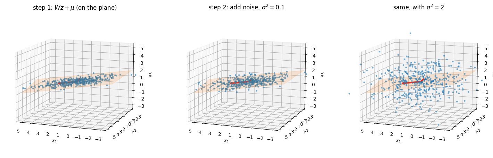
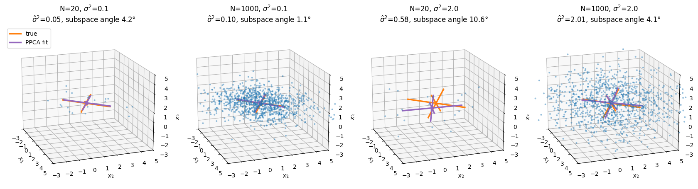
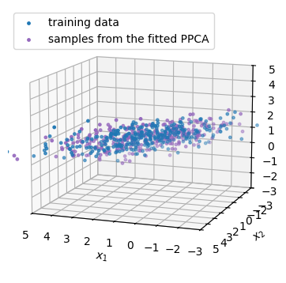

```{=html}
<style>#title-block-header { display: none; }</style>
<div class="lecture-header">
  <h1>Week 8: EM Algorithm and Probabilistic PCA</h1>
</div>
```

**Overview.** Weeks 6 and 7 dealt with **latent variable models** whose posterior $p(z\mid x)$ we cannot compute, and approximated it with variational inference. This week looks at two latent variable models where the posterior *is* available in closed form, and asks how to fit their parameters by maximum likelihood. The first hour builds the **mixture of Gaussians** (Week 7's tutorial already met it as a motivating example), shows that its maximum likelihood equations cannot be solved directly because the parameters and the posterior depend on each other, and resolves this with the **expectation-maximization (EM) algorithm**: alternate between computing the posterior with the parameters fixed and refitting the parameters with the posterior fixed. EM turns out to be a close relative of k-means and of variational inference. The second hour gives **principal component analysis** (PCA, met briefly in Week 7) a probabilistic model, **probabilistic PCA** (PPCA): a Gaussian latent variable model whose maximum likelihood fit recovers exactly the PCA directions, and which reduces to PCA in a limit.

The tutorial recaps EM on a real dataset and works through PPCA in code on 3-dimensional data. It gets its own part near the end of this chapter (@sec-w8-code).

The slides for this lecture are labelled **"Week 10"**: the course numbers calendar weeks, and reading week and the midterm came in between. These notes number lectures in order, so this is Week 8 here.

Skipped: the title slide and the "Overview of the first hour" slide (slide 2, folded into this paragraph).

::: {.callout-note}
**Notation used in this chapter.** $N$ is the number of data points, $x_n$ (the slides also write $x^{(i)}$ in the second half) is the $n$-th data point, and $D$ is its dimension (the slides write $m$ in the first half). $K$ is used twice, following the slides: in the mixture of Gaussians it is the **number of components**, and in PPCA it is the **dimension of the latent space** (Week 7 called that $M$). Each section says which one it means. In this chapter $\pi_k$ always means a **mixing coefficient**, not Week 5's stationary distribution and not the number 3.14159; the constant appears only inside $2\pi$ in Gaussian densities.
:::

## Mixture of Gaussians {#sec-w8-mog}

A single Gaussian has one peak and an elliptical shape. Real data often has several clusters, or a lopsided shape no single Gaussian fits. How can we build a more flexible density out of simple pieces?

The lecture's answer is to take a weighted average of several Gaussians.

::: {.definition-block}
**Definition.** A **[mixture of Gaussians](https://en.wikipedia.org/wiki/Mixture_model#Gaussian_mixture_model)** (Gaussian mixture model, GMM) with $K$ components is the density
$$p(x) = \sum_{k=1}^K \pi_k\,\mathcal N_D(x\mid\mu_k,\Sigma_k),\qquad \pi_k\ge0,\quad \sum_{k=1}^K\pi_k = 1.$$
Each **component** $\mathcal N_D(x\mid\mu_k,\Sigma_k)$ is a $D$-dimensional Gaussian with its own mean vector $\mu_k$ and covariance matrix $\Sigma_k$. The weights $\pi_k$ are called the **mixing coefficients**.
:::

Here $\mathcal N_D(x\mid\mu,\Sigma)$ is the **[multivariate normal](https://en.wikipedia.org/wiki/Multivariate_normal_distribution)** density

$$\mathcal N_D(x\mid\mu,\Sigma) = \frac{1}{(2\pi)^{D/2}\,|\Sigma|^{1/2}}\exp\!\Big(-\tfrac12(x-\mu)^\top\Sigma^{-1}(x-\mu)\Big),$$

where $|\Sigma|$ is the determinant of $\Sigma$. The covariance must be **[positive definite](https://en.wikipedia.org/wiki/Definite_matrix)** ($v^\top\Sigma v>0$ for every nonzero $v$) so that $\Sigma^{-1}$ exists and the exponent is a downward bowl.

The constraints on $\pi_k$ make $p(x)$ a valid density: each component integrates to 1, so the mixture integrates to $\sum_k\pi_k = 1$. The slides illustrate $K=3$ one-dimensional components ($D=1$) whose weighted sum has several bumps, and a mixture of 3 Gaussians in 2 dimensions, drawn three ways: the contours of each component labelled with its mixing coefficient, the contours of the total density $p(x)$, and $p(x)$ as a surface over the plane.

### The crabs of Naples bay {#sec-w8-crabs}

The lecture's historical example is where mixture models started. In 1892, W. F. R. Weldon collected measurements of the shore crab *Carcinus maenas* from the bay of Naples and found that the ratio of forehead width to body length had a clearly **skewed** distribution, not the symmetric bell curve expected of a single population (Weldon, *On Certain Correlated Variations in Carcinus maenas*, 1893). Weldon wondered whether the population might be a mix of two sub-species, each normally distributed. In 1894 **[Karl Pearson](https://en.wikipedia.org/wiki/Karl_Pearson)** proposed a way to fit a two-component mixture of univariate Gaussians to the data; its modern version is the **[method of moments](https://en.wikipedia.org/wiki/Method_of_moments_(statistics))** (match the sample mean, variance, and higher moments to the model's).

Figure 1 shows how two symmetric components can produce one lopsided bump. The numbers are invented for illustration, chosen to be on the scale of a forehead-to-length ratio; they are not Weldon's data.

```{=html}
<div style="overflow-x:auto; margin:1.5rem 0;">
<svg viewBox="0 0 600 330" width="100%" style="max-width:600px;display:block;margin:auto;font-family:Helvetica,'Helvetica Neue',Arial,sans-serif;" role="img" aria-label="Two dashed Gaussian curves, a lower one centred at 0.635 and a taller one centred at 0.655, and a solid curve equal to their sum. The sum has a single peak near 0.652 with a long shoulder to the left.">
  <text x="300" y="32" text-anchor="middle" font-size="24" font-weight="600" fill="#333">Two components, one skewed bump</text>
  <line x1="60" y1="260" x2="545" y2="260" stroke="#555" stroke-width="1.5"/>
  <line x1="60" y1="70" x2="60" y2="260" stroke="#555" stroke-width="1.5"/>
  <path d="M60.0,259.8 L65.3,259.7 L70.7,259.5 L76.0,259.4 L81.3,259.1 L86.7,258.8 L92.0,258.4 L97.3,257.9 L102.7,257.3 L108.0,256.4 L113.3,255.4 L118.7,254.1 L124.0,252.6 L129.3,250.7 L134.7,248.5 L140.0,245.9 L145.3,242.8 L150.7,239.4 L156.0,235.4 L161.3,231.0 L166.7,226.1 L172.0,220.8 L177.3,215.2 L182.7,209.2 L188.0,203.0 L193.3,196.7 L198.7,190.4 L204.0,184.2 L209.3,178.3 L214.7,172.8 L220.0,167.9 L225.3,163.7 L230.7,160.3 L236.0,157.7 L241.3,156.2 L246.7,155.7 L252.0,156.2 L257.3,157.7 L262.7,160.3 L268.0,163.7 L273.3,167.9 L278.7,172.8 L284.0,178.3 L289.3,184.2 L294.7,190.4 L300.0,196.7 L305.3,203.0 L310.7,209.2 L316.0,215.2 L321.3,220.8 L326.7,226.1 L332.0,231.0 L337.3,235.4 L342.7,239.4 L348.0,242.8 L353.3,245.9 L358.7,248.5 L364.0,250.7 L369.3,252.6 L374.7,254.1 L380.0,255.4 L385.3,256.4 L390.7,257.3 L396.0,257.9 L401.3,258.4 L406.7,258.8 L412.0,259.1 L417.3,259.4 L422.7,259.5 L428.0,259.7 L433.3,259.8 L438.7,259.8 L444.0,259.9 L449.3,259.9 L454.7,259.9 L460.0,260.0 L540.0,260.0" fill="none" stroke="#5795C7" stroke-width="2.2" stroke-dasharray="6 4"/>
  <path d="M60.0,260.0 L134.7,260.0 L140.0,259.9 L150.7,259.9 L156.0,259.8 L161.3,259.8 L166.7,259.7 L172.0,259.5 L177.3,259.3 L182.7,259.1 L188.0,258.7 L193.3,258.3 L198.7,257.7 L204.0,256.9 L209.3,255.9 L214.7,254.7 L220.0,253.1 L225.3,251.2 L230.7,248.9 L236.0,246.1 L241.3,242.7 L246.7,238.8 L252.0,234.3 L257.3,229.0 L262.7,223.1 L268.0,216.5 L273.3,209.2 L278.7,201.3 L284.0,192.8 L289.3,183.8 L294.7,174.5 L300.0,165.1 L305.3,155.6 L310.7,146.4 L316.0,137.5 L321.3,129.3 L326.7,121.9 L332.0,115.5 L337.3,110.4 L342.7,106.6 L348.0,104.3 L353.3,103.5 L358.7,104.3 L364.0,106.6 L369.3,110.4 L374.7,115.5 L380.0,121.9 L385.3,129.3 L390.7,137.5 L396.0,146.4 L401.3,155.6 L406.7,165.1 L412.0,174.5 L417.3,183.8 L422.7,192.8 L428.0,201.3 L433.3,209.2 L438.7,216.5 L444.0,223.1 L449.3,229.0 L454.7,234.3 L460.0,238.8 L465.3,242.7 L470.7,246.1 L476.0,248.9 L481.3,251.2 L486.7,253.1 L492.0,254.7 L497.3,255.9 L502.7,256.9 L508.0,257.7 L513.3,258.3 L518.7,258.7 L524.0,259.1 L529.3,259.3 L534.7,259.5 L540.0,259.7" fill="none" stroke="#C78557" stroke-width="2.2" stroke-dasharray="6 4"/>
  <path d="M60.0,259.8 L65.3,259.7 L70.7,259.5 L76.0,259.4 L81.3,259.1 L86.7,258.8 L92.0,258.4 L97.3,257.9 L102.7,257.3 L108.0,256.4 L113.3,255.4 L118.7,254.1 L124.0,252.6 L129.3,250.7 L134.7,248.5 L140.0,245.8 L145.3,242.8 L150.7,239.2 L156.0,235.2 L161.3,230.7 L166.7,225.8 L172.0,220.4 L177.3,214.5 L182.7,208.3 L188.0,201.7 L193.3,195.0 L198.7,188.1 L204.0,181.1 L209.3,174.2 L214.7,167.5 L220.0,161.0 L225.3,154.9 L230.7,149.1 L236.0,143.8 L241.3,138.9 L246.7,134.5 L252.0,130.4 L257.3,126.8 L262.7,123.4 L268.0,120.2 L273.3,117.1 L278.7,114.1 L284.0,111.1 L289.3,108.1 L294.7,104.9 L300.0,101.8 L305.3,98.6 L310.7,95.6 L316.0,92.7 L321.3,90.1 L326.7,88.0 L332.0,86.5 L337.3,85.8 L342.7,85.9 L348.0,87.1 L353.3,89.4 L358.7,92.8 L364.0,97.3 L369.3,103.0 L374.7,109.7 L380.0,117.3 L385.3,125.7 L390.7,134.8 L396.0,144.3 L401.3,154.1 L406.7,163.9 L412.0,173.7 L417.3,183.2 L422.7,192.3 L428.0,200.9 L433.3,209.0 L438.7,216.3 L444.0,223.0 L449.3,229.0 L454.7,234.2 L460.0,238.8 L465.3,242.7 L470.7,246.1 L476.0,248.9 L481.3,251.2 L486.7,253.1 L492.0,254.7 L497.3,255.9 L502.7,256.9 L508.0,257.7 L513.3,258.3 L518.7,258.7 L524.0,259.1 L529.3,259.3 L534.7,259.5 L540.0,259.7" fill="none" stroke="#207965" stroke-width="3"/>
  <line x1="273.3" y1="117" x2="273.3" y2="260" stroke="#888" stroke-width="1.2" stroke-dasharray="3 3"/>
  <text x="273.3" y="280" text-anchor="middle" font-size="15" fill="#555">x = 0.640</text>
  <text x="60" y="280" text-anchor="middle" font-size="14" fill="#555">0.600</text>
  <text x="540" y="280" text-anchor="middle" font-size="14" fill="#555">0.690</text>
  <text x="300" y="306" text-anchor="middle" font-size="15" fill="#555">forehead width / body length</text>
  <text x="130" y="150" text-anchor="middle" font-size="16" fill="#205279">0.4 × N(0.635, 0.01²)</text>
  <text x="470" y="105" text-anchor="middle" font-size="16" fill="#794520">0.6 × N(0.655, 0.01²)</text>
  <text x="400" y="76" text-anchor="middle" font-size="16" fill="#207965">mixture p(x)</text>
</svg>
</div>
```

**Figure 1.** A two-component mixture with invented, crab-scale numbers: $\pi_1 = 0.4$, $\mu_1 = 0.635$; $\pi_2 = 0.6$, $\mu_2 = 0.655$; both standard deviations $0.01$. The dashed curves are the weighted components $\pi_k\,\mathcal N(x\mid\mu_k,\sigma_k^2)$, the solid curve is their sum. With the means only two standard deviations apart, the sum has a single peak and a long left shoulder: a skewed curve, like the one Weldon saw. The dotted line marks the crab used in @sec-w8-resp.

::: {.callout-tip collapse="true" .clarification title="Recap: Mixture of Gaussians"}
What the symbols stand for:

- $K$: the number of components. $D$: the dimension of each data point.
- $\pi_k$: the mixing coefficient of component $k$, its share of the total weight.
- $\mu_k$, $\Sigma_k$: the mean vector and covariance matrix of component $k$.
- $\mathcal N_D(x\mid\mu,\Sigma)$: the height of a $D$-dimensional bell curve at the point $x$. $|\Sigma|$: the determinant of $\Sigma$.

Taking the equations apart:

- $p(x) = \sum_k\pi_k\,\mathcal N_D(x\mid\mu_k,\Sigma_k)$: at each point $x$, read off the height of every bell curve, weight it by $\pi_k$, and add.
- $\pi_k\ge0$, $\sum_k\pi_k = 1$: the weights split one unit of probability, so the blend still integrates to 1.
- $\frac{1}{(2\pi)^{D/2}|\Sigma|^{1/2}}$: the constant that makes one bell curve integrate to 1. A wider curve (larger $|\Sigma|$) is lower.
- $(x-\mu)^\top\Sigma^{-1}(x-\mu)$: the squared distance from $x$ to the mean, measured in units of the curve's spread.
- $\exp(-\tfrac12\,\cdot)$: turns that distance into a height, largest at $x=\mu$ and falling off with distance.

A teaching example in one dimension with $K=2$: $\pi = (0.3, 0.7)$, $\mu = (0, 3)$, both standard deviations 1. The constant is $1/\sqrt{2\pi}\approx0.3989$.

- At $x=1$: the heights are $0.3989\,e^{-0.5}\approx0.2420$ and $0.3989\,e^{-2}\approx0.0540$, so $p(1)\approx0.3(0.2420) + 0.7(0.0540) = 0.0726 + 0.0378 = 0.1104$.
- At $x=3$: the heights are $0.3989\,e^{-4.5}\approx0.0044$ and $0.3989$, so $p(3)\approx0.0013 + 0.2792 = 0.2806$.

The density is highest near the mean of the heavier component, and the lighter component still adds its own bump near 0.
:::

::: {.callout-note .section-takeaways}
**Key takeaways.**

- A single Gaussian has one peak and a symmetric shape. A weighted blend of several Gaussians can have several bumps or a lopsided shape, so it can fit data that no single bell curve fits.
- The weights must be nonnegative and add to 1 so the blend is still a valid density. Weldon's crabs show the idea: two overlapping symmetric groups can look like one skewed group.
:::

## The mixture of Gaussians as a latent variable model {#sec-w8-latent}

The mixture formula looks like a single density with many parameters. Rewriting it as a **[latent variable model](https://en.wikipedia.org/wiki/Latent_variable_model)** (the setting of Weeks 6 and 7) is what lets us reason about it, and Week 7's tutorial did exactly this (@sec-w7-tq1 in Week 7, where the weights were written $\lambda_k$).

Introduce a hidden variable $z\in\{1,\dots,K\}$ saying which component a data point came from. Give it the distribution

$$p(z=k) = \pi_k,$$

and specify the conditional of $x$ given $z$ as that component's Gaussian:

$$p(x\mid z=k) = \mathcal N_D(x\mid\mu_k,\Sigma_k).$$

The joint is prior times likelihood, $p(x,z=k) = p(z=k)\,p(x\mid z=k) = \pi_k\,\mathcal N_D(x\mid\mu_k,\Sigma_k)$, and the marginal of $x$ sums the joint over the $K$ values of $z$:

$$p(x) = \sum_{k=1}^K p(x,z=k) = \sum_{k=1}^K\pi_k\,\mathcal N_D(x\mid\mu_k,\Sigma_k).$$

This is the mixture density again. So the mixture is the same model as "first pick a component $k$ with probability $\pi_k$, then draw $x$ from component $k$". In the crab example, $z$ would be the (unrecorded) sub-species of each crab.

```{=html}
<div style="overflow-x:auto; margin:1.5rem 0;">
<svg viewBox="0 0 600 260" width="100%" style="max-width:600px;display:block;margin:auto;font-family:Helvetica,'Helvetica Neue',Arial,sans-serif;" role="img" aria-label="Graphical model. A parameter node pi points to a hidden node z_n, which points to an observed node x_n. A parameter node mu_k, Sigma_k also points to x_n. The nodes z_n and x_n sit inside a plate labelled n = 1 to N.">
  <text x="300" y="32" text-anchor="middle" font-size="24" font-weight="600" fill="#333">Mixture of Gaussians as a graph</text>
  <rect x="170" y="80" width="300" height="140" rx="10" fill="none" stroke="#888" stroke-width="1.5"/>
  <text x="455" y="210" text-anchor="end" font-size="15" fill="#555">n = 1, ..., N</text>
  <circle cx="80" cy="140" r="30" fill="#DBCDF0" stroke="#8457C7" stroke-width="2"/>
  <text x="80" y="146" text-anchor="middle" font-size="18" fill="#442079">π</text>
  <circle cx="240" cy="140" r="32" fill="#C9E4DE" stroke="#57C7AE" stroke-width="2"/>
  <text x="240" y="146" text-anchor="middle" font-size="18" fill="#207965">z_n</text>
  <circle cx="400" cy="140" r="32" fill="#C6DEF1" stroke="#5795C7" stroke-width="2"/>
  <text x="400" y="146" text-anchor="middle" font-size="18" fill="#205279">x_n</text>
  <circle cx="540" cy="140" r="38" fill="#DBCDF0" stroke="#8457C7" stroke-width="2"/>
  <text x="540" y="146" text-anchor="middle" font-size="16" fill="#442079">μ_k, Σ_k</text>
  <line x1="110" y1="140" x2="202" y2="140" stroke="#555" stroke-width="1.8"/>
  <polygon points="208,140 198,135 198,145" fill="#555"/>
  <line x1="272" y1="140" x2="362" y2="140" stroke="#555" stroke-width="1.8"/>
  <polygon points="368,140 358,135 358,145" fill="#555"/>
  <line x1="502" y1="140" x2="438" y2="140" stroke="#555" stroke-width="1.8"/>
  <polygon points="432,140 442,135 442,145" fill="#555"/>
  <text x="240" y="196" text-anchor="middle" font-size="14" fill="#555">hidden label</text>
  <text x="400" y="196" text-anchor="middle" font-size="14" fill="#555">observed</text>
</svg>
</div>
```

**Figure 2.** The mixture of Gaussians as a directed graphical model (Week 2). Purple nodes are parameters, the green node is hidden, the blue node is observed. The plate says that each of the $N$ data points has its own label $z_n$, while the parameters are shared.

::: {.callout-tip collapse="true" .clarification title="Recap: The mixture of Gaussians as a latent variable model"}
What the symbols stand for:

- $z\in\{1,\dots,K\}$: the hidden label saying which component produced a data point.
- $p(z=k) = \pi_k$: the prior on the label.
- $p(x\mid z=k)$: the density of $x$ once we know the label, the $k$-th Gaussian.
- $p(x, z=k)$: the joint, the probability of picking component $k$ and getting $x$.
- The plate in Figure 2: each of the $N$ points has its own $z_n$; the parameters are shared.

Taking the equations apart:

- $p(z=k) = \pi_k$: roll a weighted $K$-sided die to pick a component.
- $p(x\mid z=k) = \mathcal N_D(x\mid\mu_k,\Sigma_k)$: draw the point from the chosen component.
- $p(x,z=k) = \pi_k\,\mathcal N_D(x\mid\mu_k,\Sigma_k)$: prior times likelihood.
- $p(x) = \sum_k p(x,z=k)$: we never see the label, so we add over every possible label. The result is the mixture formula.

A teaching example with the mixture from the previous recap ($\pi = (0.3, 0.7)$, $\mu = (0,3)$, standard deviations 1).

- Sample a label: draw a uniform number $u = 0.45$. Since $u > 0.3$, the label is $z = 2$.
- Sample the point: with standard normal noise $-0.4$, $x = 3 - 0.4 = 2.6$.
- Joint at this $x$: $p(x, z=2)\approx0.7\times0.3989\,e^{-0.08}\approx0.2578$ and $p(x,z=1)\approx0.3\times0.3989\,e^{-3.38}\approx0.0041$.
- Marginal: $p(2.6)\approx0.2578 + 0.0041 = 0.2619$, the mixture density at 2.6.
:::

::: {.callout-note .section-takeaways}
**Key takeaways.**

- The mixture formula is the same as a two-step story: secretly pick a component with probability $\pi_k$, then draw the point from that component's Gaussian.
- Writing the mixture with a hidden label turns it into a latent variable model, so the tools of Weeks 6 and 7 (joint, posterior, evidence) apply. Here, unlike Week 7, the evidence is only a sum of $K$ terms.
:::

## Inference: responsibilities {#sec-w8-resp}

With several observations $x_1,\dots,x_N$, each data point $x_n$ has its own latent label $z_n$. Once we have seen $x_n$, what should we believe about which component it came from?

This is a posterior, and here it is easy: $z$ takes only $K$ values, so the evidence is a sum of $K$ terms. By **[Bayes' rule](https://en.wikipedia.org/wiki/Bayes%27_theorem)** (@sec-bayes in Week 1),

$$
\begin{aligned}
p(z=k\mid x) &= \frac{p(z=k)\,p(x\mid z=k)}{\sum_{j=1}^K p(z=j)\,p(x\mid z=j)}\\
&= \frac{\pi_k\,\mathcal N_D(x\mid\mu_k,\Sigma_k)}{\sum_{j=1}^K\pi_j\,\mathcal N_D(x\mid\mu_j,\Sigma_j)}.
\end{aligned}
$$

The lecture reads $\pi_k$ as the **prior** probability that $z=k$, and $p(z=k\mid x)$ as the corresponding **posterior** once we have observed the data point.

::: {.definition-block}
**Definition.** The **responsibility** of component $k$ for data point $x_n$ is the posterior
$$\gamma_{nk} = p(z_n=k\mid x_n) = \frac{\pi_k\,\mathcal N_D(x_n\mid\mu_k,\Sigma_k)}{\sum_{j=1}^K\pi_j\,\mathcal N_D(x_n\mid\mu_j,\Sigma_j)}.$$
For each $n$ the responsibilities are nonnegative and sum to 1 over $k$: a **soft assignment** of the point to the components.
:::

The slides write $p(z_n=k\mid x_n)$ throughout; the symbol $\gamma_{nk}$ is the tutorial's shorthand, and we use both. The name comes from reading the numerator as "how much of the density at $x_n$ component $k$ accounts for".

::: {.callout-note}
**Worked example: responsibilities for one crab.** Use the invented mixture of Figure 1: $\pi_1 = 0.4$, $\mu_1 = 0.635$, $\pi_2 = 0.6$, $\mu_2 = 0.655$, both $\sigma = 0.01$ ($D=1$, so $\Sigma_k = \sigma^2$). A crab has ratio $x = 0.640$.

1. **Standardized distances.** $(x-\mu_1)/\sigma = 0.5$ and $(x-\mu_2)/\sigma = -1.5$.
2. **Component densities.** $\mathcal N(x\mid\mu,\sigma^2) = \frac{1}{\sigma\sqrt{2\pi}}\,e^{-\frac12((x-\mu)/\sigma)^2}$, and $\frac{1}{0.01\sqrt{2\pi}}\approx39.89$. So component 1 gives $39.89\,e^{-0.125}\approx35.21$, and component 2 gives $39.89\,e^{-1.125}\approx12.95$. Densities can exceed 1; only their integrals must equal 1.
3. **Weight by the prior.** $\pi_1\cdot35.21\approx14.08$ and $\pi_2\cdot12.95\approx7.77$.
4. **Normalize.** The evidence is $p(x) = 14.08 + 7.77 = 21.85$, the height of the solid curve at the dotted line in Figure 1. So
$$\gamma_1 = \frac{14.08}{21.85}\approx0.644,\qquad \gamma_2 = \frac{7.77}{21.85}\approx0.356.$$

The prior favoured component 2 ($0.6$), but the crab sits much closer to component 1's mean, and the posterior swings to component 1 with probability about $0.64$. The crab is not assigned outright: about a third of it is still attributed to component 2.
:::

The slides show 500 points drawn from a mixture of 3 Gaussians in 2 dimensions, three ways: coloured by the component $z$ that actually generated each point (samples from the joint $p(x,z)$); uncoloured (samples from the marginal $p(x)$, which is all we would see in practice); and coloured by a blend of the three components' colours in proportion to the responsibilities. Points near a single component's centre are a pure colour; points between two components are a mixture of colours.

::: {.callout-tip collapse="true" .clarification title="Recap: Inference: responsibilities"}
What the symbols stand for:

- $\gamma_{nk} = p(z_n=k\mid x_n)$: the responsibility, the posterior probability that component $k$ produced point $x_n$.
- $\pi_k$: here read as the prior probability of label $k$, before seeing the point.

Taking the equation apart:

- Numerator $\pi_k\,\mathcal N_D(x_n\mid\mu_k,\Sigma_k)$: how common component $k$ is, times how well it explains $x_n$.
- Denominator $\sum_j\pi_j\,\mathcal N_D(x_n\mid\mu_j,\Sigma_j)$: the same product for every component, added up. It is the evidence $p(x_n)$.
- The ratio: component $k$'s share of the total. The shares are nonnegative and add to 1 over $k$.

A teaching example with the same mixture ($\pi = (0.3, 0.7)$, $\mu = (0,3)$, standard deviations 1).

- At $x = 1$: the numerators are $0.0726$ and $0.0378$ (from the first recap), the evidence is $0.1104$, so $\gamma_1\approx0.658$ and $\gamma_2\approx0.342$. The point is closer to component 1, which overturns the prior's preference for component 2.
- At $x = 1.5$, exactly halfway: both Gaussians have the same height there, $0.3989\,e^{-1.125}\approx0.1295$, so it cancels and $\gamma = (0.3, 0.7)$, the prior.

When the data cannot tell the components apart, the responsibilities fall back to the prior.
:::

::: {.callout-note .section-takeaways}
**Key takeaways.**

- Once we see a point, Bayes' rule tells us how likely each component is to have produced it. That answer, the responsibility, is a share rather than a verdict: a point between two clusters is partly assigned to both.
- It weighs two things: how common the component is ($\pi_k$) and how well its Gaussian explains the point. It is easy to compute because the label has only $K$ possible values.
:::

## The likelihood function {#sec-w8-lik}

To fit the model we need its parameters, $\pi = (\pi_1,\dots,\pi_K)$, $\mu = (\mu_1,\dots,\mu_K)$, $\Sigma = (\Sigma_1,\dots,\Sigma_K)$. The natural tool is **maximum likelihood** (@sec-mle in Week 1). Stack the data into a matrix $X\in\mathbb R^{N\times D}$ (one row per point); the latent labels form a vector $z\in\{1,\dots,K\}^N$, one label per point. With the data points independent,

::: {.boxed-eq}
$$\log p(X\mid\pi,\mu,\Sigma) = \sum_{n=1}^N\log\Bigg(\sum_{k=1}^K\pi_k\,\mathcal N_D(x_n\mid\mu_k,\Sigma_k)\Bigg).$$
:::

Each data point contributes the log of its mixture density. The structure to notice is a **log of a sum**: the log cannot be pushed inside onto the individual Gaussians, so the nice simplification that made the single-Gaussian MLE a sample mean and sample covariance does not happen.

::: {.callout-tip collapse="true" .clarification title="Recap: The likelihood function"}
What the symbols stand for:

- $X\in\mathbb R^{N\times D}$: the data, one row per point.
- $\pi$, $\mu$, $\Sigma$: all the mixing coefficients, means, and covariances together.
- $\log p(X\mid\pi,\mu,\Sigma)$: the log-likelihood, how probable the whole data set is under these parameters, on a log scale.

Taking the equation apart:

- $\sum_{n=1}^N$: the points are independent, so their log-probabilities add.
- $\sum_{k=1}^K\pi_k\,\mathcal N_D(x_n\mid\mu_k,\Sigma_k)$: the mixture density of one point.
- $\log(\sum_k\cdots)$: a log of a sum. A log turns a product into a sum of logs, but it does nothing useful to a sum, so it cannot be split into one piece per Gaussian.

A teaching example with two points, $x = 0$ and $x = 3$, and the same mixture ($\pi = (0.3, 0.7)$, $\mu = (0,3)$, standard deviations 1).

- $p(0)\approx0.3(0.3989) + 0.7(0.0044) = 0.1197 + 0.0031 = 0.1228$.
- $p(3)\approx0.0013 + 0.2792 = 0.2806$ (from the first recap).
- Log-likelihood: $\log0.1228 + \log0.2806\approx-2.097 - 1.271 = -3.368$.

Inside $\log0.1228$, the two components' contributions $0.1197$ and $0.0031$ are already added together, so no algebra can separate the parameters of component 1 from those of component 2.
:::

::: {.callout-note .section-takeaways}
**Key takeaways.**

- To fit the parameters we maximize the log-likelihood: the sum over data points of the log of each point's mixture density.
- The log sits on top of a sum over components, so it cannot be split into pieces that each involve one Gaussian. That is what stops the easy single-Gaussian answer (sample mean and sample covariance) from carrying over directly.
:::

## Maximum likelihood {#sec-w8-mle}

Even without a closed form, we can still differentiate the log-likelihood and set the derivatives to zero. This gives equations that the MLE must satisfy, and they have a clean interpretation.

### The means {#sec-w8-mle-mu}

Two facts do the work. First, for a symmetric matrix $A$, the **[gradient](https://en.wikipedia.org/wiki/Gradient)** of a quadratic form is $\nabla_\mu\,(x-\mu)^\top A(x-\mu) = -2A(x-\mu)$, so

$$\nabla_{\mu_k}\,\mathcal N_D(x_n\mid\mu_k,\Sigma_k) = \mathcal N_D(x_n\mid\mu_k,\Sigma_k)\,\Sigma_k^{-1}(x_n-\mu_k).$$

Second, the derivative of $\log f$ is $f'/f$. Only the $k$-th term of the inner sum depends on $\mu_k$, so

$$
\begin{aligned}
0 &= \sum_{n=1}^N\frac{\pi_k\,\mathcal N(x_n\mid\mu_k,\Sigma_k)}{\sum_j\pi_j\,\mathcal N(x_n\mid\mu_j,\Sigma_j)}\,\Sigma_k^{-1}(x_n-\mu_k)\\
&= \Sigma_k^{-1}\sum_{n=1}^N p(z_n=k\mid x_n)\,(x_n-\mu_k).
\end{aligned}
$$

The fraction that appeared is exactly the responsibility. Because $\Sigma_k$ is positive definite, $\Sigma_k^{-1}$ is invertible and we can multiply it away, leaving $\sum_n\gamma_{nk}(x_n-\mu_k) = 0$. Solving for $\mu_k$:

::: {.boxed-eq}
$$\mu_k = \frac{1}{N_k}\sum_{n=1}^N p(z_n=k\mid x_n)\,x_n,\qquad N_k = \sum_{n=1}^N p(z_n=k\mid x_n).$$
:::

The MLE of each mean is a **weighted mean of the data**, each point weighted by how responsible component $k$ is for it. $N_k$ is the **effective number of points** assigned to component $k$: if the assignments were hard (each $\gamma_{nk}$ either 0 or 1), $N_k$ would be a count and $\mu_k$ the plain average of component $k$'s points.

### The covariances {#sec-w8-mle-sigma}

Differentiating with respect to $\Sigma_k$ and setting the result to zero (this needs derivatives of $\log|\Sigma|$ and of $\Sigma^{-1}$, which we take as given) gives

::: {.boxed-eq}
$$\Sigma_k = \frac{1}{N_k}\sum_{n=1}^N p(z_n=k\mid x_n)\,(x_n-\mu_k)(x_n-\mu_k)^\top.$$
:::

Again the familiar single-Gaussian formula, the sample covariance around the mean, with each data point weighted by its responsibility.

### A prerequisite: maximizing under a constraint {#sec-w8-lagrange}

The mixing coefficients cannot be treated the same way: they must sum to 1, so we cannot set each derivative to zero independently. The lecture states the answer; this short subsection fills in the standard tool.

::: {.definition-block}
**Definition.** To maximize $f(\pi)$ subject to an equality constraint $g(\pi) = 0$, the method of **[Lagrange multipliers](https://en.wikipedia.org/wiki/Lagrange_multiplier)** introduces a new variable $\lambda$ (the **multiplier**) and looks for stationary points of $f(\pi) + \lambda\,g(\pi)$ in both $\pi$ and $\lambda$. Setting the derivative in $\lambda$ to zero recovers the constraint; setting the derivatives in $\pi$ to zero gives the remaining equations.
:::

At a constrained maximum, $f$ cannot increase along any direction that keeps $g=0$; the multiplier $\lambda$ measures how much the constraint is pushing back.

### The mixing coefficients {#sec-w8-mle-pi}

Apply this with $f$ the log-likelihood and $g(\pi) = \sum_k\pi_k - 1$. Differentiating $\log p(X\mid\pi,\mu,\Sigma) + \lambda(\sum_k\pi_k - 1)$ with respect to $\pi_k$:

$$\sum_{n=1}^N\frac{\mathcal N(x_n\mid\mu_k,\Sigma_k)}{\sum_j\pi_j\,\mathcal N(x_n\mid\mu_j,\Sigma_j)} + \lambda = 0.$$

Multiply by $\pi_k$, and the sum becomes $\sum_n\gamma_{nk} = N_k$, so $N_k + \lambda\pi_k = 0$. Summing this over $k$ and using $\sum_k\pi_k = 1$ and $\sum_k N_k = N$ (each point's responsibilities sum to 1) gives $\lambda = -N$. Therefore

::: {.boxed-eq}
$$\pi_k = \frac{N_k}{\sum_{j=1}^K N_j} = \frac{N_k}{N}.$$
:::

Each mixing coefficient is the **fraction of the data** that component $k$ is responsible for. (We did not impose $\pi_k\ge0$; the answer satisfies it automatically.)

::: {.callout-tip collapse="true" .clarification title="Recap: Maximum likelihood"}
What the symbols stand for:

- $N_k = \sum_n\gamma_{nk}$: the effective number of points that component $k$ is responsible for.
- $\lambda$: the Lagrange multiplier that enforces $\sum_k\pi_k = 1$.
- $g(\pi) = \sum_k\pi_k - 1$: the constraint, written so that it equals 0 when satisfied.

Taking the equations apart:

- $\mu_k = \frac{1}{N_k}\sum_n\gamma_{nk}x_n$: a weighted average of all the data, each point weighted by component $k$'s responsibility for it.
- $\Sigma_k = \frac{1}{N_k}\sum_n\gamma_{nk}(x_n-\mu_k)(x_n-\mu_k)^\top$: a weighted spread around that mean.
- $\pi_k = N_k/N$: the share of the data the component is responsible for.
- The Lagrange step: we cannot set each $\pi_k$'s derivative to zero on its own, because the weights must add to 1. Adding $\lambda\,g(\pi)$ and solving gives $\lambda = -N$.

A teaching example in one dimension. Four points $x = (0, 1, 4, 5)$, with responsibilities of component 1 equal to $(1, 0.8, 0.2, 0)$, so those of component 2 are $(0, 0.2, 0.8, 1)$.

- Effective counts: $N_1 = 2$, $N_2 = 2$, so $\pi = (0.5, 0.5)$.
- Means: $\mu_1 = (0.8 + 0.8)/2 = 0.8$ and $\mu_2 = (0.2 + 3.2 + 5)/2 = 4.2$.
- Variance of component 1: $\frac12\big[1(0.8)^2 + 0.8(0.2)^2 + 0.2(3.2)^2\big] = \frac12(0.64 + 0.032 + 2.048) = 1.36$.

With hard labels, component 1 would have mean 0.5. The point at 4, with only 0.2 responsibility, still pulls the mean up to 0.8 and widens the variance.
:::

::: {.callout-note .section-takeaways}
**Key takeaways.**

- Setting the derivatives to zero gives familiar answers with a twist: each mean is a weighted average of the data, each covariance is a weighted spread, and each mixing weight is the share of the data the component is responsible for. The weights are the responsibilities.
- The mixing weights have to add to 1, so they need a Lagrange multiplier instead of a plain derivative.
- These are conditions the answer must satisfy, not the answer itself: the responsibilities on the right depend on the parameters on the left.
:::

## Motivating the EM algorithm {#sec-w8-why-em}

The three boxed equations look like a solution, but they are not one. Each right-hand side contains the responsibilities $p(z_n=k\mid x_n)$, and the responsibilities themselves depend on the parameters:

$$p(z_n=k\mid x_n) = \frac{\pi_k\,\mathcal N_D(x_n\mid\mu_k,\Sigma_k)}{\sum_{j=1}^K\pi_j\,\mathcal N_D(x_n\mid\mu_j,\Sigma_j)}.$$

The tutorial puts the circularity this way. If we knew the labels $z_n$, fitting would be easy: fit one Gaussian per cluster. If we knew the parameters, inferring the labels would be easy: Bayes' rule. We know neither. The MLE has **no closed form**.

The way out is to iterate: fix one side, compute the other, and repeat.

1. Initialize the parameters to some values.
2. **E-step:** update the posteriors $p(z_n=k\mid x_n)$, holding the parameters fixed.
3. **M-step:** update the parameters $\pi,\mu,\Sigma$ with the boxed formulas, holding the posteriors fixed.
4. Repeat.

::: {.callout-tip collapse="true" .clarification title="Recap: Motivating the EM algorithm"}
What the symbols stand for:

- $p(z_n=k\mid x_n)$: the responsibilities, computed from the parameters.
- $\pi$, $\mu$, $\Sigma$: the parameters, computed from the responsibilities.
- E-step and M-step: the two halves of the loop, one per direction.

Taking the circularity apart:

- The responsibility formula has $\pi$, $\mu$, $\Sigma$ on its right-hand side.
- The three boxed MLE formulas have the responsibilities on their right-hand side.
- Each side is easy if the other is known, so we fix one, compute the other, and alternate.

A teaching example with the data $x = (0, 1, 4, 5)$ and standard deviations fixed at 1.

- If we knew the labels were $(1, 1, 2, 2)$, fitting is easy: $\mu = (0.5, 4.5)$ and $\pi = (0.5, 0.5)$.
- If we knew $\mu = (0.5, 4.5)$ and $\pi = (0.5, 0.5)$, inference is easy: for $x = 1$, $\gamma_1 = e^{-0.125}/(e^{-0.125} + e^{-6.125})\approx0.998$.

In practice we know neither the labels nor the parameters. The next section starts from a guess and alternates.
:::

::: {.callout-note .section-takeaways}
**Key takeaways.**

- The maximum-likelihood equations go in a circle: the parameters are computed from the responsibilities, and the responsibilities are computed from the parameters. So there is no closed-form answer.
- Each half is easy if the other half is known. The way out is to guess one side, compute the other, and repeat.
:::

## EM for Gaussian mixtures {#sec-w8-em-gmm}

::: {.algorithm}
**[Expectation-maximization](https://en.wikipedia.org/wiki/Expectation%E2%80%93maximization_algorithm) (EM) for a mixture of Gaussians**

Initialize $\pi,\mu,\Sigma$. Then repeat:

1. **E-step.** For each $k$ and $n$ compute the responsibilities
$$p(z_n=k\mid x_n) = \frac{\pi_k\,\mathcal N_D(x_n\mid\mu_k,\Sigma_k)}{\sum_{j=1}^K\pi_j\,\mathcal N_D(x_n\mid\mu_j,\Sigma_j)}.$$
2. **M-step.** Re-estimate the parameters, with $N_k = \sum_{n=1}^N p(z_n=k\mid x_n)$:
$$\mu_k^{\text{new}} = \frac{1}{N_k}\sum_{n=1}^N p(z_n=k\mid x_n)\,x_n,\qquad \pi_k^{\text{new}} = \frac{N_k}{N},$$
$$\Sigma_k^{\text{new}} = \frac{1}{N_k}\sum_{n=1}^N p(z_n=k\mid x_n)\,(x_n-\mu_k^{\text{new}})(x_n-\mu_k^{\text{new}})^\top.$$
3. Evaluate the log-likelihood and check for convergence (stop when it changes by less than a small tolerance).
:::

The covariance update uses the **new** means, which is what the stationarity condition for $\Sigma_k$ asks for.

```{=html}
<div style="overflow-x:auto; margin:1.5rem 0;">
<svg viewBox="0 0 620 260" width="100%" style="max-width:620px;display:block;margin:auto;font-family:Helvetica,'Helvetica Neue',Arial,sans-serif;" role="img" aria-label="A loop. Initialize parameters leads to an E-step box (compute responsibilities with parameters fixed), which leads to an M-step box (refit pi, mu, Sigma with responsibilities fixed), which leads to a convergence check. If not converged, an arrow returns to the E-step; if converged, stop.">
  <text x="310" y="32" text-anchor="middle" font-size="24" font-weight="600" fill="#333">The EM loop</text>
  <rect x="20" y="90" width="110" height="60" rx="8" fill="#fbc02d" fill-opacity="0.25" stroke="#fbc02d" stroke-width="2"/>
  <text x="75" y="116" text-anchor="middle" font-size="16" fill="#333">initialize</text>
  <text x="75" y="136" text-anchor="middle" font-size="16" fill="#333">π, μ, Σ</text>
  <rect x="170" y="80" width="130" height="80" rx="8" fill="#C9E4DE" stroke="#57C7AE" stroke-width="2"/>
  <text x="235" y="108" text-anchor="middle" font-size="17" font-weight="600" fill="#207965">E-step</text>
  <text x="235" y="128" text-anchor="middle" font-size="14" fill="#207965">responsibilities</text>
  <text x="235" y="146" text-anchor="middle" font-size="14" fill="#207965">params fixed</text>
  <rect x="340" y="80" width="130" height="80" rx="8" fill="#DBCDF0" stroke="#8457C7" stroke-width="2"/>
  <text x="405" y="108" text-anchor="middle" font-size="17" font-weight="600" fill="#442079">M-step</text>
  <text x="405" y="128" text-anchor="middle" font-size="14" fill="#442079">weighted refits</text>
  <text x="405" y="146" text-anchor="middle" font-size="14" fill="#442079">posteriors fixed</text>
  <rect x="505" y="90" width="100" height="60" rx="8" fill="#F2C6DE" stroke="#C75794" stroke-width="2"/>
  <text x="555" y="116" text-anchor="middle" font-size="15" fill="#792051">log-lik.</text>
  <text x="555" y="136" text-anchor="middle" font-size="15" fill="#792051">converged?</text>
  <line x1="130" y1="120" x2="162" y2="120" stroke="#555" stroke-width="1.8"/>
  <polygon points="168,120 158,115 158,125" fill="#555"/>
  <line x1="300" y1="120" x2="332" y2="120" stroke="#555" stroke-width="1.8"/>
  <polygon points="338,120 328,115 328,125" fill="#555"/>
  <line x1="470" y1="120" x2="497" y2="120" stroke="#555" stroke-width="1.8"/>
  <polygon points="503,120 493,115 493,125" fill="#555"/>
  <path d="M555,150 L555,210 L235,210 L235,168" fill="none" stroke="#555" stroke-width="1.8"/>
  <polygon points="235,162 230,172 240,172" fill="#555"/>
  <text x="395" y="230" text-anchor="middle" font-size="15" fill="#555">no: repeat with the new parameters</text>
  <text x="555" y="72" text-anchor="middle" font-size="15" fill="#2e7d32">yes: stop</text>
</svg>
</div>
```

**Figure 3.** EM alternates two easy problems: inferring the labels softly with the parameters fixed, and refitting the parameters with the soft labels fixed.

::: {.callout-note}
**Worked example: one M-step in one dimension.** Three crabs have ratios $x = (0.630,\ 0.640,\ 0.660)$, and suppose an E-step has just produced the responsibilities of component 1, $\gamma_{\cdot1} = (0.9,\ 0.6,\ 0.1)$, so those of component 2 are $\gamma_{\cdot2} = (0.1,\ 0.4,\ 0.9)$.

1. **Effective counts.** $N_1 = 0.9+0.6+0.1 = 1.6$ and $N_2 = 0.1+0.4+0.9 = 1.4$. They add up to $N=3$.
2. **Mixing coefficients.** $\pi_1 = 1.6/3\approx0.533$ and $\pi_2 = 1.4/3\approx0.467$.
3. **Means.** $\mu_1 = (0.9\cdot0.630 + 0.6\cdot0.640 + 0.1\cdot0.660)/1.6 = 1.017/1.6\approx0.6356$. Similarly $\mu_2 = 0.913/1.4\approx0.6521$. Each mean is pulled toward the points its component is most responsible for.
4. **Variances.** $\sigma_1^2 = \frac{1}{1.6}\big[0.9(0.630-0.6356)^2 + 0.6(0.640-0.6356)^2 + 0.1(0.660-0.6356)^2\big]\approx6.2\times10^{-5}$, a standard deviation of about $0.0079$. The same recipe for component 2 gives about $0.0108$.

The next E-step would recompute the responsibilities from these new parameters, and so on.
:::

::: {.callout-warning}
**Homework.** Assignment 3, Question 3 asks you to implement the E-step and M-step yourself in numpy, implement k-means, and compare the two. This chapter explains the method and works small invented examples; the implementation and the comparison on the assignment's data are left to the assignment.
:::

The slides illustrate EM on a two-dimensional dataset with two clusters (it is the Old Faithful geyser data that the tutorial uses; Figure 6 in @sec-w8-code-em shows the tutorial's own run). The two components start as round circles placed away from the data. After one iteration ($L=1$), they have moved onto the data, stretched along it, and the points between them are coloured purple (shared responsibility). By $L=5$ the components have separated, and by $L=20$ each has settled on one cluster, with almost every point a pure colour.

Two practical caveats, standard for EM though not on the slides. EM climbs to a **local** maximum of the likelihood, so the result can depend on the initialization; the illustration deliberately starts from a poor one to show that it can recover. And a component can collapse onto a single data point (its covariance shrinking toward zero), which sends the likelihood to infinity; implementations guard against this, for example by adding a small multiple of the identity to each $\Sigma_k$.

::: {.callout-tip collapse="true" .clarification title="Recap: EM for Gaussian mixtures"}
What the symbols stand for:

- $\mu_k^{\text{new}}$, $\Sigma_k^{\text{new}}$, $\pi_k^{\text{new}}$: the parameters after one M-step.
- Tolerance: the small change in log-likelihood below which we stop.

Taking the algorithm apart:

- E-step: with the parameters held fixed, compute every responsibility by Bayes' rule.
- M-step: with the responsibilities held fixed, refit each component as a weighted Gaussian fit. The covariance update uses the new means.
- Check: compute the log-likelihood and stop once it barely changes.

A teaching example with $x = (0, 1, 4, 5)$, standard deviations fixed at 1, $\pi = (0.5, 0.5)$, and a poor start $\mu = (1, 3)$. With equal weights and spreads, $\gamma_1 = e^{-d_1^2/2}/(e^{-d_1^2/2} + e^{-d_2^2/2})$, where $d_k$ is the distance to $\mu_k$.

- E-step: $\gamma_1\approx(0.982,\ 0.881,\ 0.018,\ 0.002)$ for the four points.
- Effective counts: $N_1\approx1.883$ and $N_2\approx2.117$.
- M-step means: $\mu_1\approx0.965/1.883\approx0.51$ and $\mu_2\approx9.035/2.117\approx4.27$.
- M-step weights: $\pi\approx(0.471,\ 0.529)$.

After one round the means moved from $(1, 3)$ to about $(0.51, 4.27)$, close to the centres of the two groups $\{0,1\}$ and $\{4,5\}$. The next E-step recomputes the responsibilities from these.
:::

::: {.callout-note .section-takeaways}
**Key takeaways.**

- EM breaks the circle by alternating two easy steps: with the parameters fixed, compute the responsibilities (E-step); with the responsibilities fixed, refit each Gaussian as a weighted fit (M-step). Repeat until the log-likelihood stops changing.
- It finds a local maximum, so the answer can depend on where it starts. A component can also collapse onto a single point, which practical implementations guard against.
:::

## The general EM algorithm {#sec-w8-general-em}

Nothing in the recipe was specific to Gaussians. Consider any model with observed data $X$, latent variables $Z$, and parameters $\theta$. We want to maximize the log-likelihood

$$\log p(X\mid\theta) = \log\sum_Z p(X,Z\mid\theta),$$

again a log of a sum (or of an integral, for continuous $Z$). Call $\log p(X,Z\mid\theta)$, the log-likelihood we would have if $Z$ were observed, the **complete-data log-likelihood**.

::: {.definition-block}
**Definition.** For current parameters $\theta^{\text{old}}$, the **expected complete-data log-likelihood** is
$$
\begin{aligned}
Q(\theta,\theta^{\text{old}}) &= \mathbb E_Z\big[\log p(X,Z\mid\theta)\,\big|\,X,\theta^{\text{old}}\big]\\
&= \sum_Z p(Z\mid X,\theta^{\text{old}})\,\log p(X,Z\mid\theta).
\end{aligned}
$$
The average is taken under the **posterior at the old parameters**, while $\theta$ inside the log is free.
:::

::: {.algorithm}
**The general EM algorithm**

Initialize $\theta^{\text{old}}$. Then repeat until convergence:

1. **E-step.** Use $\theta^{\text{old}}$ to compute the posterior $p(Z\mid X,\theta^{\text{old}})$.
2. **M-step.** $\theta^{\text{new}} = \arg\max_\theta\, Q(\theta,\theta^{\text{old}})$.
3. Replace $\theta^{\text{old}}\leftarrow\theta^{\text{new}}$.
:::

The point of the swap is that $Q$ has the log **inside** the average, on the complete-data likelihood, which is often a product of simple factors. The lecture notes that this maximization is tractable in many applications. The "E" is the expectation that defines $Q$; the "M" is its maximization.

### The Gaussian mixture as an instance {#sec-w8-em-gmm-instance}

If $z$ were observed, the MLE would be easy. Write the complete-data log-likelihood with an **[indicator function](https://en.wikipedia.org/wiki/Indicator_function)** $\mathbb 1[z_n=k]$ (1 if $z_n=k$, else 0) to pick out the one component each point belongs to:

$$
\begin{aligned}
\log p(X,Z\mid\theta) &= \sum_{n=1}^N\log p(x_n,z_n\mid\theta)\\
&= \sum_{n=1}^N\sum_{k=1}^K\mathbb 1[z_n=k]\,\log\big(\pi_k\,\mathcal N(x_n\mid\mu_k,\Sigma_k)\big).
\end{aligned}
$$

There is no log of a sum any more: each point contributes the log of one Gaussian term.

**E-step.** The labels are independent given the data, $p(Z\mid X,\theta) = \prod_{n=1}^N p(z_n\mid X,\theta)$, and each factor depends only on its own point, $p(z_n=k\mid X,\theta) = p(z_n=k\mid x_n,\theta)$, the responsibility from @sec-w8-resp.

**M-step.** The expectation of an indicator is the probability of the event, $\mathbb E[\mathbb 1[z_n=k]\mid X,\theta^{\text{old}}] = p(z_n=k\mid X,\theta^{\text{old}})$. Since $Q$ is linear in the indicators,

$$Q(\theta,\theta^{\text{old}}) = \sum_{n=1}^N\sum_{k=1}^K p(z_n=k\mid X,\theta^{\text{old}})\,\log\big(\pi_k\,\mathcal N(x_n\mid\mu_k,\Sigma_k)\big).$$

This is a weighted sum of single-Gaussian log-likelihoods, with fixed weights. Maximizing it in $\mu_k$, $\Sigma_k$ (by setting gradients to zero) and in $\pi_k$ (with the Lagrange multiplier of @sec-w8-lagrange) gives exactly the M-step formulas of @sec-w8-em-gmm. The difference from @sec-w8-mle is that the weights are now held fixed at their old values, so the equations really are solved in one step.

### Why EM never decreases the likelihood {#sec-w8-em-monotone}

The tutorial states that each EM iteration can only increase the log-likelihood, and the slides compare EM to variational inference (@sec-w8-vi-em). Neither proves the first claim, so this short subsection does, using only Week 7's ELBO.

For any distribution $q(Z)$, Week 7's identity (@sec-w7-elbo in Week 7) reads

$$\log p(X\mid\theta) = \mathcal L(q,\theta) + \mathrm{KL}\big(q(Z)\,\|\,p(Z\mid X,\theta)\big),$$

$$\mathcal L(q,\theta) = \mathbb E_{q}\big[\log p(X,Z\mid\theta)\big] + H(q),$$

where $H(q) = -\mathbb E_q[\log q(Z)]$ is the [entropy](https://en.wikipedia.org/wiki/Entropy_(information_theory)) of $q$, the first form of the ELBO from @sec-w7-two-forms in Week 7.

- **E-step.** Set $q(Z) = p(Z\mid X,\theta^{\text{old}})$. The KL term becomes 0, so the bound is **tight**: $\mathcal L(q,\theta^{\text{old}}) = \log p(X\mid\theta^{\text{old}})$.
- **M-step.** With this $q$, the first term of $\mathcal L(q,\theta)$ is exactly $Q(\theta,\theta^{\text{old}})$, and $H(q)$ does not depend on $\theta$. So maximizing $Q$ over $\theta$ maximizes $\mathcal L(q,\theta)$ over $\theta$, and $\mathcal L(q,\theta^{\text{new}})\ge\mathcal L(q,\theta^{\text{old}})$.
- **Chain them.** KL is never negative (@sec-kl in Week 6), so

$$\log p(X\mid\theta^{\text{new}})\ \ge\ \mathcal L(q,\theta^{\text{new}})\ \ge\ \mathcal L(q,\theta^{\text{old}})\ =\ \log p(X\mid\theta^{\text{old}}).$$

So EM is **coordinate ascent on the ELBO**: the E-step maximizes $\mathcal L$ over $q$ (exactly, by choosing the posterior), and the M-step maximizes it over $\theta$. This is also why "check the log-likelihood for convergence" in the algorithm is a sensible stopping rule: the sequence of log-likelihoods only goes up.

::: {.callout-tip collapse="true" .clarification title="Recap: The general EM algorithm"}
What the symbols stand for:

- $X$, $Z$, $\theta$: observed data, latent variables, and parameters of any model.
- $\log p(X,Z\mid\theta)$: the complete-data log-likelihood, what we would maximize if $Z$ were observed.
- $Q(\theta,\theta^{\text{old}})$: that log-likelihood averaged over the posterior at the old parameters.
- $\mathbb 1[z_n=k]$: the indicator, 1 if point $n$ has label $k$ and 0 otherwise.
- $\mathcal L(q,\theta)$, $H(q)$: Week 7's ELBO and the entropy of $q$.

Taking the equations apart:

- $Q = \sum_Z p(Z\mid X,\theta^{\text{old}})\log p(X,Z\mid\theta)$: the log now sits on the complete-data likelihood, inside the average, where it splits into simple pieces.
- For the mixture, the average of the indicator is the responsibility, so $Q$ is a responsibility-weighted sum of single-Gaussian log-likelihoods.
- E-step: choosing $q$ as the exact posterior makes the KL term 0, so the ELBO touches the log-likelihood.
- M-step: maximizing $Q$ raises the ELBO. The log-likelihood is at least the ELBO, so it cannot go down.

A teaching example with one point $x = 1$, two components with standard deviation 1 and equal weights, $\mu_2 = 3$ fixed, and only $\mu_1$ free, starting at $\mu_1 = 0$.

- Old log-likelihood: $\log\big(0.5\times0.3989\,(e^{-0.5} + e^{-2})\big)\approx\log0.1480\approx-1.911$.
- E-step: $\gamma_1 = e^{-0.5}/(e^{-0.5} + e^{-2})\approx0.818$.
- $Q$ as a function of $\mu_1$: $0.818\times\big(-\tfrac12(1-\mu_1)^2\big)$ plus terms without $\mu_1$. It is largest at $\mu_1 = 1$.
- New log-likelihood: $\log\big(0.5\times0.3989\,(1 + e^{-2})\big)\approx\log0.2265\approx-1.485$. It went up.
:::

::: {.callout-note .section-takeaways}
**Key takeaways.**

- EM is not specific to Gaussians. For any model with hidden variables: compute the posterior over the hidden values with the current parameters, then maximize the log-likelihood we would have if we knew them, averaged over that posterior.
- That swap moves the log inside the average, onto simple factors, which is why the M-step is usually solvable.
- No round can lower the log-likelihood: the E-step makes the ELBO touch the log-likelihood, and the M-step pushes the ELBO up. EM is coordinate ascent on Week 7's ELBO.
:::

## Relationship to k-means {#sec-w8-kmeans}

CSC311 introduced **[k-means clustering](https://en.wikipedia.org/wiki/K-means_clustering)**: choose $K$ cluster centres $\mu_k$, then alternate between (a) assigning each point to its nearest centre and (b) moving each centre to the average of the points assigned to it. With $r_{nk} = 1$ if point $n$ is assigned to cluster $k$ and 0 otherwise, k-means decreases the **distortion measure**

$$J = \sum_{n=1}^N\sum_{k=1}^K r_{nk}\,\lVert x_n-\mu_k\rVert^2.$$

These are **hard assignments**: each point belongs to exactly one cluster. The two-step structure looks like EM. The lecture shows that k-means is a limiting case of EM.

Consider a Gaussian mixture where every component has the same round covariance, $\Sigma_k = \epsilon I$ for all $k$, with $\epsilon$ fixed (not learned). Then

$$p(x\mid\mu_k,\Sigma_k) = \frac{1}{(2\pi\epsilon)^{D/2}}\exp\!\Big(-\frac{1}{2\epsilon}\lVert x-\mu_k\rVert^2\Big),$$

and EM runs over $\theta = (\pi,\mu)$ only. The normalizing constant is the same for every component, so it cancels in the responsibilities, which take a **[softmax](https://en.wikipedia.org/wiki/Softmax_function)** form:

$$p(z_n=k\mid X,\theta) = \frac{\pi_k\exp\!\big(-\lVert x_n-\mu_k\rVert^2/2\epsilon\big)}{\sum_{j=1}^K\pi_j\exp\!\big(-\lVert x_n-\mu_j\rVert^2/2\epsilon\big)}.$$

Now let $\epsilon\to0$. Every exponential goes to zero, but the one with the **smallest** distance $\lVert x_n-\mu_j\rVert$ goes to zero most slowly, so after dividing by the sum it dominates all the others (as long as every $\pi_k>0$). The responsibilities become hard:

$$p(z_n=k\mid X,\theta)\ \to\ r_{nk} = \begin{cases}1 & \text{if } k = \arg\min_j\lVert x_n-\mu_j\rVert,\\ 0 & \text{otherwise.}\end{cases}$$

So the E-step becomes the k-means assignment step. Plugging these into the expected complete-data log-likelihood,

$$Q = \sum_{n=1}^N\sum_{k=1}^K r_{nk}\Big(\log\pi_k - \frac{1}{2\epsilon}\lVert x_n-\mu_k\rVert^2\Big) + \text{const}.$$

As $\epsilon\to0$ the distance term, scaled by $1/\epsilon$, swamps the $\log\pi_k$ term, so maximizing $Q$ over the means is the same as minimizing $\frac12\sum_n\sum_k r_{nk}\lVert x_n-\mu_k\rVert^2$, the k-means distortion. (The slide writes the limit as $-\frac12\sum_n\sum_k r_{nk}\lVert x_n-\mu_k\rVert^2 + \text{const}$, dropping the positive factor $1/\epsilon$, which does not change where the maximum is.) The M-step for $\mu_k$ becomes "move each mean to the average of its points".

The lecture's verdict: in the limit, EM's maximization is k-means. EM is slower, but more flexible and more accurate, because it keeps soft assignments and learns a full covariance per cluster, so it can fit elongated or differently sized clusters that k-means, with its implicit round clusters of equal size, cannot.

::: {.callout-tip collapse="true" .clarification title="Recap: Relationship to k-means"}
What the symbols stand for:

- $r_{nk}$: the hard assignment, 1 if point $n$ belongs to cluster $k$ and 0 otherwise.
- $J$: the distortion, the total squared distance from each point to its own centre.
- $\epsilon$: the shared variance of every component when $\Sigma_k = \epsilon I$.

Taking the equations apart:

- $J = \sum_n\sum_k r_{nk}\lVert x_n-\mu_k\rVert^2$: only each point's own centre counts, because $r_{nk}$ is 0 for the others.
- $\Sigma_k = \epsilon I$: every cluster is a round blob of the same size, so the Gaussian's constant cancels from the responsibilities.
- The softmax form: the responsibility depends only on $\pi_k$ and the squared distances, scaled by $1/2\epsilon$.
- $\epsilon\to0$: dividing by a tiny $\epsilon$ blows up the differences between distances, so the nearest centre takes all the responsibility.

A teaching example with one point $x = 1$, centres $\mu = (0, 3)$, and equal weights. The squared distances are 1 and 4, so $\gamma_1 = 1/(1 + e^{-3/(2\epsilon)})$.

- $\epsilon = 1$: $\gamma_1 = 1/(1 + e^{-1.5})\approx0.818$.
- $\epsilon = 0.25$: $\gamma_1 = 1/(1 + e^{-6})\approx0.998$.
- $\epsilon = 0.1$: $\gamma_1 = 1/(1 + e^{-15})\approx0.9999997$.

As the blobs shrink, the soft assignment hardens into "nearest centre", the k-means rule.
:::

::: {.callout-note .section-takeaways}
**Key takeaways.**

- k-means is EM for a mixture in which every cluster is a tiny round blob of the same size. As the blobs shrink, each point's responsibility goes entirely to its nearest centre, and EM's two steps become k-means' assign-to-nearest and move-to-average steps.
- EM is slower but more flexible: soft assignments and a separate covariance per cluster let it fit elongated or differently sized clusters that k-means cannot.
:::

## VI vs EM {#sec-w8-vi-em}

Both EM and variational inference maximize something built from the expected complete-data log-likelihood. The slide puts them side by side.

**Variational inference** (Week 7) maximizes the ELBO

$$\mathcal L(x;\theta,\phi) = \mathbb E_{z\sim q_\phi}\big[\log p_\theta(x,z)\big] + H(q_\phi).$$

It maximizes the expected complete-data log-likelihood while penalizing low-entropy $q_\phi$, with the expectation under an approximating family $q_\phi$. It proceeds by alternating gradient ascent steps on $\theta$ and $\phi$.

**EM** maximizes

$$Q(\theta,\theta^{\text{old}}) = \mathbb E_{z\sim p(z\mid x,\theta^{\text{old}})}\big[\log p_\theta(x,z)\big].$$

The slide writes the EM parameters as $\phi$ and the posterior as $q^{\text{old}}_\phi$; there is no separate variational family in EM, so here we write them as the model parameters $\theta$ and the exact posterior at $\theta^{\text{old}}$. EM also maximizes an expected complete-data log-likelihood, but the expectation is under the **exact posterior**, and each M-step **maximizes** fully rather than taking a gradient step.

Reading the two together with @sec-w8-em-monotone: EM is the special case of maximizing the ELBO in which the E-step can choose $q$ to be the exact posterior, so the bound is tight after every E-step. Variational inference is what we do when that exact posterior is not available, as in the VAE.

::: {.callout-tip collapse="true" .clarification title="Recap: VI vs EM"}
What the symbols stand for:

- $\mathcal L(x;\theta,\phi)$: the ELBO that variational inference maximizes, with model parameters $\theta$ and variational parameters $\phi$.
- $q_\phi$: an approximating distribution from a chosen family.
- $Q(\theta,\theta^{\text{old}})$: EM's objective, averaged under the exact posterior at $\theta^{\text{old}}$.

Taking the two objectives apart:

- Shared piece: both average the complete-data log-likelihood $\log p_\theta(x,z)$.
- VI averages under $q_\phi$ and adds the entropy $H(q_\phi)$; it takes gradient steps in $\theta$ and $\phi$.
- EM averages under the exact posterior and maximizes fully in $\theta$ at each M-step.
- EM is the case of ELBO maximization in which $q$ can be set to the exact posterior, so the bound is tight after every E-step.

A teaching example with Week 7's two-state model ($p(x=1,z=1) = 0.24$, $p(x=1,z=0) = 0.07$, $\log p(x)\approx-1.171$).

- VI with $q = (0.5, 0.5)$: the ELBO is about $-1.350$, a gap of $0.179$ below the log evidence (@sec-w7-elbo in Week 7).
- EM's E-step instead sets $q$ to the posterior $(0.774, 0.226)$. Then each ratio $p(x,z)/q(z)$ equals $p(x) = 0.31$, so the ELBO is $\log0.31\approx-1.171$ and the gap is 0.
:::

::: {.callout-note .section-takeaways}
**Key takeaways.**

- EM and variational inference push up the same kind of bound. EM can set its averaging distribution to the exact posterior, so the bound is tight after every E-step, and it maximizes fully in each M-step.
- Variational inference is what we do when the exact posterior is out of reach, as in the VAE: pick an approximating family and take gradient steps instead.
:::

## Part 1 summary {#sec-w8-summary1}

- EM is a classical method in statistics.
- It fits models in the presence of latent variables.
- Applied to Gaussian mixtures, compared to k-means it captures the covariance structure of the data.

## Part 2: probabilistic PCA {#sec-w8-part2}

The second hour moves from a discrete latent variable (which cluster) to a **continuous** one (coordinates in a low-dimensional space), and gives a probabilistic interpretation of PCA. Week 7 introduced PCA as a geometric method (@sec-w7-pca in Week 7); this part shows it can be expressed as the maximum likelihood estimate of a particular probabilistic model.

## Low-dimensional representations {#sec-w8-lowdim}

In practice, data is often very high-dimensional, but its important features can be captured accurately in a low-dimensional subspace. Finding a low-dimensional representation of the data brings:

- **computational benefits** (fewer numbers per data point),
- **interpretability and visualization** (two or three coordinates can be plotted),
- **generalization** (a model with fewer degrees of freedom tends to overfit less).

The slides' example is a PCA of genetic data from about 1,400 Europeans, from the study *Genes mirror geography within Europe* (Novembre et al., 2008). Each person is described by a very long vector of genetic markers. Projected onto the first two principal components and rotated, the people's points form a rough map of Europe: individuals from Italy, Spain, Portugal, the UK and so on cluster roughly where their countries sit geographically. Two numbers per person, out of hundreds of thousands, recover the dominant structure.

::: {.callout-tip collapse="true" .clarification title="Recap: Low-dimensional representations"}
What the terms stand for:

- $D$: the number of coordinates each data point has.
- $K$: the number of coordinates in the low-dimensional representation, with $K < D$.
- Low-dimensional subspace: a flat surface of dimension $K$ inside the $D$-dimensional space, near which the data lies.

Taking the three benefits apart:

- Computation: each point is stored and processed as $K$ numbers instead of $D$.
- Interpretability: with $K = 2$ or 3 we can plot the points and look at them.
- Generalization: a model with fewer numbers to fit has less room to fit noise.

A teaching example of the storage saving, with invented sizes on the scale of the genetics study: $N = 1{,}400$ people and $D = 500{,}000$ markers each.

- Raw data: $1{,}400\times500{,}000 = 700$ million numbers.
- With $K = 2$: two numbers per person ($2{,}800$), plus the two directions ($1{,}000{,}000$) and the mean ($500{,}000$), about $1.5$ million numbers.

That is about 466 times fewer numbers, and the two coordinates per person are the ones that drew the map of Europe.
:::

::: {.callout-note .section-takeaways}
**Key takeaways.**

- Data with many coordinates often varies along only a few directions. Describing each point by its position along those few directions keeps most of the information.
- That buys cheaper computation, plots we can actually read, and models less prone to overfitting. In the genetics example, two numbers per person recover a rough map of Europe.
:::

## Recap: principal component analysis {#sec-w8-pca-recap}

We have data $x^{(1)},\dots,x^{(N)}\in\mathbb R^D$ and want a $K$-dimensional representation with $K<D$ (here $K$ is the **latent dimension**, Week 7's $M$). PCA approximates each data point as

$$x^{(i)}\approx\tilde x^{(i)} = \bar x + U z^{(i)},\qquad z^{(i)} = U^\top\big(x^{(i)}-\bar x\big)\in\mathbb R^K,$$

where $\bar x = \frac1N\sum_i x^{(i)}$ is the data mean, $U\in\mathbb R^{D\times K}$ has **orthonormal** columns ($U^\top U = I_K$) spanning the **principal subspace**, and $z^{(i)}$ is the **code vector** of point $i$. $U$ is chosen to minimize the reconstruction error:

$$U^\ast = \arg\min_U\sum_{i=1}^N\big\lVert x^{(i)}-\bar x-UU^\top(x^{(i)}-\bar x)\big\rVert^2.$$

$UU^\top v$ is the **orthogonal projection** of $v$ onto the column space of $U$, so this is the average squared distance from each centred point to its projection.

The solution is the top $K$ **[eigenvectors](https://en.wikipedia.org/wiki/Eigenvalues_and_eigenvectors)** of the **empirical covariance matrix** $\hat\Sigma = \frac1N\sum_i(x^{(i)}-\bar x)(x^{(i)}-\bar x)^\top$, those with the largest eigenvalues. (Week 5 used eigenvectors to find stationary distributions, @sec-stationary in Week 5; the same concept, a vector the matrix only rescales, is used here on a symmetric matrix.)

In two dimensions, with $K=1$, we look for one direction $u_1$ along which the data is well represented. The slides offer two candidates: the direction of highest variance of the projected data, or the direction of minimum reconstruction error. These are the **same** direction: for a unit vector $u$ and centred data, each point's squared length splits as (squared length of its projection onto $u$) + (squared distance to that projection), by Pythagoras. The total is fixed by the data, so maximizing the first part is the same as minimizing the second.

What PCA does not have is a probabilistic model: it has no likelihood and no noise model, and it cannot generate new data. PPCA adds these.

::: {.callout-tip collapse="true" .clarification title="Recap: Principal component analysis"}
What the symbols stand for:

- $x^{(i)}$: data point $i$. $\bar x$: the mean of the data.
- $U\in\mathbb R^{D\times K}$: the $K$ chosen directions as orthonormal columns, so $U^\top U = I_K$.
- $z^{(i)}$: the code of point $i$, its $K$ coordinates along those directions.
- $\tilde x^{(i)}$: the reconstruction of point $i$ from its code.
- $\hat\Sigma$: the empirical covariance matrix of the data.

Taking the equations apart:

- $z^{(i)} = U^\top(x^{(i)}-\bar x)$: centre the point, then read its coordinate along each column of $U$.
- $\tilde x^{(i)} = \bar x + Uz^{(i)}$: go back to data space using only those $K$ coordinates.
- $\lVert x^{(i)}-\bar x - UU^\top(x^{(i)}-\bar x)\rVert^2$: the squared distance from the centred point to its projection, what we lose.
- The best $U$: the top $K$ eigenvectors of $\hat\Sigma$, the directions of largest spread.

A teaching example with $D = 2$, $K = 1$, $\bar x = (0,0)$, direction $u = (1,1)/\sqrt2$, and the point $x = (3, 1)$.

- Code: $z = (3 + 1)/\sqrt2\approx2.828$.
- Reconstruction: $\tilde x = 2.828\times(0.707, 0.707) = (2, 2)$.
- Loss: $(3-2)^2 + (1-2)^2 = 2$.
- Pythagoras: $\lVert x\rVert^2 = 10 = z^2 + \text{loss} = 8 + 2$.

The total 10 is fixed by the data, so a direction that keeps more (larger $z^2$) loses less.
:::

::: {.callout-note .section-takeaways}
**Key takeaways.**

- PCA describes each point by its coordinates along a few chosen directions and rebuilds it from them. The best directions are the top eigenvectors of the data's covariance.
- "Directions of greatest spread" and "directions that lose least when we project" are the same thing, because each point's squared length splits into the part kept plus the part lost.
- PCA has no probability model: no likelihood, no noise, and no way to generate data. That is the gap probabilistic PCA fills.
:::

## The probabilistic PCA model {#sec-w8-ppca}

Take the same template as the Gaussian mixture, latent variable then observation, but with a **Gaussian** latent variable.

::: {.definition-block}
**Definition.** **Probabilistic PCA** (PPCA) with latent dimension $K$ is the latent variable model
$$z\sim\mathcal N_K(0,I_K),\qquad x\mid z\sim\mathcal N_D\big(Wz+\mu,\ \sigma^2 I_D\big),$$
with parameters $W\in\mathbb R^{D\times K}$, $\mu\in\mathbb R^D$, and noise variance $\sigma^2>0$. Equivalently $x = Wz+\mu+\epsilon$, where $\epsilon\sim\mathcal N_D(0,\sigma^2I_D)$ is independent of $z$.
:::

What sort of data does this model produce? Matrix-vector multiplication gives the answer: $Wz = z_1w_1 + \dots + z_Kw_K$ is a linear combination of the columns $w_1,\dots,w_K$ of $W$, with coefficients $z = (z_1,\dots,z_K)$. With $z$ random, $Wz$ is a **random** linear combination of the columns of $W$, so $Wz+\mu$ always lies in the $K$-dimensional plane through $\mu$ spanned by the columns of $W$. To get $x$, we add a small amount of **[isotropic](https://en.wikipedia.org/wiki/Isotropy)** noise (the same variance $\sigma^2$ in every direction) in all $D$ directions.

```{=html}
<div style="overflow-x:auto; margin:1.5rem 0;">
<svg viewBox="0 0 640 270" width="100%" style="max-width:640px;display:block;margin:auto;font-family:Helvetica,'Helvetica Neue',Arial,sans-serif;" role="img" aria-label="Flow diagram. A latent box z ~ N(0, I_K) with K numbers feeds a box W z + mu, a point on a K-dimensional plane in D dimensions. A noise box epsilon ~ N(0, sigma squared I_D) joins at a plus sign, giving the observed box x with D numbers.">
  <text x="320" y="32" text-anchor="middle" font-size="24" font-weight="600" fill="#333">How PPCA generates a data point</text>
  <rect x="15" y="90" width="150" height="74" rx="8" fill="#C9E4DE" stroke="#57C7AE" stroke-width="2"/>
  <text x="90" y="120" text-anchor="middle" font-size="17" fill="#207965">z ~ N(0, I_K)</text>
  <text x="90" y="144" text-anchor="middle" font-size="14" fill="#207965">K numbers</text>
  <rect x="215" y="90" width="160" height="74" rx="8" fill="#FAEDCB" stroke="#C7A857" stroke-width="2"/>
  <text x="295" y="120" text-anchor="middle" font-size="17" fill="#796020">W z + μ</text>
  <text x="295" y="144" text-anchor="middle" font-size="14" fill="#796020">on a K-dim plane</text>
  <circle cx="420" cy="127" r="18" fill="#fff" stroke="#555" stroke-width="1.8"/>
  <text x="420" y="134" text-anchor="middle" font-size="22" fill="#333">+</text>
  <rect x="470" y="90" width="155" height="74" rx="8" fill="#C6DEF1" stroke="#5795C7" stroke-width="2"/>
  <text x="547" y="120" text-anchor="middle" font-size="17" fill="#205279">x</text>
  <text x="547" y="144" text-anchor="middle" font-size="14" fill="#205279">D numbers, observed</text>
  <rect x="340" y="200" width="160" height="50" rx="8" fill="#F7D9C4" stroke="#C78557" stroke-width="2"/>
  <text x="420" y="231" text-anchor="middle" font-size="16" fill="#794520">ε ~ N(0, σ² I_D)</text>
  <line x1="165" y1="127" x2="207" y2="127" stroke="#555" stroke-width="1.8"/>
  <polygon points="213,127 203,122 203,132" fill="#555"/>
  <line x1="375" y1="127" x2="396" y2="127" stroke="#555" stroke-width="1.8"/>
  <polygon points="402,127 392,122 392,132" fill="#555"/>
  <line x1="438" y1="127" x2="462" y2="127" stroke="#555" stroke-width="1.8"/>
  <polygon points="468,127 458,122 458,132" fill="#555"/>
  <line x1="420" y1="200" x2="420" y2="151" stroke="#555" stroke-width="1.8"/>
  <polygon points="420,145 415,155 425,155" fill="#555"/>
  <text x="190" y="80" text-anchor="middle" font-size="14" fill="#555">multiply by W</text>
</svg>
</div>
```

**Figure 4.** PPCA as a generative process. The latent $z$ has only $K$ coordinates; $W$ places it on a plane in $D$ dimensions; isotropic noise then moves it off the plane in every direction.

The slides draw this in 2 dimensions with $K=1$: a one-dimensional standard normal $p(z)$; a sampled value $\hat z$ placed at $\mu + \hat z\,w$ along the line through $\mu$ in direction $w$, with a small round Gaussian $p(x\mid\hat z)$ around it; and the resulting marginal $p(x)$, an ellipse elongated along $w$. The column span of $W$ plays the role of the **principal subspace** in PCA. Figure 7 in @sec-w8-code-data shows the same picture in 3 dimensions with $K=2$.

Unlike PCA, which compresses $x\mapsto z$, the model is written in the direction $z\mapsto x$: it describes how low-dimensional causes generate high-dimensional data.

::: {.callout-tip collapse="true" .clarification title="Recap: The probabilistic PCA model"}
What the symbols stand for:

- $z\in\mathbb R^K$: the latent coordinates, drawn from $\mathcal N_K(0,I_K)$.
- $W\in\mathbb R^{D\times K}$: the matrix whose columns $w_1,\dots,w_K$ span the sheet the data lies near.
- $\mu\in\mathbb R^D$: where the sheet is centred.
- $\sigma^2$: the noise variance, the same in every direction. $\epsilon$: the noise itself.

Taking the model apart:

- $z\sim\mathcal N_K(0,I_K)$: pick $K$ independent standard normal coordinates.
- $Wz = z_1w_1 + \dots + z_Kw_K$: a random combination of $W$'s columns, so it always lies in their span.
- $Wz + \mu$: shift that point so the sheet passes through $\mu$.
- $+\,\epsilon$ with $\epsilon\sim\mathcal N_D(0,\sigma^2I_D)$: nudge it off the sheet by a small amount in every direction.

A teaching example with $D = 3$, $K = 1$, $w = (2, 1, 0)$, $\mu = (1, 1, 1)$, and $\sigma = 0.1$.

- Draw $z = 0.5$: the noise-free point is $(1,1,1) + 0.5(2,1,0) = (2, 1.5, 1)$.
- Draw noise $\epsilon = (0.1, -0.1, 0.05)$: the observed point is $x = (2.1, 1.4, 1.05)$.

Every noise-free point has the form $(1,1,1) + z(2,1,0)$, a line through $\mu$. The data is a thin tube around that line.
:::

::: {.callout-note .section-takeaways}
**Key takeaways.**

- Probabilistic PCA is a story of how data is made: pick a few random coordinates, place them on a flat sheet inside the big space using $W$, then add a little noise that is the same in every direction.
- The sheet spanned by $W$'s columns plays the role of PCA's principal subspace, but now there is a full probability model, written in the direction from latent coordinates to data.
:::

## The PPCA likelihood {#sec-w8-ppca-lik}

To do maximum likelihood we need the marginal density of $x$:

$$\max_{W,\mu,\sigma^2}\ \log p(x\mid W,\mu,\sigma^2) = \max_{W,\mu,\sigma^2}\ \log\int p(x\mid z,W,\mu,\sigma^2)\,p(z)\,dz.$$

In the Gaussian mixture this was a log of a sum, which is why we needed EM. The lecture points out that PPCA is actually **easier**:

- $x = Wz+\mu+\epsilon$ is an affine transformation of Gaussian variables ($z$ and $\epsilon$ are independent Gaussians, so jointly Gaussian),
- so $p(x\mid W,\mu,\sigma^2)$ is Gaussian,
- so we only need to compute its mean and covariance.

Both follow from linearity of expectation, $\mathbb E[z] = 0$, $\mathbb E[zz^\top] = I_K$, $\mathbb E[\epsilon] = 0$, $\mathbb E[\epsilon\epsilon^\top] = \sigma^2I_D$, and the independence of $z$ and $\epsilon$ (which makes the cross terms $\mathbb E[Wz\epsilon^\top]$ vanish):

$$
\begin{aligned}
\mathbb E[x] &= \mathbb E[Wz+\mu+\epsilon] = W\,\mathbb E[z] + \mu + \mathbb E[\epsilon] = \mu,\\
\mathrm{Cov}[x] &= \mathbb E\big[(Wz+\epsilon)(Wz+\epsilon)^\top\big] = W\,\mathbb E[zz^\top]\,W^\top + \mathrm{Cov}[\epsilon] = WW^\top + \sigma^2 I_D.
\end{aligned}
$$

::: {.boxed-eq}
$$x\sim\mathcal N_D(\mu,\ C),\qquad C = WW^\top + \sigma^2I_D.$$
:::

The covariance is a **low-rank** part $WW^\top$ (rank at most $K$, the variation along the plane) plus an **isotropic** part $\sigma^2I_D$ (the noise, equal in all directions).

### PPCA is not identifiable {#sec-w8-ident}

Recall that a square matrix $R$ is **[orthogonal](https://en.wikipedia.org/wiki/Orthogonal_matrix)** if $RR^\top = I$; it represents a rotation (possibly with a reflection). For any orthogonal $R\in\mathbb R^{K\times K}$,

$$(WR)(WR)^\top = WRR^\top W^\top = WW^\top.$$

So $W$ and $WR$ give the same $C$, hence the same distribution of $x$. The model is **not [identifiable](https://en.wikipedia.org/wiki/Identifiability)**: $W$ is not uniquely determined by the data distribution. Rotating the latent space changes $W$ without changing anything we can observe. What the data does determine is the **subspace** spanned by the columns of $W$, and $WW^\top$.

### The log-likelihood {#sec-w8-ppca-loglik}

Plugging $\mathcal N_D(\mu,C)$ into the multivariate normal density and summing over $N$ independent data points, the log-likelihood is

::: {.boxed-eq}
$$\log p(X\mid W,\mu,\sigma^2) = -\frac{ND}{2}\log2\pi - \frac N2\log|C| - \frac12\sum_{i=1}^N(x^{(i)}-\mu)^\top C^{-1}(x^{(i)}-\mu).$$
:::

The first term is a constant, the second penalizes a large spread (large determinant), and the third penalizes data far from $\mu$ as measured by $C$. Unlike the mixture, this has no log of a sum, and the MLE $(\hat\mu,\hat W,\hat\sigma^2)$ can be found **in closed form** (Tipping and Bishop, *Probabilistic Principal Component Analysis*, 1999, has the details).

::: {.callout-tip collapse="true" .clarification title="Recap: The PPCA likelihood"}
What the symbols stand for:

- $C = WW^\top + \sigma^2I_D$: the covariance of $x$ under the model.
- $R$: any $K\times K$ orthogonal matrix, $RR^\top = I$, a rotation or reflection of the latent space.
- $|C|$: the determinant of $C$, a measure of the total spread.

Taking the equations apart:

- $\mathbb E[x] = \mu$: the latent and the noise both average to zero.
- $\mathrm{Cov}[x] = WW^\top + \sigma^2I_D$: spread along the sheet ($WW^\top$, rank at most $K$) plus round noise.
- $(WR)(WR)^\top = WW^\top$: rotating the latent axes changes $W$ but not $C$, so the data cannot tell them apart.
- In the log-likelihood: $-\frac{ND}{2}\log2\pi$ is a constant; $-\frac N2\log|C|$ penalizes a model that spreads its probability too thinly; $-\frac12\sum_i(x^{(i)}-\mu)^\top C^{-1}(x^{(i)}-\mu)$ penalizes points far from $\mu$ in units of $C$.

A teaching example with $D = 2$, $K = 1$, $w = (2, 0)$, $\mu = (0,0)$, $\sigma^2 = 0.5$.

- Covariance: $C = \mathrm{diag}(4 + 0.5,\ 0.5) = \mathrm{diag}(4.5,\ 0.5)$, so $|C| = 2.25$.
- Non-identifiability: with $K = 1$ the orthogonal $R$ are $\pm1$, and $w = (-2, 0)$ gives the same $C$.
- Log-density of $x = (3, 1)$: $-\log2\pi - \tfrac12\log2.25 - \tfrac12\big(9/4.5 + 1/0.5\big)\approx-1.838 - 0.405 - 2 = -4.243$.

The offset of 3 along the sheet and the offset of 1 off it cost the same amount (2 each in the bracket), because the variance along the sheet is 9 times larger.
:::

::: {.callout-note .section-takeaways}
**Key takeaways.**

- Because probabilistic PCA builds $x$ by scaling and adding Gaussians, $x$ itself is a single Gaussian. Its covariance is a low-rank part (spread along the sheet) plus round noise, so the likelihood has no log of a sum, unlike the mixture.
- Rotating the latent coordinates changes $W$ but not the distribution of $x$. The data can pin down the sheet, but not which axes we draw inside it.
:::

## The maximum likelihood estimates {#sec-w8-ppca-mle}

Let $\lambda_1\ge\lambda_2\ge\dots\ge\lambda_D$ be the eigenvalues of the empirical covariance $\hat\Sigma$, with unit eigenvectors $u_1,\dots,u_D$. The maximum likelihood estimator can be shown to be

::: {.boxed-eq}
$$\hat\mu = \frac1N\sum_{i=1}^N x^{(i)},\qquad \hat W = \hat U\big(\hat L-\hat\sigma^2I_K\big)^{1/2}R,\qquad \hat\sigma^2 = \frac{1}{D-K}\sum_{i=K+1}^D\lambda_i,$$
:::

where

- the columns of $\hat U\in\mathbb R^{D\times K}$ are the $K$ unit eigenvectors of $\hat\Sigma$ with the largest eigenvalues, $u_1,\dots,u_K$ (exactly the PCA directions);
- $\hat L = \mathrm{diag}(\lambda_1,\dots,\lambda_K)$ is the diagonal matrix of the corresponding eigenvalues;
- $R$ is **any** $K\times K$ orthogonal matrix, the non-identifiability of @sec-w8-ident showing up in the answer.

Reading each piece:

- $\hat\mu$ is the sample mean, as for any Gaussian.
- $\hat\sigma^2$ is the **average of the $D-K$ discarded eigenvalues**: the average variance in the directions the plane does not cover.
- $\hat W$ points along the top $K$ eigenvectors, scaled by $\sqrt{\lambda_i-\hat\sigma^2}$: the variance in direction $u_i$ beyond what the noise already accounts for. Since $\hat\sigma^2$ averages the smaller eigenvalues, $\lambda_i\ge\hat\sigma^2$ for $i\le K$, so the square root is real.

::: {.callout-tip collapse="true" .clarification title="Recap: The maximum likelihood estimates"}
What the symbols stand for:

- $\lambda_1\ge\dots\ge\lambda_D$: the eigenvalues of the empirical covariance, the variance of the data along each eigenvector.
- $u_1,\dots,u_D$: the matching unit eigenvectors. $\hat U$: the first $K$ of them as columns.
- $\hat L$: the diagonal matrix of the top $K$ eigenvalues.
- $R$: any orthogonal $K\times K$ matrix, left free by non-identifiability.

Taking the estimates apart:

- $\hat\mu$: the sample mean.
- $\hat\sigma^2 = \frac{1}{D-K}\sum_{i>K}\lambda_i$: the average variance in the directions the sheet does not cover.
- $\hat W = \hat U(\hat L - \hat\sigma^2I)^{1/2}R$: point along the top $K$ eigenvectors (PCA's directions), and stretch column $i$ by $\sqrt{\lambda_i - \hat\sigma^2}$, the variance beyond the noise.

A teaching example with $D = 4$, $K = 1$, and eigenvalues $6,\ 1.2,\ 0.5,\ 0.3$.

- Noise: $\hat\sigma^2 = (1.2 + 0.5 + 0.3)/3\approx0.667$.
- Column of $\hat W$: points along $u_1$, with length $\sqrt{6 - 0.667}\approx2.309$.
:::

::: {.callout-note .section-takeaways}
**Key takeaways.**

- The best probabilistic PCA fit has a closed form built from PCA's ingredients: the sheet is spanned by the top $K$ eigenvectors of the data's covariance, exactly the PCA directions.
- The noise level is the average variance left over in the discarded directions, and each column of $W$ is stretched by the variance in its direction beyond that noise. The rotation $R$ stays free.
:::

## Interpreting the MLE {#sec-w8-ppca-interp}

That seems complex. To see how the fitted model behaves, look at the density it fits. The fitted marginal of $x$ is Gaussian with mean $\hat\mu = \bar x$ and covariance (taking $R=I$, since $R$ cancels in $\hat W\hat W^\top$)

$$\hat C = \hat W\hat W^\top + \hat\sigma^2 I = \hat U\big(\hat L-\hat\sigma^2I\big)\hat U^\top + \hat\sigma^2I.$$

Now measure the model's variance along different directions. The variance of the centred data along a unit vector $u$ is $\mathrm{Var}[u^\top(x-\bar x)] = u^\top\hat C u$.

- **Along a top eigenvector** $u_i$, $i\le K$ (a column of $\hat U$): $\hat U^\top u_i$ is the $i$-th standard basis vector, so
$$u_i^\top\hat C u_i = (\lambda_i-\hat\sigma^2) + \hat\sigma^2 = \lambda_i.$$
- **Along any unit vector orthogonal to the span of $\hat U$** (for example $u_i$ with $i>K$): $\hat U^\top u_i = 0$, so
$$u_i^\top\hat C u_i = \hat\sigma^2.$$

The model captures the variance along the principal axes **exactly**, and approximates the variance in all remaining directions with a **single** number, their average.

```{=html}
<div style="overflow-x:auto; margin:1.5rem 0;">
<svg viewBox="0 0 600 300" width="100%" style="max-width:600px;display:block;margin:auto;font-family:Helvetica,'Helvetica Neue',Arial,sans-serif;" role="img" aria-label="Bar chart of six eigenvalues of an empirical covariance: 5, 3, 0.6, 0.5, 0.4, 0.3. The first two bars are kept as they are by PPCA with K equals 2. The last four are replaced by their average, 0.45, drawn as a flat dashed line across those four positions.">
  <text x="300" y="32" text-anchor="middle" font-size="24" font-weight="600" fill="#333">What PPCA keeps and what it averages</text>
  <line x1="70" y1="240" x2="560" y2="240" stroke="#555" stroke-width="1.5"/>
  <line x1="70" y1="60" x2="70" y2="240" stroke="#555" stroke-width="1.5"/>
  <text x="58" y="245" text-anchor="end" font-size="14" fill="#555">0</text>
  <text x="58" y="96" text-anchor="end" font-size="14" fill="#555">5</text>
  <line x1="66" y1="90" x2="70" y2="90" stroke="#555"/>
  <rect x="95" y="90" width="50" height="150" fill="#DBCDF0" stroke="#8457C7" stroke-width="2"/>
  <rect x="175" y="150" width="50" height="90" fill="#DBCDF0" stroke="#8457C7" stroke-width="2"/>
  <rect x="255" y="222" width="50" height="18" fill="#FAEDCB" stroke="#C7A857" stroke-width="2"/>
  <rect x="335" y="225" width="50" height="15" fill="#FAEDCB" stroke="#C7A857" stroke-width="2"/>
  <rect x="415" y="228" width="50" height="12" fill="#FAEDCB" stroke="#C7A857" stroke-width="2"/>
  <rect x="495" y="231" width="50" height="9" fill="#FAEDCB" stroke="#C7A857" stroke-width="2"/>
  <line x1="250" y1="226.5" x2="550" y2="226.5" stroke="#C75794" stroke-width="2.5" stroke-dasharray="7 4"/>
  <text x="120" y="82" text-anchor="middle" font-size="15" fill="#442079">5</text>
  <text x="200" y="142" text-anchor="middle" font-size="15" fill="#442079">3</text>
  <text x="400" y="205" text-anchor="middle" font-size="15" fill="#792051">σ̂² = average = 0.45</text>
  <text x="120" y="262" text-anchor="middle" font-size="15" fill="#555">λ1</text>
  <text x="200" y="262" text-anchor="middle" font-size="15" fill="#555">λ2</text>
  <text x="280" y="262" text-anchor="middle" font-size="15" fill="#555">λ3</text>
  <text x="360" y="262" text-anchor="middle" font-size="15" fill="#555">λ4</text>
  <text x="440" y="262" text-anchor="middle" font-size="15" fill="#555">λ5</text>
  <text x="520" y="262" text-anchor="middle" font-size="15" fill="#555">λ6</text>
  <text x="160" y="288" text-anchor="middle" font-size="15" fill="#442079">kept exactly (K = 2)</text>
  <text x="400" y="288" text-anchor="middle" font-size="15" fill="#796020">replaced by one number</text>
</svg>
</div>
```

**Figure 5.** An invented spectrum with $D=6$: eigenvalues $5, 3, 0.6, 0.5, 0.4, 0.3$. PPCA with $K=2$ keeps variance 5 and 3 along $u_1,u_2$, and models the other four directions with $\hat\sigma^2 = (0.6+0.5+0.4+0.3)/4 = 0.45$. The columns of $\hat W$ then have lengths $\sqrt{5-0.45}\approx2.13$ and $\sqrt{3-0.45}\approx1.60$.

::: {.callout-tip collapse="true" .clarification title="Recap: Interpreting the MLE"}
What the symbols stand for:

- $\hat C = \hat W\hat W^\top + \hat\sigma^2I$: the fitted model's covariance.
- $u^\top\hat Cu$: the model's variance along a unit direction $u$.

Taking the equations apart:

- $\hat C = \hat U(\hat L - \hat\sigma^2I)\hat U^\top + \hat\sigma^2I$: the extra variance along the top directions, plus noise everywhere.
- Along a top eigenvector: $(\lambda_i - \hat\sigma^2) + \hat\sigma^2 = \lambda_i$, the data's own variance.
- Along any direction off the sheet: only the noise, $\hat\sigma^2$.

A teaching example continuing the previous recap (eigenvalues $6,\ 1.2,\ 0.5,\ 0.3$, $K = 1$, $\hat\sigma^2\approx0.667$).

- Along $u_1$: the model gives $6$, matching the data.
- Along $u_2$, $u_3$, $u_4$: the model gives $0.667$ each, against the data's $1.2$, $0.5$, $0.3$.
- Total variance: the data has $6 + 1.2 + 0.5 + 0.3 = 8$, and the model has $6 + 3(0.667) = 8$.

The fit keeps the large direction exactly and replaces the three small ones by their average, without changing the total.
:::

::: {.callout-note .section-takeaways}
**Key takeaways.**

- The fitted model reproduces the data's variance exactly along the $K$ principal directions, and replaces the variance in all other directions by a single number, their average.
- So probabilistic PCA keeps the important directions in full detail and summarizes everything else as noise.
:::

## How does PPCA relate to PCA? {#sec-w8-ppca-pca}

PCA maps a data point to a code, $x\mapsto z$. In PPCA the map from data to latent is the **posterior** $p(z\mid x)$. Since $z$ and $x$ are jointly Gaussian, the posterior is Gaussian too, and the Gaussian conditioning formula (the multivariate version of @sec-gauss-cond in Week 5; derived for PPCA in @sec-w8-code-woodbury) gives

$$\mathbb E[z\mid x] = \big(W^\top W+\sigma^2I\big)^{-1}W^\top(x-\mu),\qquad \mathrm{Cov}[z\mid x] = \sigma^2\big(W^\top W+\sigma^2I\big)^{-1}.$$

The posterior covariance on slide 34 is printed as $\sigma^{-2}(W^\top W+\sigma^2I)$, which is a typo, as the tutorial points out: the inverse is missing and the power of $\sigma$ has the wrong sign. A quick check: as $\sigma^2\to0$ the noise disappears, so the posterior should become certain and its covariance should shrink to 0. The corrected formula does this; the printed one blows up.

In the limit $\sigma^2\to0$,

$$\mathbb E[z\mid x]\ \xrightarrow{\ \sigma^2\to0\ }\ \big(W^\top W\big)^{-1}W^\top(x-\mu).$$

Mapping this back to data space gives $W(W^\top W)^{-1}W^\top(x-\mu)$, the **orthogonal projection** of $x-\mu$ onto the column space of $W$. Plugging in the MLEs, that column space is the span of $\hat U$, the PCA subspace, so this limit **recovers standard PCA**.

The tutorial (@sec-w8-code-post) also looks at what happens when $\sigma^2>0$: the PPCA reconstruction uses the same directions as PCA, but shrinks each coordinate toward the mean.

::: {.callout-tip collapse="true" .clarification title="Recap: How does PPCA relate to PCA?"}
What the symbols stand for:

- $\mathbb E[z\mid x]$: the posterior mean, the best guess of a point's latent coordinates.
- $\mathrm{Cov}[z\mid x]$: the posterior covariance, how uncertain that guess is.

Taking the equations apart:

- $\mathbb E[z\mid x] = (W^\top W + \sigma^2I)^{-1}W^\top(x-\mu)$: like a projection onto the sheet, but the $+\sigma^2I$ damps the answer toward 0.
- $\mathrm{Cov}[z\mid x] = \sigma^2(W^\top W + \sigma^2I)^{-1}$: the uncertainty. It does not depend on $x$, and it shrinks to 0 as $\sigma^2\to0$.
- As $\sigma^2\to0$: the mean becomes $(W^\top W)^{-1}W^\top(x-\mu)$, and mapping back with $W$ gives the orthogonal projection, PCA's answer.

A teaching example with $D = 2$, $K = 1$, $w = (2, 0)$, $\mu = (0,0)$, and $x = (3, 1)$. Here $W^\top W = 4$ and $W^\top x = 6$.

- $\sigma^2 = 1$: $\mathbb E[z\mid x] = 6/5 = 1.2$, variance $1/5 = 0.2$, reconstruction $2\times1.2 = 2.4$ along the first axis.
- $\sigma^2 = 0.1$: $\mathbb E[z\mid x] = 6/4.1\approx1.463$, variance $\approx0.024$, reconstruction $\approx2.93$.
- $\sigma^2\to0$: $\mathbb E[z\mid x]\to6/4 = 1.5$, reconstruction $3$, the PCA projection of $(3,1)$ onto the first axis.

With $\sigma^2 = 1$ the reconstruction is $0.8$ of PCA's; with less noise the factor approaches 1.
:::

::: {.callout-note .section-takeaways}
**Key takeaways.**

- In PCA a point gets one code. In probabilistic PCA a point gets a posterior over codes: a best guess plus an uncertainty.
- The best guess is PCA's answer pulled toward the centre, more so when the noise is large. As the noise shrinks to zero it becomes exactly PCA's projection, so PCA is the noise-free limit of probabilistic PCA.
:::

## Why probabilistic PCA? {#sec-w8-why-ppca}

If PCA gives the same directions, what does the probabilistic version buy?

- **Fewer parameters than a full Gaussian.** Fitting a full-covariance Gaussian to $D$-dimensional data requires $O(D^2)$ parameters. PPCA models only the $K$ most significant correlations, with $O(KD)$ parameters, as long as $K$ is small.
- **A basis for more sophisticated Bayesian methods**, for example determining the number of components $K$ automatically.
- **A likelihood function**, which lets us compare PPCA with other probabilistic models of the same data.
- **EM instead of eigendecomposition.** Solving for the MLE directly needs the eigenvalues and eigenvectors of a $D\times D$ matrix. We can instead fit PPCA with EM (treating $z$ as the latent variable, with the posterior of @sec-w8-ppca-pca as the E-step), which scales to very large $D$.

::: {.callout-tip collapse="true" .clarification title="Recap: Why probabilistic PCA?"}
What the terms stand for:

- Full Gaussian: a Gaussian with an unrestricted $D\times D$ covariance.
- $O(D^2)$, $O(KD)$: how the parameter count grows with $D$.
- Likelihood: a number that says how probable the data is under the model, which PCA alone does not provide.

Taking the parameter counts apart:

- Full Gaussian: a symmetric covariance has $D(D+1)/2$ free entries, plus $D$ for the mean.
- Probabilistic PCA: $DK$ entries of $W$, $D$ for $\mu$, and 1 for $\sigma^2$.

A teaching example with $D = 1{,}000$ and $K = 5$.

- Full Gaussian: $1{,}000\times1{,}001/2 + 1{,}000 = 501{,}500$ parameters.
- Probabilistic PCA: $5{,}000 + 1{,}000 + 1 = 6{,}001$ parameters.

About 84 times fewer parameters, and the gap widens as $D$ grows.
:::

::: {.callout-note .section-takeaways}
**Key takeaways.**

- PCA and probabilistic PCA find the same directions, but only probabilistic PCA gives a likelihood. That lets us compare it with other models, choose $K$ on held-out data, and build Bayesian methods on top.
- It needs far fewer parameters than a full Gaussian when $K$ is small, and it can be fitted with EM, which avoids a huge eigendecomposition when $D$ is large.
:::

## Code walk-through: the PPCA tutorial notebook {#sec-w8-code}

The tutorial notebook `PPCA_tutorial.ipynb` (titled "Tutorial 10: EM and Probabilistic PCA") has two parts and an appendix: a short recap of EM for Gaussian mixtures on the Old Faithful data, a tour of PPCA on synthetic 3-dimensional data, and the matrix identity behind the PPCA posterior. Its notation matches this chapter: $\gamma_{nk}$ for responsibilities, $x^{(i)}$ for data points, $K$ for the number of components in Part 1 and for the latent dimension in Part 2. The excerpts below trim some comments, print statements, and plotting lines; otherwise they match the notebook.

### Setup {#sec-w8-code-setup}

```python
import io
import time
import numpy as np
import matplotlib.pyplot as plt
from scipy import stats

rng = np.random.default_rng(412)   # fixed seed: a fresh run reproduces the saved outputs
plt.rcParams["figure.dpi"] = 100
```

- `numpy` does the linear algebra, `matplotlib` draws, and `scipy.stats` provides the multivariate normal log-density used at the end.
- `rng = np.random.default_rng(412)` creates one random number generator with a fixed **seed**, so every random draw in the notebook is reproducible. All sampling below goes through `rng`.

### Part 1: EM on the Old Faithful data {#sec-w8-code-em}

The notebook's Part 1 restates the model, the stationarity equations, and the EM updates of @sec-w8-mle and @sec-w8-em-gmm in the $\gamma_{nk}$ notation. The demo uses the dataset of the EM illustration on the slides: 272 eruptions of the **[Old Faithful](https://en.wikipedia.org/wiki/Old_Faithful)** geyser in Yellowstone, each recorded as (eruption duration in minutes, waiting time to the next eruption in minutes).

```python
FAITHFUL = """3.6,79
1.8,54
...
4.467,74"""

X_of = np.loadtxt(io.StringIO(FAITHFUL), delimiter=",")
X_of = (X_of - X_of.mean(0)) / X_of.std(0)          # standardize each column
print(X_of.shape)
```

```
(272, 2)
```

- The 272 rows are pasted into the notebook as a string, so it needs no network access. `io.StringIO` makes the string look like a file, and `np.loadtxt` parses it into a $272\times2$ array.
- The second line **standardizes** each column: subtract its mean and divide by its standard deviation (`mean(0)` and `std(0)` work column by column). Durations are a few minutes and waiting times are tens of minutes; without this, the waiting-time axis would dominate every distance and every covariance.

A helper draws each fitted Gaussian:

```python
def draw_gaussian(ax, mu, Sigma, color):
    # 1-standard-deviation ellipse of N(mu, Sigma)
    t = np.linspace(0, 2 * np.pi, 100)
    L = np.linalg.cholesky(Sigma)
    ell = mu[:, None] + L @ np.stack([np.cos(t), np.sin(t)])
    ax.plot(ell[0], ell[1], color=color, lw=2, zorder=4)
    ax.plot(mu[0], mu[1], "x", color=color, ms=9, mew=2.5, zorder=4)
```

The points $(\cos t,\sin t)$ trace the unit circle. The **[Cholesky decomposition](https://en.wikipedia.org/wiki/Cholesky_decomposition)** writes $\Sigma = LL^\top$ with $L$ lower triangular; if $u$ is on the unit circle, $\mu + Lu$ is on the ellipse of points one "standard deviation" from $\mu$ as measured by $\Sigma$. (This is the same idea as Week 7's reparameterization $z=\mu+\sigma\epsilon$, in matrix form.) A cross marks the mean.

The EM run itself:

```python
from sklearn.mixture import GaussianMixture

# A deliberately bad start, as on slide 14: means off the data, unit covariances, equal weights.
Mu0 = np.array([[-1.5, 1.0], [1.5, -1.0]])
Sigma0 = np.stack([np.eye(2), np.eye(2)])
Pi0 = np.array([0.5, 0.5])

# warm_start=True with max_iter=1: every call to fit() does one more EM iteration.
gmm = GaussianMixture(n_components=2, means_init=Mu0, precisions_init=np.linalg.inv(Sigma0),
                      weights_init=Pi0, warm_start=True, max_iter=1)

ll = []
for it in range(1, 26):
    gmm.fit(X_of)
    ll.append(gmm.score(X_of) * len(X_of))            # log-likelihood of the data
    if it in show:
        gamma = gmm.predict_proba(X_of)               # responsibilities
        ...
print("log-likelihood never decreases:", bool(np.all(np.diff(ll) >= -1e-6)))
print("fitted mixing weights:", np.round(gmm.weights_, 3))
```

- **`GaussianMixture`** is [scikit-learn](https://en.wikipedia.org/wiki/Scikit-learn)'s implementation of EM for a mixture of Gaussians, with full covariances by default. `n_components=2` is $K$.
- **The initialization** sets $\mu_1 = (-1.5, 1)$ and $\mu_2 = (1.5, -1)$, both off to the side of the data, $\Sigma_1 = \Sigma_2 = I$, and $\pi = (0.5, 0.5)$. scikit-learn takes the inverse covariances (**precision** matrices) as its input, hence `precisions_init=np.linalg.inv(Sigma0)`.
- **One iteration per call.** `max_iter=1` makes each `fit()` run a single E-step and M-step, and `warm_start=True` makes the next `fit()` continue from where the previous one stopped instead of re-initializing. The loop therefore runs 25 EM iterations, one per pass, and can record the state after each. scikit-learn warns that one iteration has not converged; the notebook silences that warning on purpose.
- **`gmm.score(X_of)`** returns the **average** log-likelihood per data point, so multiplying by $N = 272$ gives the total log-likelihood $\sum_n\log\sum_k\pi_k\mathcal N(x_n\mid\mu_k,\Sigma_k)$.
- **`gmm.predict_proba(X_of)`** returns the $272\times2$ matrix of responsibilities $\gamma_{nk}$, the E-step quantity. Its first column colours the points.

```
log-likelihood never decreases: True
fitted mixing weights: [0.356 0.644]
```

{fig-alt="Five panels. The first shows grey points in two clusters, lower left and upper right, with a blue circle at the top left and a red circle at the bottom right, both away from the data. After 1 iteration both components are long thin ellipses lying along the whole diagonal of the data, and points in the middle are pale. After 5 iterations the blue ellipse covers the lower-left cluster and the red ellipse the upper-right one. After 20 iterations each ellipse fits its cluster tightly and nearly every point is clearly red or blue. The last panel shows the log-likelihood rising from about minus 535 to about minus 386 and flattening after about 11 iterations."}

What to read off Figure 6, following the notebook's comments:

- **Soft assignments.** After one iteration, the points between the two ellipses are pale: they are shared between the clusters. EM does not force a choice until the data does.
- **Monotone likelihood.** The log-likelihood goes up at every iteration (the printed check confirms no decrease, up to a tolerance of $10^{-6}$ for rounding), as proved in @sec-w8-em-monotone, and is flat after about 11 iterations, once the two components have settled on which cluster each owns.
- **Fitted weights.** $\hat\pi\approx(0.356,\ 0.644)$: about a third of the eruptions belong to the short-eruption, short-wait cluster (lower left) and two thirds to the long one.
- **The covariances matter.** The fitted ellipses are tilted, because within each cluster longer eruptions tend to come with longer waits. k-means (@sec-w8-kmeans) is the $\Sigma_k=\epsilon I$, $\epsilon\to0$ limit of EM and cannot represent these shapes.
- **EM and VI.** The notebook restates @sec-w8-em-monotone and @sec-w8-vi-em: EM is coordinate ascent on the ELBO with the E-step setting $q$ to the exact posterior.

::: {.callout-warning}
**Homework.** The notebook uses scikit-learn so that the E-step and M-step stay hidden. Writing them yourself in numpy is Assignment 3, Q3.3, and implementing k-means and comparing it with EM is also part of Assignment 3, Q3. Those implementations and comparisons are left to the assignment.
:::

### Part 2: sampling from a PPCA model {#sec-w8-code-data}

Part 2 begins by restating PCA (@sec-w8-pca-recap) and the PPCA model (@sec-w8-ppca), with a table comparing it with the Gaussian mixture (reproduced in @sec-w8-gaussian-models). Then it builds a PPCA model with $D=3$ and $K=2$ whose true parameters are known, so that every estimate can be checked.

```python
D, K = 3, 2
mu_true = np.array([1.0, 1.0, 1.0])
U_true = np.stack([np.array([1.0, 1.0, 0.0]) / np.sqrt(2),
                   np.array([-1.0, 1.0, 1.0]) / np.sqrt(3)], axis=1)      # D x K, orthonormal columns
W_true = U_true @ np.diag([2.0, 1.0])                                      # D x K

def make_data(N, sigmasq, rng):
    # Sample N points from the PPCA model. Returns the noisy x, the latent z, and the noise-free signal Wz + mu.
    Z = rng.standard_normal((N, K))                 # z ~ N(0, I_K)
    signal = mu_true + Z @ W_true.T                 # W z + mu: lies exactly on the plane
    X = signal + np.sqrt(sigmasq) * rng.standard_normal((N, D))
    return X, Z, signal
```

- **The true parameters.** `U_true` has two orthonormal columns, $(1,1,0)/\sqrt2$ and $(-1,1,1)/\sqrt3$ (each has length 1, and their dot product is $(-1+1+0)/\sqrt6 = 0$). `W_true` scales them by 2 and 1, so $w_1$ has length 2 and $w_2$ length 1. Then $W W^\top = U\,\mathrm{diag}(4,1)\,U^\top$: the true variance along the plane is 4 in direction $u_1$ and 1 in direction $u_2$.
- **`make_data`** is the generative process of Figure 4, row by row. `rng.standard_normal((N, K))` draws $N$ latent vectors $z\sim\mathcal N(0,I_2)$, stacked as rows of `Z`. With data points as rows, $Wz$ for every point at once is `Z @ W_true.T` ($N\times K$ times $K\times D$). Adding `mu_true` gives the noise-free `signal`, which lies exactly on the plane. Adding `np.sqrt(sigmasq)` times standard normals gives noise with variance $\sigma^2$ in each of the 3 coordinates.
- It returns the latent `Z` and the clean `signal` too, which a real dataset would never provide; the notebook uses them later to measure how well each method recovers the truth.

The next cell (omitted here) draws the plane $\mu + \mathrm{span}(W)$ in orange, the two columns of $W$ as red arrows, and 400 samples.

{fig-alt="Three 3D scatter plots of blue points with a translucent orange plane seen nearly edge-on and two short red arrows at its centre. In the left plot every point lies on the plane. In the middle plot the points form a thin layer around the plane. In the right plot the points form a ball and the plane is hard to see."}

With small $\sigma^2$ the data is a thin pancake around the plane; with large $\sigma^2$ the pancake becomes a ball and the plane is hard to see. In practice we only see the blue points $x^{(i)}$ and must estimate $W$, $\mu$, $\sigma^2$.

### Checking the marginal covariance and the rotation {#sec-w8-code-cov}

The notebook restates @sec-w8-ppca-lik ($x\sim\mathcal N(\mu, C)$, $C = WW^\top+\sigma^2I$, and the log-likelihood) and then checks it numerically.

```python
sigmasq = 0.1
C_true = W_true @ W_true.T + sigmasq * np.eye(D)

X, _, _ = make_data(200_000, sigmasq, rng)
print("empirical covariance of 200k samples:\n", np.round(np.cov(X.T), 3))
print("W W^T + sigma^2 I:\n", np.round(C_true, 3))

theta = 0.7                                               # rotate the latent space by an arbitrary angle
R = np.array([[np.cos(theta), -np.sin(theta)], [np.sin(theta), np.cos(theta)]])
W_rot = W_true @ R
print("\nW and WR are different matrices:", not np.allclose(W_true, W_rot))
print("but they give the same C:       ", np.allclose(W_rot @ W_rot.T, W_true @ W_true.T))
```

```
empirical covariance of 200k samples:
 [[ 2.435  1.672 -0.332]
 [ 1.672  2.438  0.333]
 [-0.332  0.333  0.433]]
W W^T + sigma^2 I:
 [[ 2.433  1.667 -0.333]
 [ 1.667  2.433  0.333]
 [-0.333  0.333  0.433]]

W and WR are different matrices: True
but they give the same C:        True
```

- **The covariance formula holds.** With 200,000 samples (`_` discards the returned `Z` and `signal`), the empirical covariance `np.cov(X.T)` matches $WW^\top + \sigma^2I$ to within about $0.005$ in every entry. (`np.cov` expects variables in rows, hence the transpose.) For example the top-left entry is $\lVert$row 1 of $W\rVert^2 + \sigma^2 = (1.414^2 + 0.577^2) + 0.1 = 2 + 0.333 + 0.1 = 2.433$.
- **Non-identifiability (@sec-w8-ident).** `R` is the $2\times2$ rotation by $0.7$ radians, an orthogonal matrix. `W_true @ R` has different entries from `W_true`, but `np.allclose` confirms that $(WR)(WR)^\top = WW^\top$, so the two give the same distribution of $x$.

### Fitting PPCA in closed form {#sec-w8-code-mle}

The notebook restates the closed-form MLE and the variance interpretation of @sec-w8-ppca-mle and @sec-w8-ppca-interp, then implements it.

```python
def ppca_mle(X, K):
    # Closed-form maximum likelihood for PPCA (slide 31), with R = I.
    N, D = X.shape
    mu_hat = X.mean(axis=0)
    S = np.cov(X.T, bias=True)                          # empirical covariance (the MLE uses 1/N)
    lam, U = np.linalg.eigh(S)                          # eigh returns ascending eigenvalues
    lam, U = lam[::-1], U[:, ::-1]                      # sort descending
    sigmasq_hat = lam[K:].mean()                        # average of the D-K discarded eigenvalues
    W_hat = U[:, :K] @ np.diag(np.sqrt(lam[:K] - sigmasq_hat))
    return mu_hat, W_hat, sigmasq_hat, lam
```

Line by line, against the boxed MLE:

- `mu_hat = X.mean(axis=0)`: $\hat\mu$, the sample mean.
- `np.cov(X.T, bias=True)`: the empirical covariance $\hat\Sigma$ with $1/N$ (`bias=True`) rather than the default $1/(N-1)$, because the MLE uses $1/N$.
- `np.linalg.eigh(S)`: the eigendecomposition of a symmetric matrix, returning eigenvalues in **ascending** order with the unit eigenvectors as columns of `U`. Reversing both (`[::-1]`) puts them in the descending order $\lambda_1\ge\lambda_2\ge\dots$ that the formula uses.
- `lam[K:].mean()`: $\hat\sigma^2$, the average of $\lambda_{K+1},\dots,\lambda_D$ (Python indexes from 0, so `lam[K:]` are the eigenvalues after the first $K$).
- `U[:, :K] @ np.diag(np.sqrt(lam[:K] - sigmasq_hat))`: $\hat W = \hat U(\hat L-\hat\sigma^2I)^{1/2}$ with $R = I$. Since $\hat L-\hat\sigma^2 I$ is diagonal, its square root is the square root of each diagonal entry.

To compare a fitted subspace with the true one regardless of rotation, the notebook measures the angle between them:

```python
def subspace_angle_deg(A, B):
    # largest principal angle between span(A) and span(B); 0 means the same subspace
    Qa, Qb = np.linalg.qr(A)[0], np.linalg.qr(B)[0]
    s = np.linalg.svd(Qa.T @ Qb, compute_uv=False)
    return np.degrees(np.arccos(np.clip(s.min(), -1, 1)))
```

`np.linalg.qr(A)[0]` gives an orthonormal basis for the span of the columns of `A`. The singular values of $Q_a^\top Q_b$ are the cosines of the **[principal angles](https://en.wikipedia.org/wiki/Angles_between_flats)** between the two subspaces; the smallest singular value gives the largest angle. An angle of 0 means the two planes coincide. Because this depends only on the spans, it is unaffected by the rotation $R$ and by sign flips of the columns.

Fitting on 1,000 points with $\sigma^2 = 0.1$:

```
eigenvalues of the empirical covariance: [4.065 1.083 0.104]   (true: 4.1, 1.1, 0.1)
sigma^2:  true 0.1   estimated 0.104
mu_hat: [1.069 1.017 0.98 ]
W_true:
 [[ 1.414 -0.577]
 [ 1.414  0.577]
 [ 0.     0.577]]
W_hat:
 [[-1.376 -0.586]
 [-1.438  0.557]
 [-0.009  0.571]]
angle between span(W_hat) and span(W_true): 0.53 degrees
u_i^T C_hat u_i: [4.065 1.083 0.104]   = (lambda_1, lambda_2, sigma_hat^2)
```

- **The eigenvalues.** The true $C$ has eigenvalues $4+0.1$, $1+0.1$, and $0.1$ (the plane's variances plus noise, and noise alone in the third direction). The empirical ones are close.
- **$\hat\sigma^2 = 0.104$** is just the third eigenvalue, since $D-K = 1$ eigenvalue is discarded.
- **$\hat W$ vs $W$.** The first column of $\hat W$ is close to **minus** the first column of $W$, and the second is close to the second. An eigenvector is only determined up to sign, and flipping a column's sign is a reflection, an orthogonal $R$. The subspace angle of 0.53° confirms that the plane itself is recovered.
- **The last line** checks @sec-w8-ppca-interp: along the eigenvectors of $\hat\Sigma$, the fitted $\hat C$ has variance $\lambda_1$, $\lambda_2$, and $\hat\sigma^2$.

The next cell fits PPCA for four combinations of sample size and noise, and draws the principal axes of the true $C$ and the fitted $\hat C$ (one standard deviation along each eigenvector).

{fig-alt="Four 3D scatter plots with orange and purple crosses of axes at the centre. Titles: N=20, sigma squared 0.1, estimate 0.05, subspace angle 4.2 degrees; N=1000, sigma squared 0.1, estimate 0.10, angle 1.1 degrees; N=20, sigma squared 2.0, estimate 0.58, angle 10.6 degrees; N=1000, sigma squared 2.0, estimate 2.01, angle 4.1 degrees. The purple axes nearly coincide with the orange ones except in the third panel, where they are visibly tilted and the short axes differ."}

More data helps (compare left and right within each noise level), and more noise hurts (compare the two $N=20$ panels). With 20 points and $\sigma^2=2$, the noise estimate is far too small ($0.58$ against $2$) and the plane is off by about $10.6°$. With 1,000 points both are estimated well even at high noise.

### The posterior and PCA as a limit {#sec-w8-code-post}

The notebook derives the posterior of @sec-w8-ppca-pca in a compact form. Write

$$M = W^\top W + \sigma^2 I_K\qquad(\text{a } K\times K \text{ matrix}).$$

Then

$$p(z\mid x) = \mathcal N\big(M^{-1}W^\top(x-\mu),\ \sigma^2M^{-1}\big),$$

the formula of @sec-w8-ppca-pca with $M$ abbreviated (the derivation is in @sec-w8-code-woodbury). The notebook draws three observations from it.

1. PCA gives one code $z$. PPCA gives a mean and an **uncertainty**, and the covariance $\sigma^2M^{-1}$ is the same for every $x$.
2. As $\sigma^2\to0$, the reconstruction $W\,\mathbb E[z\mid x]$ tends to the orthogonal projection onto the column space of $W$, which at the MLE is the PCA subspace (@sec-w8-ppca-pca).
3. For $\sigma^2>0$ the reconstruction **shrinks** toward the mean. Plug in the MLE $\hat W = \hat U(\hat L-\hat\sigma^2I)^{1/2}$. Then $M = \hat W^\top\hat W + \hat\sigma^2 I = (\hat L-\hat\sigma^2 I) + \hat\sigma^2I = \hat L$, which is diagonal, and

$$\hat W\,\mathbb E[z\mid x] = \hat U\,\mathrm{diag}\Big(\frac{\lambda_i-\hat\sigma^2}{\lambda_i}\Big)\,\hat U^\top(x-\hat\mu).$$

PCA's reconstruction is $\hat U\hat U^\top(x-\hat\mu)$: the same directions, but PPCA multiplies coordinate $i$ by

$$\frac{\lambda_i-\hat\sigma^2}{\lambda_i} = \frac{\text{signal variance}}{\text{signal variance} + \text{noise variance}} < 1.$$

A direction that is mostly noise is shrunk most strongly toward the mean.

```python
def posterior_z(X, mu, W, sigmasq):
    # p(z | x) = N(M^{-1} W^T (x - mu), sigma^2 M^{-1}),  M = W^T W + sigma^2 I_K
    M = W.T @ W + sigmasq * np.eye(W.shape[1])
    mean = np.linalg.solve(M, W.T @ (X - mu).T).T          # N x K
    cov = sigmasq * np.linalg.inv(M)                        # K x K, the same for every x
    return mean, cov

def reconstruct_ppca(X, mu, W, sigmasq):
    return mu + posterior_z(X, mu, W, sigmasq)[0] @ W.T     # E[x | z] at z = E[z | x]

def reconstruct_pca(X, mu, W):
    U = np.linalg.qr(W)[0]                                  # orthonormal basis of span(W)
    return mu + (X - mu) @ U @ U.T                          # orthogonal projection
```

- `np.linalg.solve(M, b)` computes $M^{-1}b$ without forming $M^{-1}$ explicitly (faster and more accurate). Applied to all points at once, `W.T @ (X - mu).T` is a $K\times N$ matrix whose columns are $W^\top(x^{(i)}-\mu)$, and the final `.T` returns one posterior mean per row.
- `reconstruct_ppca` maps the posterior mean back through the model, $\mu + W\,\mathbb E[z\mid x]$.
- `reconstruct_pca` builds an orthonormal basis of the span of $W$ with QR and projects onto it, $\mu + UU^\top(x-\mu)$. This is PCA's reconstruction for that subspace.

```
posterior for the first data point: mean [-0.611  0.478]
posterior covariance (same for every x):
 [[ 0.0236 -0.    ]
 [-0.      0.0867]]
shrink factors (lambda_i - sigma^2)/lambda_i: [0.976 0.913]

PCA as the limit: keep W_hat, mu_hat fixed and send sigma^2 -> 0 in the posterior
  sigma^2 = 1        max |PPCA reconstruction - PCA projection| = 1.81e+00
  sigma^2 = 0.1      max |PPCA reconstruction - PCA projection| = 2.85e-01
  sigma^2 = 0.01     max |PPCA reconstruction - PCA projection| = 3.05e-02
  sigma^2 = 0.0001   max |PPCA reconstruction - PCA projection| = 3.07e-04
  sigma^2 = 1e-08    max |PPCA reconstruction - PCA projection| = 3.07e-08
```

- **The posterior covariance is diagonal** at the MLE, because $M = \hat L$, with entries $\hat\sigma^2/\lambda_i$: small (confident) along the high-variance direction, larger along the weaker one. The `-0.` entries are tiny rounding errors.
- **Shrink factors** of $0.976$ and $0.913$: with $\sigma^2 = 0.1$ the PPCA reconstruction is close to PCA, slightly pulled in, more so in the weaker direction.
- **The limit.** Holding $\hat W,\hat\mu$ fixed and lowering only the $\sigma^2$ used in the posterior, the largest gap between the PPCA reconstruction and the PCA projection drops by a factor of about 10 for each factor of 10 in $\sigma^2$, down to $3\times10^{-8}$. This is the $\sigma^2\to0$ limit of @sec-w8-ppca-pca, numerically.

### Which reconstruction is better? {#sec-w8-code-recon}

The notebook then compares the two reconstructions on fresh test data, against two targets: the **noisy observation** $x$ itself (what PCA is designed to fit) and the **noise-free signal** $Wz+\mu$ that generated it (available only because the data is synthetic).

```python
for s2 in [0.01, 0.1, 1.0, 4.0]:
    Xtr, _, _ = make_data(2000, s2, rng)
    mu_hat, W_hat, s2_hat, lam = ppca_mle(Xtr, K)
    Xte, _, clean = make_data(5000, s2, rng)
    rec_pca, rec_ppca = reconstruct_pca(Xte, mu_hat, W_hat), reconstruct_ppca(Xte, mu_hat, W_hat, s2_hat)
    err = lambda A, B: np.mean(np.sum((A - B) ** 2, axis=1))
    ...
```

For each noise level it fits on 2,000 training points, then reconstructs 5,000 test points both ways. `err` is the mean over test points of the squared Euclidean distance.

```
 sigma^2 |   shrink factors |         error to noisy x |  error to clean signal Wz+mu
         |                  |         PCA         PPCA |           PCA           PPCA
    0.01 |      [1.   0.99] |       0.010        0.010 |         0.019          0.019
     0.1 |      [0.98 0.91] |       0.099        0.110 |         0.200          0.188
     1.0 |      [0.81 0.48] |       1.021        1.749 |         2.013          1.300
     4.0 |      [0.47 0.18] |       4.001        9.530 |         8.003          2.824
```

- **Against the noisy $x$, PCA wins**, and it must: the orthogonal projection is the closest point of the plane to $x$.
- **Against the clean signal, PPCA wins**, by more as the noise grows (at $\sigma^2 = 4$, an error of 2.8 against PCA's 8.0). $\mu + W\,\mathbb E[z\mid x]$ is the posterior mean of the signal, the best guess in squared error. PCA keeps all the noise that happens to fall inside the plane; PPCA shrinks it away. In this sense **PPCA denoises**.
- **With small noise** the shrink factors are close to 1 and the two methods coincide: the $\sigma^2\to0$ limit again.

### An error floor {#sec-w8-code-floor}

The notebook asks: fit on $N$ training points, reconstruct test points. Does the reconstruction error to $x$ go to zero as $N\to\infty$?

```python
Xte, _, _ = make_data(5000, 0.1, rng)
for N in [5, 10, 100, 1000, 100_000]:
    Xtr, _, _ = make_data(N, 0.1, rng)
    mu_hat, W_hat, s2_hat, _ = ppca_mle(Xtr, K)
    e = np.mean(np.sum((Xte - reconstruct_pca(Xte, mu_hat, W_hat)) ** 2, axis=1))
    print(f"N = {N:>6}:  test reconstruction error (PCA projection) = {e:.3f}")
print("floor = (D - K) * sigma^2 =", (D - K) * 0.1)
```

```
N =      5:  test reconstruction error (PCA projection) = 0.504
N =     10:  test reconstruction error (PCA projection) = 0.212
N =    100:  test reconstruction error (PCA projection) = 0.104
N =   1000:  test reconstruction error (PCA projection) = 0.104
N = 100000:  test reconstruction error (PCA projection) = 0.104
```

No. More data makes the estimate of the plane essentially perfect by $N = 100$, but each test point still carries noise in the $D-K$ directions orthogonal to the plane, and a $K$-dimensional code cannot represent it. Each of those directions contributes variance $\sigma^2$ to the squared error, so the error levels off at $(D-K)\sigma^2 = 1\times0.1 = 0.1$ (the printed $0.104$ is that floor plus sampling variation).

### Why PPCA, in code {#sec-w8-code-gen}

The notebook's "Why PPCA?" section restates @sec-w8-why-ppca with numbers and two more points:

- **Generate new data.** With a density we can sample: $z\sim\mathcal N(0,I_K)$, then $x\sim\mathcal N(\hat Wz+\hat\mu,\ \hat\sigma^2I)$.
- **Compare models by likelihood**, for example to choose $K$, on held-out data.
- **Parameter counts.** A full Gaussian needs $D(D+1)/2 + D$ parameters (a symmetric covariance plus a mean), PPCA about $DK + D + 1$. For $D = 10^4$ and $K = 10$, that is about 50 million against 110 thousand.
- **Missing data and EM.** Missing entries of $x$ can be treated as extra latent variables, and PPCA can be fitted with EM (E-step: the posterior of @sec-w8-code-post; M-step: a linear regression), avoiding the $D\times D$ eigendecomposition.
- **Toward the VAE.** Replace $Wz+\mu$ by a neural network and we get the decoder of Week 7's VAE (@sec-w7-vae in Week 7). The price is that the marginal and the posterior are no longer closed-form Gaussians, hence the ELBO.

```python
Xtr, _, _ = make_data(300, 0.1, rng)
Xte, _, _ = make_data(5000, 0.1, rng)

# generate new data from the fitted model
mu_hat, W_hat, s2_hat, _ = ppca_mle(Xtr, K)
z_new = rng.standard_normal((300, K))
X_new = mu_hat + z_new @ W_hat.T + np.sqrt(s2_hat) * rng.standard_normal((300, D))

# held-out log-likelihood: which K?
for k in [1, 2]:
    m, W, s2, _ = ppca_mle(Xtr, k)
    ll = stats.multivariate_normal.logpdf(Xte, m, W @ W.T + s2 * np.eye(D)).mean()
    print(f"PPCA K={k}: {D * k + D + 1:>2} parameters, held-out log-likelihood per point = {ll:.3f}")
ll = stats.multivariate_normal.logpdf(Xte, Xtr.mean(0), np.cov(Xtr.T, bias=True)).mean()
print(f"full Gaussian: {D * (D + 1) // 2 + D:>2} parameters, held-out log-likelihood per point = {ll:.3f}")
```

- **Generation** is `make_data` with the fitted parameters in place of the true ones.
- **Held-out log-likelihood.** `stats.multivariate_normal.logpdf(Xte, mean, cov)` evaluates $\log\mathcal N(x\mid\text{mean},\text{cov})$ at each of the 5,000 test points; `.mean()` averages them. For PPCA the covariance is $\hat W\hat W^\top + \hat\sigma^2I$; for the full Gaussian it is the empirical covariance of the training data. Higher is better, and because the test points were not used for fitting, a model cannot score well just by having more parameters.

{fig-alt="A 3D scatter plot in which blue training points and purple sampled points overlap, both forming the same flat tilted cloud."}

```
PPCA K=1:  7 parameters, held-out log-likelihood per point = -4.440
PPCA K=2: 10 parameters, held-out log-likelihood per point = -3.845
full Gaussian:  9 parameters, held-out log-likelihood per point = -3.845
```

The samples in Figure 9 fill the same pancake as the training data. $K=1$ scores clearly worse: it has to explain a two-dimensional pancake with a line plus isotropic noise. $K=2$ matches the full Gaussian. With $D=3$ PPCA saves nothing in parameters (the printed count $DK+D+1$ does not subtract the rotation redundancy, which is why it even exceeds the full Gaussian's 9); with $D = 10^4$, the saving is the difference between a model we can fit and one we cannot.

### Appendix: the Woodbury identity and the posterior {#sec-w8-code-woodbury}

Evaluating the PPCA likelihood needs $C^{-1}$ for $C = \sigma^2I_D + WW^\top$, and inverting a $D\times D$ matrix costs $O(D^3)$ operations, which is prohibitive when $D$ is large (images, say) even though $K$ is small. But $C$ is "simple plus low rank", and the **[Woodbury matrix identity](https://en.wikipedia.org/wiki/Woodbury_matrix_identity)** exploits that. For invertible $A$ and $B$,

$$(A+UBV)^{-1} = A^{-1} - A^{-1}U\big(B^{-1}+VA^{-1}U\big)^{-1}VA^{-1}.$$

(To verify it, multiply the right-hand side by $A+UBV$ and simplify to $I$.) Take $A = \sigma^2I_D$, $U = W$, $B = I_K$, $V = W^\top$, and use $M = \sigma^2I_K + W^\top W$:

$$C^{-1} = \sigma^{-2}I_D - \sigma^{-4}W\big(I_K + \sigma^{-2}W^\top W\big)^{-1}W^\top = \sigma^{-2}\big(I_D - WM^{-1}W^\top\big).$$

Only the $K\times K$ matrix $M$ is inverted: $O(K^3)$ instead of $O(D^3)$.

**Where the posterior comes from.** For jointly Gaussian $(z,x)$, the conditioning formula (the multivariate version of @sec-gauss-cond in Week 5) gives

$$
\begin{aligned}
\mathbb E[z\mid x] &= \mathbb E[z] + \mathrm{Cov}[z,x]\,\mathrm{Cov}[x]^{-1}(x-\mathbb E[x]),\\
\mathrm{Cov}[z\mid x] &= \mathrm{Cov}[z] - \mathrm{Cov}[z,x]\,\mathrm{Cov}[x]^{-1}\,\mathrm{Cov}[x,z].
\end{aligned}
$$

Here $\mathbb E[z] = 0$, $\mathrm{Cov}[z] = I_K$, $\mathrm{Cov}[x] = C$, and $\mathrm{Cov}[z,x] = \mathbb E[z(Wz+\epsilon)^\top] = W^\top$ (the noise is independent of $z$). So $\mathbb E[z\mid x] = W^\top C^{-1}(x-\mu)$ and $\mathrm{Cov}[z\mid x] = I_K - W^\top C^{-1}W$. Using the Woodbury form of $C^{-1}$ and $W^\top W = M - \sigma^2 I_K$:

$$
\begin{aligned}
W^\top C^{-1} &= \sigma^{-2}\big(W^\top - W^\top W M^{-1}W^\top\big) = \sigma^{-2}\big(M - W^\top W\big)M^{-1}W^\top = M^{-1}W^\top,\\
I_K - W^\top C^{-1}W &= I_K - M^{-1}W^\top W = M^{-1}\big(M - W^\top W\big) = \sigma^2M^{-1}.
\end{aligned}
$$

Hence $\mathbb E[z\mid x] = M^{-1}W^\top(x-\mu)$ and $\mathrm{Cov}[z\mid x] = \sigma^2M^{-1}$, the formulas used in @sec-w8-ppca-pca and @sec-w8-code-post.

The notebook times both routes with $D = 2000$, $K = 5$, $\sigma^2 = 0.5$ and a random $W$:

```python
t0 = time.perf_counter(); C_inv_direct = np.linalg.inv(C); t_direct = time.perf_counter() - t0
t0 = time.perf_counter()
M = s2 * np.eye(K_big) + W.T @ W                                   # K x K
C_inv_woodbury = (np.eye(D_big) - W @ np.linalg.solve(M, W.T)) / s2
t_woodbury = time.perf_counter() - t0
```

```
same matrix: True
direct D x D inverse:   945.4 ms
Woodbury (K x K):        40.4 ms
```

Both give the same matrix, and the Woodbury route is more than 20 times faster here. (The exact timings depend on the machine; the Woodbury route still pays for forming the $D\times D$ result, which is why it is not $(2000/5)^3$ times faster.)

::: {.callout-tip collapse="true" .clarification title="Recap: The PPCA tutorial notebook"}
What the variables stand for:

- `X_of`: the standardized Old Faithful data. `gmm.predict_proba`: the responsibilities $\gamma_{nk}$. `gmm.score(X_of) * len(X_of)`: the total log-likelihood.
- `W_true`, `mu_true`: the known parameters of the synthetic PPCA model. `make_data`: the generative process of @sec-w8-ppca.
- `lam`, `sigmasq_hat`, `W_hat`: the sorted eigenvalues, $\hat\sigma^2$, and $\hat W$ from `ppca_mle`.
- `M`: the $K\times K$ matrix $W^\top W + \sigma^2I_K$ used by the posterior and by the Woodbury identity.

Taking the code's formulas apart:

- `lam[K:].mean()`: $\hat\sigma^2$, the average of the discarded eigenvalues.
- `U[:, :K] @ np.diag(np.sqrt(lam[:K] - sigmasq_hat))`: $\hat W$ with $R = I$.
- `np.linalg.solve(M, W.T @ (X - mu).T)`: the posterior mean $M^{-1}W^\top(x-\mu)$.
- Shrink factor $(\lambda_i - \hat\sigma^2)/\lambda_i$: how much PPCA pulls coordinate $i$ toward the mean compared with PCA.
- Error floor $(D-K)\sigma^2$: the noise in the directions off the sheet, which no $K$-dimensional code can represent.
- Woodbury: $C^{-1} = \sigma^{-2}(I_D - WM^{-1}W^\top)$, which inverts only $M$.

A teaching example with $D = 3$, $K = 2$, and empirical eigenvalues $5,\ 2,\ 0.2$.

- $\hat\sigma^2 = 0.2$, the single discarded eigenvalue.
- Shrink factors: $(5 - 0.2)/5 = 0.96$ and $(2 - 0.2)/2 = 0.9$.
- Error floor for PCA reconstruction of new points: $(3 - 2)\times0.2 = 0.2$.

A teaching example of Woodbury with $D = 2$, $K = 1$, $w = (1, 1)$, $\sigma^2 = 1$.

- Direct: $C = \begin{pmatrix}2 & 1\\ 1 & 2\end{pmatrix}$, so $C^{-1} = \frac13\begin{pmatrix}2 & -1\\ -1 & 2\end{pmatrix}$.
- Woodbury: $M = 1 + 2 = 3$, and $C^{-1} = I - \frac13 ww^\top$, which gives the same matrix after inverting only the number 3.
:::

::: {.callout-note .section-takeaways}
**Key takeaways.**

- On the Old Faithful data, EM from a deliberately bad start finds the two eruption types, and the log-likelihood rises at every iteration, as the theory promises.
- On synthetic data with a known answer, the closed-form fit recovers the true plane, and more data and less noise both help. Probabilistic PCA's shrunken reconstructions are closer to the clean signal than PCA's when the noise is large, while PCA stays closer to the noisy observation.
- Reconstruction error cannot fall below the noise off the plane, $(D-K)\sigma^2$, however much data we have. The Woodbury identity makes the large matrix inverse cheap by inverting only a $K\times K$ matrix.
:::

## Summary: some Gaussian models {#sec-w8-gaussian-models}

The lecture closes by placing this week's two models next to the next lecture's:

- **Gaussian mixture model.** A Gaussian latent variable model $p(x) = \sum_z p(x,z)$ with a discrete latent, used for **clustering**.
- **Probabilistic PCA.** A Gaussian latent variable model $p(x) = \int p(x,z)\,dz$ with a continuous latent, used for **dimensionality reduction**.
- **Bayesian linear regression** (next lecture). A Gaussian **discriminative** model $p(y\mid x)$ used for regression, with a Bayesian analysis of the weights.

The tutorial's comparison table puts the first two side by side:

| | Gaussian mixture | PPCA |
|---|---|---|
| latent $z$ | discrete, $z\in\{1,\dots,K\}$ | continuous, $z\in\mathbb R^K$, prior $\mathcal N(0,I)$ |
| marginal $p(x)$ | a mixture, no closed-form MLE | $\mathcal N(\mu,\ WW^\top+\sigma^2I)$, closed-form MLE from an eigendecomposition |
| posterior $p(z\mid x)$ | responsibilities $\gamma_{nk}$ | $\mathcal N\big(M^{-1}W^\top(x-\mu),\ \sigma^2M^{-1}\big)$ |
| fitting | EM (E: responsibilities, M: weighted Gaussian fits) | closed form, or EM for large $D$ |
| limiting case | $\Sigma_k = \epsilon I$, $\epsilon\to0$: k-means | $\sigma^2\to0$: PCA |
| used for | clustering | dimensionality reduction |

## Summary {#sec-summary8}

::: {.callout-note}
**Key takeaways from Week 8:**

- **Mixture of Gaussians.** $p(x) = \sum_k\pi_k\mathcal N(x\mid\mu_k,\Sigma_k)$ is a latent variable model with a discrete label $z$, $p(z=k) = \pi_k$. Its posterior, the **responsibility** $\gamma_{nk} = p(z_n=k\mid x_n)$, is a $K$-term Bayes' rule and gives a soft assignment of each point.
- **No closed-form MLE.** The log-likelihood is a sum of logs of sums. Its stationarity conditions say each $\mu_k$, $\Sigma_k$ is a responsibility-weighted mean and covariance and $\pi_k = N_k/N$, but the responsibilities depend on the parameters.
- **EM.** Alternate an E-step (compute the posterior with $\theta$ fixed) and an M-step (maximize the expected complete-data log-likelihood $Q(\theta,\theta^{\text{old}})$). It is coordinate ascent on the ELBO with $q$ set to the exact posterior, so the log-likelihood never decreases; it finds a local maximum.
- **k-means and VI.** With $\Sigma_k = \epsilon I$ and $\epsilon\to0$, responsibilities become hard and EM becomes k-means. VI maximizes the same kind of bound when the exact posterior is not available, by gradient steps over an approximating family.
- **PPCA.** $z\sim\mathcal N(0,I_K)$, $x = Wz+\mu+\epsilon$ makes $x\sim\mathcal N(\mu,\ WW^\top+\sigma^2I)$. $W$ is determined only up to a rotation. The MLE has closed form: $\hat W$ spans the top $K$ eigenvectors of the empirical covariance (the PCA subspace), and $\hat\sigma^2$ is the average of the discarded eigenvalues.
- **PPCA vs PCA.** The posterior mean shrinks each PCA coordinate by $(\lambda_i-\hat\sigma^2)/\lambda_i$ and becomes the PCA projection as $\sigma^2\to0$. In exchange PPCA gives a likelihood, can generate data, denoises, and needs $O(KD)$ parameters instead of $O(D^2)$.
:::

**Next week:** Bayesian linear regression, a Gaussian discriminative model $p(y\mid x)$ with a Bayesian treatment of the weights.

## Quick self-check

If you can explain, using only "responsibility," "weighted mean," and "circular," why the Gaussian mixture MLE needs an iterative algorithm; using only "posterior," "tight," and "lower bound," why an EM iteration cannot decrease the log-likelihood; and using only "eigenvector," "average," and "shrink," how the PPCA fit relates to PCA, you have understood the core of Week 8.

## High-level overview {#sec-overview8}

This section retells each part of the week in plain language and without formulas, using the lecture's and tutorial's own examples. Read it before the chapter for orientation, or after it as a review.

**Mixture of Gaussians (@sec-w8-mog, @sec-w8-latent).** Build a flexible density by blending several bell curves, each with its own weight. Equivalently: first secretly pick which bell curve a data point comes from, then draw the point from it. Weldon's lopsided crab measurements were the original motivation: two overlapping sub-populations can produce one skewed curve.

**Responsibilities (@sec-w8-resp).** Once we see a point, Bayes' rule tells us how likely each bell curve is to have produced it. These probabilities are a soft assignment: a point between two clusters is partly attributed to both.

**Maximum likelihood (@sec-w8-lik, @sec-w8-mle).** Setting the slope of the log-likelihood to zero says each bell curve's centre and spread should be a weighted average over the data, weighted by its responsibilities, and its weight should be its share of the data. But the responsibilities depend on the very centres and spreads we are solving for.

**EM (@sec-w8-why-em, @sec-w8-em-gmm, @sec-w8-general-em).** Break the circle by alternating: guess the parameters, compute responsibilities, refit the parameters from them, recompute responsibilities, and so on. The same idea works for any model with hidden variables: average the "if we knew the hidden values" log-likelihood over the current posterior, and maximize. Each round can only improve the fit, because it is pushing up a lower bound that touches the true log-likelihood after every E-step.

**k-means and VI (@sec-w8-kmeans, @sec-w8-vi-em).** If every cluster is a tiny round blob of the same size, the soft assignments become hard nearest-centre assignments, and EM turns into k-means. Variational inference is the version of the same idea for models whose exact posterior we cannot compute.

**Low-dimensional representations and PCA (@sec-w8-lowdim, @sec-w8-pca-recap).** High-dimensional data often lies near a flat low-dimensional surface; a PCA of European genetic data roughly reproduces the map of Europe from two numbers per person. PCA finds the directions of greatest spread, which are also the directions that lose the least when we project onto them.

**Probabilistic PCA (@sec-w8-ppca to @sec-w8-why-ppca).** Imagine each data point is made by picking a few random coordinates, placing them on a flat sheet inside the big space, and adding a little round noise. The resulting data is a single bell curve, so fitting it needs no iteration: the best sheet is spanned by the PCA directions, and the noise level is the average leftover spread in the other directions. The sheet's orientation within itself cannot be pinned down, only the sheet. Asking where a point most likely came from on the sheet gives PCA's answer pulled slightly toward the centre, and exactly PCA's answer when the noise vanishes. In return for this small change we get a proper probability model with few parameters.

**Tutorial (@sec-w8-code).** On the Old Faithful geyser data, EM from a deliberately bad start finds the two eruption types in about 11 rounds, with the likelihood rising every round. On synthetic 3-dimensional data from a known PPCA model, the closed-form fit recovers the true plane to within a fraction of a degree, more data and less noise help, PPCA's shrunken reconstructions are closer to the clean signal than PCA's when noise is large, reconstruction error cannot fall below the noise off the plane, and a matrix identity makes the large inverse cheap.
